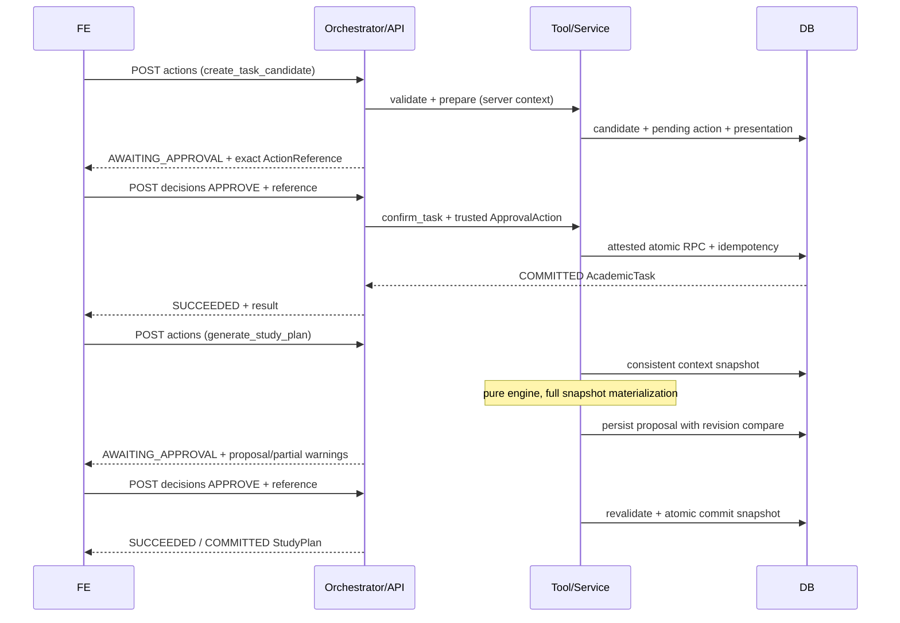

# Hợp đồng tích hợp thống nhất StudyFlow F1

| Thuộc tính | Giá trị |
|---|---|
| Contract package | **1.0.1 — APPROVED / CHÍNH THỨC**, hiệu lực 05/11/2026, giờ Việt Nam |
| Logical schema | **F1 v1.1**, `schema_version: "1.1"` |
| Phạm vi | API FE ↔ BE; Tool/Service Orchestrator ↔ BE; Data/RPC BE ↔ DB |
| Trạng thái phê duyệt | **Team đã phê duyệt**, theo xác nhận của người dùng ngày 05/11/2026; căn cứ và phạm vi tại [APPROVAL.md](APPROVAL.md) |
| Trạng thái triển khai | Đặc tả + schemas + fixtures + kiểm tra contract; chưa có API handler, migration hoặc DB chạy thật |

## 1. Nguồn chuẩn và cách sử dụng

[Schema F1 v1.1](../docs/database/schema_F1.md) tiếp tục quyết định **ngữ nghĩa nghiệp vụ**. Bộ này cụ thể hóa các chi tiết transport, chữ ký service và persistence còn thiếu. Không sửa field/state/scope của F1 v1.1. Nếu phát hiện mâu thuẫn, dừng tích hợp phần liên quan, sửa bộ contract; không âm thầm sửa schema gốc.

| File | Là nguồn chuẩn cho |
|---|---|
| [README.md](README.md) | Luồng xử lý, trust boundary, transaction, invariants và quyết định đã phê duyệt |
| [APPROVAL.md](APPROVAL.md) | Căn cứ, phạm vi và ngày hiệu lực của bản chính thức |
| [schemas/f1.schema.json](schemas/f1.schema.json) | Kiểu/enum/nullability/required của mọi DTO và 10 entity logic; JSON Schema 2020-12 |
| [openapi.yaml](openapi.yaml) | Method/path/header/query/request/response HTTP; OpenAPI 3.1.1, viết bằng cú pháp JSON hợp lệ trong YAML |
| [service-contract.json](service-contract.json) | 10 operation chính thức, schema arguments/result, approval và mapping RPC |
| [data-contract.json](data-contract.json) | Tên bảng/cột, PostgreSQL type, nullability và PK cho 10 entity |
| [examples/manifest.json](examples/manifest.json) | Các ví dụ hợp lệ/không hợp lệ và validator phải áp dụng |
| [acceptance-cases.md](acceptance-cases.md) | Các ca runtime phải được các bên chứng minh khi triển khai |
| [VALIDATION.md](VALIDATION.md) | Kết quả kiểm tra đã chạy và giới hạn của bằng chứng |

FE sinh/đối chiếu TypeScript types từ schema chung; BE tạo Pydantic validator tương đương; DB đối chiếu mapping và invariants. Không duy trì ba bộ enum riêng. `contract_version` dùng để quản lý package/RPC, không thêm vào các DTO v1.1 vốn không có field này.

Các quyết định IC-01–IC-08 ở mục 10 đã được team phê duyệt theo [ghi nhận phê duyệt](APPROVAL.md). Decision Register và ADR được đồng bộ theo phạm vi này. Khi tài liệu baseline/physical design cũ còn ghi phương án `PROPOSED/DRAFT` khác với bộ contract, áp dụng bộ contract chính thức; không suy ra toàn bộ nội dung hoặc công việc ngoài phạm vi của tài liệu cũ cũng đã được duyệt.

## 2. Quy ước chung

- JSON UTF-8, `snake_case`, từ chối field lạ ở request/command/entity chuẩn hóa. Các map mở chỉ được dùng ở `Issue.details`, provenance và dữ liệu draft theo allowlist intent; không coi chúng là quyền thực thi.
- DTO chuẩn hóa phải có đủ field đã liệt kê. Nullable khác optional. `CandidateTaskFields` cho phép thiếu/null; policy patch cho phép thiếu nhưng không nhận null. Request/query không ép kiểu lỏng (`"false"` trong JSON không thành boolean).
- UUID entity do backend cấp. `conversation_id` trong request phải trỏ hội thoại cùng owner; lần đầu dùng UUID do FE tạo có thể tạo hội thoại sau xác thực bằng cơ chế create-if-absent; UUID không phải bằng chứng quyền. Server cấp `message_id`, action/candidate/proposal/block IDs.
- API timestamp RFC 3339 có offset hoặc `Z`; response chuẩn hóa UTC `Z`. Lịch nghiệp vụ theo phút (`second=0`, không fraction); timestamp audit có thể có microsecond. DB lưu `timestamptz`; giữ IANA timezone riêng. Validator kiểm tra timezone trong IANA TZDB, không chỉ regex.
- Khoảng nửa mở `[start_at,end_at)`, end > start. Query thời gian phải có cả start và end hoặc bỏ cả hai. Bộ lọc lịch lấy block có giao khoảng truy vấn, giữ nguyên start/end, không cắt hay sửa snapshot.
- Local time `HH:mm`; `24:00` chỉ hợp lệ cho `end_time` của WEEKLY. DB dùng `time(0) without time zone`, giữ `24:00:00`, serialize lại `24:00`. Khi mở rộng thành instant chuyển sang 00:00 ngày kế tiếp; không xuất timestamp `T24:00`.
- Deadline DATE dùng cutoff 00:00 ngày kế tiếp theo `deadline_timezone`; giữ ngày người dùng nhập để hiển thị. DATETIME có `deadline_date=null`. DST mơ hồ/không tồn tại phải hỏi lại.
- Version >=1, revision >=0. `base_plan_id/base_plan_version` cùng null cho lịch đầu tiên; không tạo plan giả version 0. Dùng integer an toàn trong JSON (tối đa `2^53-1`); đây là giới hạn biểu diễn, không phải mức trần cấu hình học.
- Policy mặc định 25–90 phút/buổi, 240 phút/ngày, nghỉ 10 phút, cho buổi cuối ngắn. Custom phải được lưu/merge đúng; không áp các mặc định này như hard cap. Patch lưu hồ sơ phải khác `{}`; override một lần được là `{}`.

## 3. API contract — FE ↔ BE

### 3.1. Authentication, header và HTTP

Mọi endpoint cần `Authorization: Bearer <Supabase access JWT>`. FastAPI verify chữ ký, thuật toán allowlist, issuer, audience, expiry, subject và key rotation; `user_id` chỉ từ JWT đã kiểm chứng. Không nhận owner, `ApprovalAction`, principal, `requires_review`, engine result hay backend attestation từ FE.

Mọi POST có `Content-Type: application/json`, `Idempotency-Key` dài 16–128 ký tự `[A-Za-z0-9._:-]`. GET không cần key. Body tối đa **64 KiB UTF-8**, text tin nhắn tối đa **8.000 ký tự**. Rate limit là cấu hình deployment phải công bố; contract không tự bịa throughput đã đạt.

Response có `X-Request-ID` do server cấp, trùng `request_id` trong body. Khi replay POST trả `Idempotency-Replayed: true`; request mới trả false. Không để FE tự chọn trace ID đáng tin cậy. CORS allowlist origin deployment; cho phép Authorization/Idempotency-Key, expose X-Request-ID/Idempotency-Replayed/Retry-After. Không gửi token vào URL hoặc log.

| HTTP | Ý nghĩa / mã lỗi |
|---|---|
| 200 | Thành công đọc/ghi; hoặc cần làm rõ/chờ duyệt. `NEEDS_CLARIFICATION` không phải lỗi HTTP |
| 400 | JSON/header/query sai cấu trúc hoặc `schema_version` không hỗ trợ → `INVALID_PARAMETER` |
| 401 | Token thiếu/sai/hết hạn → `UNAUTHENTICATED` |
| 403 | Thao tác không được phép → `FORBIDDEN` |
| 404 | Không tồn tại hoặc target thuộc người khác → `ENTITY_NOT_FOUND`; không tiết lộ entity người khác |
| 409 | `APPROVAL_REQUIRED`, `ACTION_REVIEW_REQUIRED`, `AMBIGUOUS_REFERENCE`, các lỗi `STALE_*`, `IDEMPOTENCY_CONFLICT`, `TIME_CONFLICT`, `ACTIVE_BLOCK_REQUIRES_REVIEW` |
| 413 | Body quá lớn → `PAYLOAD_TOO_LARGE` |
| 422 | JSON hợp lệ nhưng field/union/invariant sai → `INVALID_PARAMETER`/`MISSING_REQUIRED_FIELD`; ngoài scope → `UNSUPPORTED_OPERATION` |
| 429 | `RATE_LIMITED`, `Retry-After` số giây |
| 500 / 503 | `INTERNAL_ERROR` / `SERVICE_UNAVAILABLE`; 503 có `Retry-After` |

Schema v1.1 đã có mã lỗi domain; package này thêm đúng bốn mã **transport**: `UNAUTHENTICATED`, `PAYLOAD_TOO_LARGE`, `RATE_LIMITED`, `SERVICE_UNAVAILABLE`. Không ghi chúng thành domain state hoặc operation DB. `retryable=true` chỉ cho sự cố tạm thời; retry ghi phải giữ nguyên key/body. Lỗi stale/review-required cần tải/xem lại, không tự gửi lại lệnh ghi.

### 3.2. Danh mục endpoint

| Method/path | Input | Response 200 | Tác động |
|---|---|---|---|
| `POST /v1/messages` | `UserMessage` | `OrchestratorReply` | Hội thoại, trích xuất, hỏi lại; ghi nghiệp vụ chỉ sau quyết định rõ ràng đúng ngữ cảnh |
| `POST /v1/actions` | `ActionRequest` | `OrchestratorReply` | Đầu vào có cấu trúc từ form: chuẩn bị candidate/TimeWindow/policy/proposal để xem và xác nhận |
| `POST /v1/actions/{action_id}/review` | `ReviewActionRequest` | `OrchestratorReply` | Khôi phục/xem lại action; không tự duyệt |
| `POST /v1/decisions` | `UserDecision` | `OrchestratorReply` | Quyết định APPROVE/REJECT gắn đúng action và target/version |
| `GET /v1/tasks` | query, status_filter, page_size, cursor | `search_tasksResult` | Chỉ đọc task cùng user |
| `GET /v1/time-windows` | kind?, include_archived=false, page_size, cursor | `TimeWindowListResult` | Chỉ đọc; phục vụ form/calendar |
| `GET /v1/preferences` | Không có body | `PreferencesResult` | Đọc policy đầy đủ và schedule_revision |
| `GET /v1/plans` | view=CURRENT, version?, proposal_id?, start_at?, end_at? | `get_study_planResult` | Đọc current/history/proposal |

`ActionRequest` chỉ cho phép `create_task_candidate`, `set_availability`, `set_busy_interval`, `set_scheduling_preferences`, `generate_study_plan`. Đây là yêu cầu **chuẩn bị**, không phải API gọi raw tool tùy ý. TimeWindow/policy chỉ ghi PendingAction ở bước này; chưa gọi tool ghi chính thức. Candidate được ghi nháp; proposal được lưu riêng. `confirm_task`/`approve_study_plan`/`reject_study_plan` chỉ được routing từ quyết định đã kiểm chứng. Không công bố endpoint create/patch/delete AcademicTask hoặc tạo/dời riêng StudyBlock.

Form nhập task tạo synthetic message `source=UI` ở kho hội thoại server, rồi mới tạo candidate; không bịa `source_message_id` từ client. Tin nhắn chat được lưu trước khi trích xuất và có thể tạo nhiều action theo thứ tự phụ thuộc; chỉ một action AWAITING tại một thời điểm.

Query GET bỏ field nghĩa là giá trị mặc định/null công bố trong schema arguments. `status_filter` lặp query key (vd `?status_filter=TODO&status_filter=IN_PROGRESS`). Không truyền status_filter thì backend dùng `[]`, nghĩa là mọi status của user. page_size mặc định 50, tối đa 100. Cursor opaque, ràng buộc owner/filter/sort, không cho FE tự decode rồi chỉnh. Sort tasks `(deadline_at,task_id)` tăng dần; TimeWindows `(created_at,window_id)` tăng dần. Phân trang keyset không hứa snapshot xuyên nhiều request; muốn refresh phải bắt đầu lại. Không trả total ước đoán.

`GET /v1/plans`: CURRENT không nhận version/proposal_id; HISTORY cần version; PROPOSAL cần proposal_id. CURRENT chưa có lịch trả `PlanView(plan=null,study_blocks=[])`. HISTORY/PROPOSAL không thấy trả 404. Proposal luôn trả payload đầy đủ để không giấu phần chưa xếp; nếu truyền filter thời gian ở view PROPOSAL thì trả 422 (adapter giữ service arguments start/end=null). PlanView có thể lọc block, nhưng plan metadata vẫn nguyên; không dùng view đã lọc làm snapshot đầu vào engine.

### 3.3. Response và hành vi FE

POST luôn dùng `OrchestratorReply`, kể cả lỗi. GET dùng ToolResult đúng loại; lỗi GET dùng `ErrorResult`. Không trả cấu trúc lỗi mặc định của framework. `Error.details` không chứa SQL, stack trace, secret hoặc thông tin user khác.

| state | FE xử lý |
|---|---|
| NEEDS_CLARIFICATION | Hiển thị questions; chưa có quyền ghi nghiệp vụ |
| AWAITING_APPROVAL | Hiển thị đúng nội dung typed data, nút xác nhận/từ chối gửi nguyên ActionReference |
| SUCCEEDED | Hiển thị theo ToolResult; chỉ COMMITTED mới báo đã lưu task/lịch chính thức |
| ERROR | Hiển thị code/message; xử lý retry theo mã và retryable |

`ActionPresentation` là **DTO trình bày tích hợp**, không phải entity thứ 11. Nó chứa PendingAction, candidate/proposal nếu có, normalized_command và effective_policy. Khi sửa policy phải trả policy đầy đủ sau merge để người dùng thấy. Với TimeWindow hiển thị ADD/UPDATE/ARCHIVE, nội dung mới và target/version; với candidate hiển thị deadline precision/timezone và effort/priority; với proposal hiển thị full snapshot, diff, policy_snapshot, warnings và unallocated của PARTIAL.

Orchestrator được phép bọc kết quả chuẩn bị trong ToolResult DRAFTED có `data=ActionPresentation`; raw tool `create_task_candidate` vẫn trả DRAFTED/TaskCandidate. Đây là adapter trình bày nội bộ, không thêm operation LLM. `ActionPresentation.normalized_command` chỉ là preview dữ liệu đã kiểm tra, FE không được sửa rồi gửi làm command thực thi.

FE lưu ActionReference theo response mới nhất. Không tự lấy proposal đang gần nhất, parse message để tìm ID, gửi `approved=true`, hay tự biến text LLM thành approval. Thay đổi field làm tăng action/candidate version và phải trình bày lại. `review` kiểm tra expected_action_version, dựng lại nội dung, đặt requires_review=false và tăng action.version nếu đã cần review; response trả reference mới. Retry cùng key trả reference cũ đã phát hành, không tăng version lần nữa. GET không được tự ghi trạng thái đã review.

## 4. Service/Tool contract — Orchestrator ↔ BE

Chữ ký framework độc lập:

```text
execute(command: ValidatedCommand, context: ExecutionContext)
    -> Result schema theo operation

prepare_action(request, trusted_context) -> OrchestratorReply
submit_decision(decision, trusted_context) -> OrchestratorReply
review_action(action_id, expected_version, trusted_context) -> OrchestratorReply
get_scheduling_context(user_id, generation_scope) -> snapshot + schedule_revision
engine.schedule(SchedulingContext) -> SchedulingResult
```

`ExecutionContext` là server-only, gồm TrustedContext, conversation_id, idempotency_key, ApprovalAction/null và ActionReference/null. Không serialize toàn bộ context vào LLM prompt hoặc trả ra FE. Read tool dùng key=null/approval=null; GET độc lập có conversation_id=null, message_id là ID audit server cấp cho request, không được dùng như source message của approval. Tool ghi cần key và conversation_id hợp lệ; năm tool ở bảng dưới cần approval hợp lệ. Reject proposal cần decision REJECT kiểm chứng cùng action/target; không dùng intent LLM làm quyền.

| Operation | Arguments quan trọng | Kết quả thành công | Điều kiện |
|---|---|---|---|
| create_task_candidate | slots | DRAFTED/TaskCandidate | Context có message/conversation cùng owner; chỉ ghi nháp |
| confirm_task | candidate_id, expected_candidate_version | COMMITTED/AcademicTask | Approval TASK_CANDIDATE đúng version, candidate READY |
| search_tasks | query, status_filter, page_size, cursor | READ/SearchTasksData | Không ghi |
| set_availability | change_type, window_id, expected_window_version, window | COMMITTED/TimeWindow | Approval PENDING_ACTION; kind=AVAILABILITY |
| set_busy_interval | Như trên | COMMITTED/TimeWindow | Approval PENDING_ACTION; kind=BUSY |
| set_scheduling_preferences | policy_patch, expected_schedule_revision | COMMITTED/PreferencesData | Approval PENDING_ACTION; merge/validate full policy |
| generate_study_plan | generation_scope, policy_overrides | PROPOSED/PlanProposal hoặc READ/SchedulingReadData | Không commit lịch; override không ghi User |
| get_study_plan | view, version, proposal_id, start_at, end_at | READ/PlanView hoặc ProposalView | Chỉ đọc |
| approve_study_plan | proposal_id, expected_proposal_version, expected_plan_version | COMMITTED/StudyPlan | Approval PLAN_PROPOSAL; revalidation và transaction |
| reject_study_plan | proposal_id, expected_proposal_version | REJECTED/PlanProposal | Quyết định đúng đích; idempotent; không sửa current plan |

Các arguments nullable vẫn phải có key ở service. HTTP adapter bổ sung null/default trước khi gọi. `ADD`: window_id/version=null, window khác null. `UPDATE`: gửi toàn bộ window và ID/version. `ARCHIVE`: window=null, ID/version khác null. Không hiểu request thêm một khoảng thành thay cả tuần.

Dispatcher allowlist đúng 10 tên. `get_scheduling_context`, normalizer, classifier và validator là service nội bộ, không tự biến thành tool public. Intent hợp lệ và allowlist slots được xác định ở schema F1; mọi intent lạ ngoài scope trả UNSUPPORTED_OPERATION. LLM output là ExtractionResult chưa tin cậy; server resolve owner/reference, phân giải ngày tương đối theo tin nhắn gốc, chạy ValidationReport rồi mới tạo command.

### 4.1. Pipeline xác nhận

1. Chuẩn bị và validate dữ liệu; thiếu thì giữ nháp và hỏi tiếp.
2. Lưu PendingAction, target/version và presentation server-side; trả ActionReference cùng nội dung đủ để duyệt.
3. Khi quyết định đến: xác thực owner/conversation; tra request receipt và idempotency trước; tải action/target/presentation hiện tại.
4. Nếu requires_review, reference cũ, nhiều đích mơ hồ hoặc nội dung đã đổi: không ghi; trả lỗi review/version hoặc hỏi lại.
5. Server tạo ApprovalAction từ UI decision hoặc **tin nhắn người dùng đã lưu**, không từ boolean/provenance do LLM khai. CHAT cần source_message_id cùng owner/conversation và đúng ngữ cảnh quyết định. Reply chỉ "đồng ý" không có context rõ thì hỏi lại.
6. Gọi tool phù hợp, commit nghiệp vụ/approval/action completion trong cùng RPC; thành công mới phản hồi COMMITTED. Từ chối candidate/timewindow/policy chuyển action CANCELLED, candidate DRAFT→CANCELLED nếu có; không ghi entity chính thức. Proposal reject đi qua reject_study_plan.

Không tách transaction ghi ApprovalAction trước rồi mới commit target. Đối với lỗi stale nghiệp vụ, RPC được phép commit trạng thái proposal=STALE cùng receipt lỗi có cấu trúc rồi trả error; không raise SQL exception làm rollback mất STALE. Với lỗi kỹ thuật giữa ghi snapshot, rollback toàn bộ. Request lỗi stale lặp cùng key phải nhận lại cùng kết quả; để duyệt proposal mới phải dùng request/key mới.

### 4.2. Scheduler

Service tải inputs cùng revision từ **một snapshot nhất quán**, mở rộng recurrence, giữ protected blocks, merge policy, rồi gọi engine thuần ngoài transaction ghi. Engine không đọc DB/LLM, không cấp ID và không commit.

Service ghép retained + generated thành snapshot đầy đủ, cấp/giữ block_id, tính diff và validate lại trước persistence. IDs của block giữ nguyên không đổi. Chỉ thay block tương lai chưa khóa, thuộc selected tasks, nằm trọn horizon; giữ block lịch sử/khóa/giao ranh/ngoài scope. Block đang học chặn tái phân bổ task liên quan để làm rõ tiến độ.

`remaining = retained_future + newly_scheduled + unallocated`. Không trừ block lịch sử, không giảm remaining vì xếp lịch hoặc thời gian trôi qua. FULL/PARTIAL/NONE/NO_CHANGE là coverage, không phải trạng thái task hay HTTP lỗi.

Chỉ lưu proposal khi coverage FULL/PARTIAL, không có hard conflict và diff thực sự thay đổi. NONE không committable. NO_CHANGE hoặc diff rỗng trả READ/SchedulingReadData, kể cả diff rỗng mà coverage PARTIAL/NONE; không tạo snapshot trùng. PARTIAL cần cho thấy phần chưa xếp trước approval; không tuyên bố thuật toán tham lam đã chứng minh bài toán vô nghiệm.

## 5. Data schema — BE ↔ DB

### 5.1. Tên, kiểu và mapping

Chọn Supabase PostgreSQL, FastAPI, Data API/RPC và Supabase CLI làm **baseline chính thức cho bộ contract này**. `app_private` không exposed; `app_api` chỉ expose routines allowlist. Data dictionary máy đọc ở data-contract.json bao phủ đủ field của 10 entity; không phải SQL migration.

| Entity | Table | Khóa và bất biến chính |
|---|---|---|
| User | app_private.user_profiles | PK user_id → auth.users.id; current_plan_id same-owner, policy đầy đủ |
| TaskCandidate | app_private.task_candidates | PK candidate_id; CONFIRMED iff confirmed_task_id khác null, khớp task.candidate_id |
| AcademicTask | app_private.academic_tasks | PK task_id; UNIQUE(candidate_id), same-owner candidate; remaining/status/effort nhất quán |
| TimeWindow | app_private.time_windows | PK window_id; NONE/WEEKLY union; archived_at thay hard-delete |
| StudyPlan | app_private.study_plans | PK plan_id; UNIQUE(user_id,version), UNIQUE(source_proposal_id); snapshot bất biến |
| StudyBlock | app_private.study_blocks | PK(plan_id,block_id), same-owner plan/task; **cấm UNIQUE(user_id,block_id)** |
| PlanProposal | app_private.plan_proposals | PK proposal_id; version=1; payload/scope/policy/base snapshot bất biến; approved iff committed_plan_id khác null |
| PendingAction | app_private.pending_actions | PK action_id; partial UNIQUE(user_id,conversation_id) trong ba state AWAITING |
| ApprovalAction | app_private.approval_actions | PK approval_action_id; target_type/id/version đúng typed target; CHAT cần source_message_id |
| IdempotencyRecord | app_private.idempotency_records | PK(user_id,operation,idempotency_key); chỉ entity này có expires_at vận hành |

UUID → uuid; instant → timestamptz; date → date; local time → time(0) without time zone; enum/string/timezone → text; integer → bigint với CHECK miền JSON an toàn; boolean → boolean; nested object/array → jsonb có validator đúng schema. Cột required không-null dùng NOT NULL. DB lưu đủ metadata created_at/updated_at đúng entity; StudyBlock chỉ có created_at. Không tự thêm duration/status/source_block_id vào block.

`data-contract.json` quyết định tên physical table/cột của bộ này: User dùng `user_profiles` (thay tên gợi ý `user_settings` ở baseline cũ). Đây là lựa chọn tích hợp đã phê duyệt tại IC-04; không đổi logical User. Không tạo SQL ENUM chưa khai báo; text CHECK enum theo schema chung. JSONB không thay FK, ownership hay constraint scalar.

### 5.2. Constraints ngoài khả năng JSON Schema

1. Mọi tham chiếu cùng owner: task→candidate; block→task/plan; profile→current plan; proposal→base/committed plan; plan→previous/proposal; action→candidate/proposal/dependency; approval→typed target. Dùng composite FK `(user_id,id)` với UNIQUE hỗ trợ tương ứng. FK target version được kiểm tra trong RPC/trigger cùng transaction; không FK vào version mutable khiến audit cũ mất hiệu lực.
2. ApprovalAction có ba cột physical nullable `target_candidate_id`, `target_pending_action_id`, `target_proposal_id` hỗ trợ integrity: đúng một cột khác null, khớp target_type/target_id, FK cùng owner. Các cột này không serialize ra logical DTO. data-contract.json mô tả riêng chúng.
3. Candidate CONFIRMED có đúng một task; task↔candidate backlink đồng nhất, kiểm tra deferred trong transaction promotion. Plan↔proposal backlink cũng phải đồng nhất. FK vòng profile/plan/proposal được tạo sau bảng hoặc DEFERRABLE phù hợp; không bỏ constraint vì vòng phụ thuộc.
4. StudyPlan version tăng đúng 1 theo user, previous_plan_id là current plan trước commit. Chặn UPDATE/DELETE metadata và block snapshot sau commit. Proposal chỉ được đổi state/committed_plan_id/updated_at theo transition; không sửa payload đã trình duyệt.
5. TimeWindow union và end>start; valid_until>valid_from; WEEKLY end<=24:00. Trường datetime nghiệp vụ theo phút. AcademicTask remaining<=estimated, COMPLETED↔remaining=0 cho task không cancelled; TODO/IN_PROGRESS remaining>0; available_from<=deadline. Validate deadline DATE cutoff theo timezone.
6. StudyBlock non-overlap trong **cùng plan_id** bằng GiST exclusion `[start,end)` (btree_gist cho UUID equality). Các snapshot lịch sử được overlap nhau. Kiểm tra availability/busy/deadline/workload/break/policy là bước service/RPC riêng, không thay bằng exclusion constraint.
7. Không DELETE history/cascade xóa task/plan đã tham chiếu; FK ON DELETE/UPDATE RESTRICT. Archive/cancel theo state được hỗ trợ. Xóa tài khoản là quy trình ngoài scope cần thiết kế riêng.
8. Index tối thiểu: tasks(user_id,status,deadline_at,task_id); windows(user_id,kind); proposals(user_id,status,generated_at); blocks(plan_id,start_at), (task_id,plan_id); plan(user_id,version); partial awaiting index; approval target và unique idempotency. Không thêm GIN JSONB nếu chưa có truy vấn cần.

### 5.3. Persistence hỗ trợ transport

Để server chứng minh nguồn tin nhắn, nội dung đã trình bày và tiến trình hàng đợi đa bước, cần kho hạ tầng bền vững cho **conversation ownership, source messages, API request receipts, action presentations và workflow continuations**. Đây là 5 record hạ tầng, không mở rộng business scope thành Course/StudySession hay entity nghiệp vụ thứ 11.

- Conversation: `(user_id,conversation_id)` unique; không cho attach conversation người khác.
- Message: server message_id, cùng owner/conversation, source UI/CHAT, text, received_at; retry API dùng lại message_id đã lưu, không tạo một tin mới mỗi lần retry.
- API receipt: unique(user_id,HTTP operation,Idempotency-Key), fingerprint body chuẩn hóa, status IN_PROGRESS/COMPLETED và response gốc. Cần cho POST messages/actions/review/decisions vì chúng không phải cả 10 domain operation trong IdempotencyRecord. Store không được chỉ nằm trong RAM.
- Presentation: unique(user_id,action_id,action_version), exact target/version, normalized content digest, full effective policy/partial warnings khi có, source_message_id và thời điểm server phát hành. Liên kết owner/target phải được DB kiểm tra. Nó chứng minh nội dung server phát hành; không tự chứng minh người dùng đã đọc.
- Workflow continuation (`app_private.workflow_continuations`): PK `(user_id,source_message_id)` 15 cột, giữ trạng thái tuần tự của `PlannedWorkflow` cho một tin nhắn nguồn. Same-owner FK tới `conversation_records(user_id,conversation_id)`, `source_messages(user_id,conversation_id,message_id)` và `api_request_receipts(user_id,http_operation,idempotency_key)` với `origin_http_operation='POST /v1/messages'`. Các cột `conversation_id`, `origin_http_operation`, `origin_api_idempotency_key`, `origin_request_fingerprint`, `workflow_plan`, `created_at` bất biến sau khởi tạo. Giữ ít nhất 7 ngày cho hàng hoàn tất/hủy; không xóa theo TTL đối với continuation còn `AWAITING_DECISION` hoặc tham chiếu action đang chờ duyệt.

Các record hạ tầng này được đặc tả tại `data-contract.json.infrastructure_records`; implementer phải cung cấp persistence adapter tương đương trước khi nhận delivery là hoàn tất. Không giả vờ source_message_id chỉ là UUID tùy ý. Không có product TTL cho candidate/action/proposal/presentation/awaiting continuation; không dùng expiry token để xóa nháp.

## 6. RPC, quyền và nguồn request

### 6.1. Quyết định bảo vệ boundary

Forward cùng JWT của FE **không chứng minh request xuất phát từ FastAPI**. Bộ này chốt hướng **user JWT + attestation backend cho mọi RPC ghi**, thay vì tin owner field hay LLM approval. IC-05 đã được phê duyệt, cụ thể hóa Option A trong ADR-002 và thay thế phương án để ngỏ về CHAT attestation trong tài liệu đầu vào của PR #15.

- FastAPI forward user JWT để DB có auth.uid(); không dùng service_role cho request người dùng.
- `authenticated`: USAGE app_api + EXECUTE đúng wrappers; không có table DML/SELECT/USAGE app_private, không execute helper signing/verifier trực tiếp. `anon`/PUBLIC không có EXECUTE wrappers.
- Wrapper dùng **SECURITY DEFINER có giới hạn**: owner `sf_rpc_owner` là NOLOGIN, NOSUPERUSER, NOBYPASSRLS, không cấp role cho authenticated, chỉ quyền bảng cần thiết; `search_path=''`, tên object fully-qualified. Explicit auth.uid()/same-owner checks bắt buộc. Bảng ENABLE + FORCE RLS; policy cho sf_rpc_owner dựa trên auth.uid(), không tin p_user_id.
- Routines đọc được gọi bằng user JWT và enforce ownership; không nhận arbitrary SQL/table name. Mọi routine ghi, gồm helper lưu message/action/receipt/proposal, cần attestation hợp lệ; revoke mọi helper/bypass writer khác.
- Secret attestation chỉ ở backend secret store và private verifier key store, không nằm trong repo/env example/FE/log. Dùng ít nhất 32 byte ngẫu nhiên mật mã; DB key store/rotation/grants được mô tả tại data-contract.json.security_support. Key store toàn cục có FORCE RLS và policy SELECT riêng chỉ cho sf_rpc_owner, không áp policy user_id của bảng nghiệp vụ; chỉ migration/key-rotation owner được ghi. Deployment thiếu key hoặc quyền đúng phải fail closed.

Chốt wrapper SECURITY DEFINER có kiểm soát theo IC-05, thay cho phương án ưu tiên INVOKER trước đây. Không cấp quyền bảng cho authenticated để bù thiếu quyền wrapper; triển khai phải tuân thủ role, grants, FORCE RLS và owner checks đã nêu. Đọc [Supabase API security](https://supabase.com/docs/guides/api/securing-your-api) và [PostgreSQL function security](https://www.postgresql.org/docs/current/sql-createfunction.html).

### 6.2. RpcEnvelope và attestation

Mỗi RPC public nhận **một đối số `p_request jsonb`** theo `RpcRequest` (union theo routine từ `RpcEnvelope`), trả JSONB ToolResult đúng loại. HTTP qua PostgREST `/rest/v1/rpc/<function>` với `Content-Profile: app_api` và Authorization user JWT; không dùng HTTP route public này làm API FE chính.

`RpcEnvelope.arguments` phải validate theo operation registry; không coi object mở trong envelope là cho phép field tùy ý. Read request dùng attestation=null; mutation yêu cầu object. DB luôn so sánh execution_context principal với auth.uid(); principal trong envelope không tự cấp quyền.

Attestation `payload` là base64url không padding của UTF-8 JSON với đủ: `v=1`, `key_id`, `user_id`, `rpc`, `request_id`, `request_digest`, `issued_at`, `expires_at`. `request_digest=SHA256` của canonical JSON toàn envelope **bỏ attestation**, bao gồm arguments, trusted context, decision/approval và nội dung proposal nếu có. Canonical JSON: sort object keys theo Unicode code point, giữ thứ tự array, không khoảng trắng, UTF-8 không escape non-ASCII, chỉ integer an toàn, cấm float/NaN/duplicate JSON keys; timestamp đã chuẩn hóa UTC. Các object cùng nghĩa phải được normalize trước digest, không hash raw HTTP bytes.

`signature=HMAC-SHA256(key, ASCII(payload))` dạng hex lowercase. DB kiểm tra key_id khớp payload, constant-time signature, strict payload schema, user_id=auth.uid(), rpc khớp routine đang chạy, digest khớp exact normalized request. Chốt transport validity **60 giây**, clock skew tối đa 5 giây; issued_at không vượt now+5s, expires_at=issued_at+60s, reject quá hạn. Request_id/operation/key được bind vào digest; replay hợp lệ chỉ trả cùng kết quả qua idempotency, không ghi thêm. Attestation của request mới không dùng cho request khác. Rotate key theo key_id, giữ key cũ đủ để xác minh request còn trong validity window.

Attestation không gửi ra FE, không được nhận từ `/v1/messages/actions/decisions`. Backend ký lại attestation mới khi retry sau token expiry nhưng giữ normalized business request và key; fingerprint business loại phần attestation/time/request_id. TTL 60 giây là bảo vệ vận chuyển, **không phải TTL của proposal hay PendingAction**. Chưa có verifier chạy thật; test bảo mật ở acceptance-cases.md là bắt buộc trước triển khai.

### 6.3. Inventory RPC

| Routine app_api | Input/output | Lock/revision |
|---|---|---|
| create_task_candidate | create_task_candidate arguments → result | Owner lock, không tăng revision |
| confirm_task | confirm_task arguments + trusted approval → result | Owner lock; tăng revision khi tạo task |
| search_tasks | search_tasks arguments → result | Read-only |
| set_availability / set_busy_interval | arguments + trusted approval → result | Owner lock; tăng revision |
| set_scheduling_preferences | arguments + trusted approval → result | Owner lock; so revision; tăng revision |
| get_study_plan | get_study_plan arguments → result | Read-only |
| approve_study_plan | arguments + trusted approval → result | Owner lock; revalidate; tăng revision |
| reject_study_plan | arguments + trusted REJECT → result | Owner lock; không đổi schedule_revision |
| get_scheduling_context | scope → complete inputs + base plan/revision | Một SQL snapshot nhất quán; không ghép nhiều request REST |
| persist_plan_proposal | original command_arguments + complete proposal → generate_study_planResult | Owner lock; compare revision; không tăng revision |
| lookup_operation_result | operation, key, fingerprint → result cũ hoặc null | Chỉ đọc của auth.uid(); khác fingerprint trả conflict |
| prepare_pending_action / review_pending_action | command/presentation + expected action version → ActionPresentation | Owner lock; version guard; một awaiting/conversation |
| record_source_message / claim_api_receipt / renew_api_receipt / release_api_receipt / complete_api_receipt | Schema record hạ tầng ở data-contract.json | Identity/receipt/lease guards; không tăng schedule_revision |
| ensure_user_context | `{timezone?}` → `PreferencesData` | Signed bootstrap idempotent cho user mới (gồm first `GET /v1/preferences`, `idempotency_key=null`, `conversation_id=null`); không ghi đè hoặc tăng `schedule_revision` khi đã có profile |
| list_time_windows | `kind?`, `include_archived`, `page_size`, `cursor` → `TimeWindowPage` | Read-only phục vụ `GET /v1/time-windows` |
| get_workflow_context | `conversation_id`, `action_id?`, `include_Draft_candidates`, `include_pending_proposals` → `WorkflowContextData` | Một SQL read snapshot nhất quán (profile, awaiting/requested action + presentation + target, draft candidates, pending proposals) |
| get_workflow_continuation | `conversation_id`, `source_message_id?` → `WorkflowContinuationData` | Read-only tải continuation theo message nguồn hoặc continuation đang `AWAITING_DECISION` |
| initialize_workflow_continuation | `conversation_id`, `source_message_id`, `origin_*`, `workflow_plan` → `WorkflowContinuationRecord` | Signed helper; owner lock; gắn chặt `POST /v1/messages` receipt đang `IN_PROGRESS`; idempotent trên cùng `(user_id,source_message_id)` |
| checkpoint_workflow_continuation | `source_message_id`, `expected_continuation_version`, `active_api_receipt`, `transition_kind` (`WAIT_FOR_DECISION`/`ADVANCE`), `recorded_outcome?`, `awaiting_reference?`, `next_status` → `WorkflowContinuationRecord` | Signed helper; owner lock; verify active receipt lease (`IN_PROGRESS`, `lease_expires_at > now()`); tăng `version` đúng 1 |

`generate_study_plan` là application operation, **không phải DB chạy engine**. Chữ ký 18 RPC nội bộ khác 10 command public được lưu trong `service-contract.json.internal_interfaces`. Không gọi LLM/network trong transaction. Candidate clarification dùng helper nội bộ versioned, không public PATCH task.

## 7. Transaction và idempotency

Mọi writer cùng owner dùng `SELECT ... FOR UPDATE` trên user_profiles trước authoritative reads và ghi, trong một RPC transaction READ COMMITTED. Profile khởi tạo bằng insert-on-conflict từ auth.uid() qua routine có attestation (`app_api.ensure_user_context`, cho phép `idempotency_key=null` và `conversation_id=null` khi bootstrap ở first `GET /v1/preferences`); insert trước khi lock nếu chưa có. Chọn row lock cụ thể để tránh mỗi team tự chọn advisory-key hash khác nhau. Snapshot input đọc riêng bằng một SQL statement (`get_scheduling_context`, `get_workflow_context`); nếu implementer dùng nhiều statement thì phải cung cấp REPEATABLE READ tương đương, không mặc định READ COMMITTED là snapshot nhất quán.

Thứ tự mutation: verify JWT/attestation → fast idempotency lookup → owner row lock → **lookup lại idempotency sau lock** → reload state/version → validate → write + complete domain record. Không khóa action rồi mới khóa owner ở đường khác gây deadlock. Transaction failure rollback toàn bộ. Không tự COMMIT giữa RPC.

Fingerprint domain = SHA256 canonical `{schema_version, user_id, operation, arguments, decision_binding}`; decision_binding chứa decision, action_id/action_version, target_type/id/version hoặc null. Không có request_id, audit clock, chữ ký, message_id phát sinh mới; message ID của request retry phải được API receipt giữ lại. Cùng owner/operation/key khác fingerprint → IDEMPOTENCY_CONFLICT. Cùng fingerprint/key completed → kết quả gốc trước khi kiểm tra target terminal/stale. Key khác sau candidate đã confirm/proposal đã approve không tạo task/plan thứ hai; unique FK bảo vệ, trả conflict trạng thái với STALE_ENTITY_VERSION hoặc STALE_PROPOSAL và result reference trong details nếu được phép.

Riêng generate_study_plan: fingerprint dùng **arguments gốc** (generation_scope/policy_overrides), không hash proposal_id/generated_at/block IDs mới sinh. Service lookup_operation_result trước khi chạy engine; persist_plan_proposal nhận command_arguments gốc cùng proposal, dùng namespace operation=generate_study_plan và lookup lại sau lock. Attestation vẫn bind toàn bộ generated payload. DB đối chiếu scope và effective policy từ command với proposal/revision, không tin một policy_snapshot tự khai. Nếu worker retry sau persist nhưng trước trả response, dùng lại proposal đã lưu; không tạo proposal thứ hai do ID/clock mới làm đổi fingerprint.

Transport receipt, workflow continuation và domain idempotency giữ ít nhất **7 ngày**; transport công bố bảo đảm retry trong 7 ngày. Sau cửa sổ này FE phải đọc trạng thái để reconcile, không tự retry mù. Giữ vĩnh viễn uniqueness nghiệp vụ; cleanup IdempotencyRecord không xóa business history. API receipts không chiếm namespace 10 domain operation. Với workflow nhiều bước thuộc một `source_message_id`, mỗi step có `step_key` ổn định (`s01`, `s02`, ...) và khóa idempotency cho domain operation ở step thứ `i` được dẫn xuất tất định bằng `SHA256(origin_api_idempotency_key + ":" + step_key + ":" + operation)` dạng hex lowercase 64 ký tự (không phụ thuộc vào `Idempotency-Key` của `POST /v1/decisions` về sau).

API receipt claim/execute/complete có recovery: claim IN_PROGRESS có lease vận hành **120 giây**, renew mỗi tối đa 30 giây trong công việc dài; không lease product action. Mỗi lần claim/reclaim tăng lease_version; renew/release/complete phải so expected_lease_version và fingerprint dưới lock, worker cũ không được complete sau khi lease đã bị reclaim. Claim đầu tiên lưu message_id/action_id ổn định trước công việc ngoại vi; worker chết được recovery bằng các ID và domain keys đó. Chỉ complete sau khi mọi bước đã có kết quả bền vững; replay trả đúng response trước đó, thay request_id ở envelope theo request hiện tại.

Không giữ DB transaction trong lúc gọi LLM. Cùng key đang chạy trả 503 SERVICE_UNAVAILABLE/retryable=true/Retry-After; không chạy song song lần hai và không complete receipt bằng lỗi “đang chạy”. Lỗi tạm thời 429/503 không bị cache thành kết quả terminal: release lease đúng version để lần retry có thể chạy lại. Kết quả 200 và lỗi domain terminal như stale/review-required được complete; request mới sau review dùng key mới.

Approval transaction: compare current_plan_id/base_plan_version/base_schedule_revision; capture now sau lock; kiểm tra ownership, pending action, presentation/partial visibility, policy_snapshot, task/workload/availability/busy/retained blocks và block mới không quá khứ. Trong cùng transaction tạo StudyPlan + mọi StudyBlock, cập nhật pointer/revision, proposal APPROVED/committed_plan_id, ApprovalAction, action COMPLETED, domain idempotency. Không có trạng thái APPROVED mà thiếu snapshot.

Revision tăng cho confirmation task, TimeWindow/policy/timezone thay đổi và commit current plan. Không tăng chỉ vì đọc, ghi draft, proposal mới, review hoặc reject. Bất kỳ writer tương lai ảnh hưởng scheduling cũng phải theo giao thức này. Request đụng revision cũ bị stale dù plan.version chưa đổi.

## 8. Luồng tham chiếu



Nếu query lọc lịch trả chỉ một tuần, service vẫn dùng full base snapshot khi tạo proposal. Nếu proposal còn hợp lệ sau nhiều ngày thì vẫn có thể duyệt; nếu giờ học mới đã qua hoặc revision đổi thì STALE. Chưa có task/availability → hỏi lại, không trả “lịch trống thành công”.

## 9. Kiểm tra và điều kiện tích hợp

```powershell
python -m pip install -r contracts/requirements-check.txt
python contracts/check_contract.py
```

Checker xác minh schema, OpenAPI, references, registry, entity mapping, fixtures hợp lệ/không hợp lệ và các invariant thuần quan trọng. Fixture `rpc-write-shape-only` chứa chữ ký giả chỉ để kiểm tra cấu trúc, **không phải attestation hợp lệ để gọi DB**. Checker không chứng minh JWT verification, grants/RLS, attestation verifier, transaction, concurrency, DB storage hoặc UI rendering đã chạy thật. Các ca đó có owner và expected result tại acceptance-cases.md.

Phần phê duyệt contract của M0 đã hoàn tất theo [APPROVAL.md](APPROVAL.md); schema và fixtures đã được kiểm tra theo VALIDATION.md. Việc mock/real adapter cùng tuân thủ contract vẫn cần bằng chứng triển khai, không tự coi toàn bộ M0 hoặc mốc tích hợp thật đã hoàn tất chỉ từ phê duyệt tài liệu. Các ca runtime tiếp tục theo dõi ở acceptance-cases.md.

## 10. Quyết định đã phê duyệt và trách nhiệm duy trì

Tất cả IC-01–IC-08 dưới đây có trạng thái **APPROVED**, hiệu lực 05/11/2026. Cột trách nhiệm chỉ vai trò duy trì và review thay đổi về sau, không tự gán tên người ký.

| ID | Lựa chọn chính thức | Vai trò duy trì / review thay đổi |
|---|---|---|
| IC-01 | 8 endpoint; POST chuẩn bị khác POST quyết định; GET timewindows/preferences là read adapter | FE + TV2 + TV3 |
| IC-02 | Typed ActionPresentation để hiển thị full policy/target; bốn mã lỗi transport bổ sung | FE + TV2 + TV3 |
| IC-03 | DTO chung, unknown-field rejection, schema_version=1.1; package=1.0.1 | TV2 điều phối; tất cả consumer |
| IC-04 | user_profiles, bigint, typed approval FK, PostgreSQL time giữ 24:00 | TV1 + TV2 + TV4 |
| IC-05 | user JWT + backend HMAC attestation; wrapper SECURITY DEFINER tối thiểu quyền, FORCE RLS | TV1 + TV2 + security owner |
| IC-06 | Owner row lock, double idempotency lookup, consistent input snapshot | TV1 + TV2 + TV4 |
| IC-07 | Request receipt/message/presentation/workflow continuation persistence; retry 7 ngày; transport token 60 giây | TV1 + TV2 + TV3 |
| IC-08 | Datetime theo phút, query defaults/cursors/filter; 64KiB/8000 ký tự/100 items | FE + TV2 |

Vai trò TV1–TV4 theo bản phân công hiện có; không tự gán tên người. Thay đổi từng IC sau phê duyệt cần review cụ thể từ các consumer liên quan. Nếu thay trust model, phải cập nhật đồng thời API/service/data và acceptance cases, không chỉ sửa một ADR. Decision Register/ADR đã ghi nhận bản chính thức; physical design khi triển khai phải đối chiếu lại với bộ này. Merge tài liệu không thay thế căn cứ phê duyệt đã được ghi nhận.

Breaking change về field/enum/nullability/side effect tăng major contract; additive thay đổi vẫn phải review consumer và cập nhật fixtures/changelog. Nếu đổi ngữ nghĩa F1 phải tăng schema gốc theo quy trình của nó. Không tái sử dụng version 1.1 cho behavior khác mà không ghi nhận.

## 11. Căn cứ

- Repo main `70f463b`; schema F1 v1.1; Database Baseline v1.1; ADR-001..005 và Implementation Decision Register.
- Physical design PR #15 head `d00a43d`: tham khảo draft, không coi là phê duyệt. Scheduler PR #12 đang mở: contract engine bám schema gốc; bộ này không chứng nhận code của PR đã tương thích.
- [OpenAPI 3.1.1](https://spec.openapis.org/oas/v3.1.1.html), [JSON Schema 2020-12](https://json-schema.org/draft/2020-12/json-schema-core), [PostgreSQL datetime](https://www.postgresql.org/docs/current/datatype-datetime.html), [Supabase security](https://supabase.com/docs/guides/api/securing-your-api).
