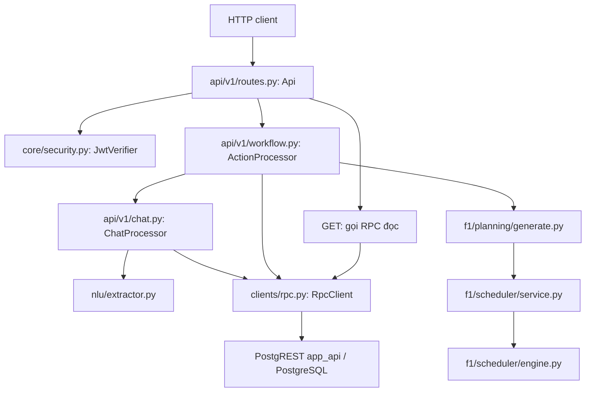

# Bản đồ code F1 và đề xuất tổ chức file

Ngày đọc code: **07/11/2026**. Nhánh local: `feat/f1-mvp-intergration`, HEAD `77916bf`.
Cập nhật theo góp ý team và đối chiếu lại source ngày **09/11/2026**; HEAD local vẫn là `77916bf`.
Phạm vi đối chiếu là checkout local; không fetch remote và không xác nhận môi trường triển khai.
Contract giữ nguyên **package 1.0.1 — APPROVED**, logical schema **F1 v1.1**, `schema_version="1.1"`, theo [ghi nhận phê duyệt](../../contracts/APPROVAL.md).

## 1. Kết luận và phạm vi thay đổi

Repo đã có code FastAPI, xác minh JWT, RPC có chữ ký, workflow lưu bền vững và scheduler. Tuy nhiên, frontend hiện vẫn chạy các luồng mẫu riêng: `Assistant.tsx` gọi `getAssistantReply()`, `Planner.tsx` gọi `runPlannerCommand()`, còn task/lịch trong `App.tsx` nằm trong React state. Chưa có client gọi tám endpoint F1 trong `frontend/src`. Vì vậy, sự tồn tại của các luồng backend chưa chứng minh frontend đã tích hợp đầu cuối.

Điểm khó đọc chính là **trách nhiệm và trạng thái sử dụng của code chưa rõ**, hơn là thiếu thư mục:

- `api/v1/chat.py` và `api/v1/workflow.py` đang chứa phần lớn điều phối nghiệp vụ.
- `orchestrator/` và `services/` đã có mã nháp với giao diện khác, nhưng không nằm trên đường gọi của `create_app()` hiện tại.
- Một số thư mục đã được tạo nhưng mới có `__init__.py`; tên thư mục không phải bằng chứng chức năng đã được triển khai ở đó.
- Các file giao diện lớn trộn xử lý trạng thái, lưu trữ, hiệu ứng và JSX.
- Tài liệu kiến trúc/README còn mô tả nhiều thời điểm khác nhau, dễ khiến người đọc chọn sai đường tích hợp.

**Đề xuất:** giữ nguyên toàn bộ cây thư mục hiện có; xác định một đường chạy chính, rồi mới tách trách nhiệm vào các thư mục đã có. Các tên file đích ở mục 4 chỉ là phương án, chưa được tạo hoặc di chuyển trong lượt này. Không đổi contract, tên endpoint, tên operation hay chuỗi migration.

**Điều chỉnh phạm vi ngày 09/11:** sửa documentation trước; refactor chỉ bắt đầu khi có baseline regression/contract/HTTP và integration phù hợp chạy đạt, rồi triển khai bằng các PR nhỏ theo backend, Assistant và Planner. Việc chưa chạy hoàn tất bộ HTTP trong môi trường thư viện sẵn có ở lượt trước không tự chứng minh code hoặc integration test bị lỗi; hiện chưa có baseline tái chạy đủ để mở đợt chuyển logic backend.

Đợt dịch comment ngày 07/11 được tách thành phạm vi review riêng, không đưa vào PR refactor. Đã loại thay đổi dịch chú thích của 21 migration lịch sử khỏi working tree và đồng bộ lại phần chú thích trong template sinh migration 012; bản dịch được giữ dưới dạng patch riêng ngoài repo. Còn 82 file source/test/CSS/cấu hình mẫu thay đổi comment/docstring, cũng được xuất patch riêng. Đây là artifact review local, chưa phải các branch/PR đã tách. Không thêm migration mới chỉ để đổi ngôn ngữ chú thích; chưa commit hay mở PR trong lượt này.

## 2. Đường chạy thực tế



`main.py:create_app()` lắp ráp các thành phần trên, truyền settings, đồng hồ và transport. Sơ đồ không nối frontend vào HTTP vì source frontend hiện chưa có bước đó.

| Luồng | File Python chính | RPC và nơi lưu/xử lý hiện hành |
|---|---|---|
| Đọc task, khung giờ, policy, lịch | `api/v1/routes.py` | `search_tasks` ở 015; `list_time_windows` ở 016; `ensure_user_context` ở 013; `get_study_plan` ở 018 |
| Gửi tin nhắn | `routes.py` → `workflow.py` → `chat.py` → `nlu/extractor.py` | Receipt/tin nguồn ở 013; continuation, checkpoint, context ở 017 |
| Tạo task, hỏi thông tin còn thiếu | `chat.py`, `workflow.py` | Candidate ở 014; pending action và presentation ở 015 |
| Xác nhận task | `workflow.py:decide()` | `confirm_task` ở 015 ghi task, phê duyệt, revision và dữ liệu chống ghi trùng trong giao dịch |
| Đổi giờ rảnh/bận hoặc policy | `workflow.py:prepare()`, `decide()` | Các writer ở 016; phần thân xử lý khung giờ và writer policy được thay lần cuối ở 021 để thêm cảnh báo |
| Sinh đề xuất lịch | `workflow.py:build_plan()` → `f1/planning/generate.py` → scheduler | Đọc đầu vào ở 018; lưu proposal ở 019; hiển thị để duyệt qua pending action ở 015 |
| Duyệt/từ chối lịch | `workflow.py:decide()`, `reject()` | `approve_study_plan` / `reject_study_plan` ở 020; lịch chính thức chỉ được ghi khi duyệt |
| Xem lại, hủy, tiếp tục nhiều ý định | `workflow.py:review()`, `reject()`; `chat.py:resume()` | Pending action ở 015; checkpoint continuation ở 017 |

Các số 013–021 là phần cuối của tên migration `2026110500xx_*.sql`, không phải thư mục hoặc gói mới. Để hiểu hành vi hiện tại phải đọc cả lần định nghĩa sau cùng, không chỉ hàm cùng tên trong migration 005–008.

## 3. Vai trò các file hiện có

### Backend đang được ứng dụng sử dụng

Mọi đường dẫn trong bảng này tính từ `backend/app/`.

| File | Chức năng và ranh giới |
|---|---|
| `main.py` | Tạo FastAPI, lắp RPC/JWT/extractor, đăng ký route, CORS và xử lý lỗi router |
| `core/config.py` | Đọc và kiểm tra cấu hình; giải mã khóa ký; xác định issuer |
| `core/security.py` | Tải/cache JWKS, kiểm tra thuật toán/chữ ký/claims/thời gian JWT, lấy UUID chủ sở hữu |
| `core/contract.py` | Tải `f1.schema.json`, tạo validator dùng lại, chuẩn hóa JSON và băm dữ liệu |
| `clients/rpc.py` | Dựng RpcRequest, ký chứng thực HMAC cho thao tác ghi, chuyển JWT của người gọi, gọi PostgREST, tạo khóa bước con |
| `api/v1/http.py` | Ánh xạ lỗi sang HTTP, dựng response/header và cấu trúc lỗi |
| `api/v1/routes.py` | Tám endpoint, xác thực, đọc query/body, kiểm tra schema, fingerprint HTTP và gọi processor/RPC |
| `api/v1/workflow.py` | Vòng đời receipt, chuẩn bị/review/quyết định action, chuẩn hóa deadline DATE, xây presentation và gọi sinh proposal |
| `api/v1/chat.py` | Trích xuất ý định, dependency, hàng đợi nhiều bước, làm rõ candidate, checkpoint/resume và ghép câu trả lời |
| `nlu/extractor.py` | Giao diện extractor; bản DeepSeek thật, bản theo kịch bản cho test và bản báo chưa cấu hình. Prompt là dữ liệu chạy, không phải comment |
| `nlu/evaluation.py` | Chấm ý định và slot trên tập 40 câu; ngưỡng 38/40. Có bộ chấm không có nghĩa đã chạy model thật |
| `f1/planning/generate.py` | Đổi snapshot JSON từ DB sang model scheduler; áp policy/override; mở rộng time window; tạo PlanProposal hoặc báo cáo chỉ đọc |
| `f1/scheduler/models.py` | Dataclass/enum cho task, interval, scope, policy, context, block, kết quả và proposal payload |
| `f1/scheduler/intervals.py` | Toán khoảng nửa mở, UTC, làm tròn phút, gộp/trừ/cắt khoảng và chia theo ngày địa phương |
| `f1/scheduler/normalization.py` | Kiểm tra TimeWindow và mở rộng lịch một lần/hằng tuần; xử lý giờ địa phương và DST |
| `f1/scheduler/constraints.py` | Kiểm tra cấu trúc context, block giữ lại, kết quả sinh lịch và các ràng buộc lịch |
| `f1/scheduler/engine.py` | Xếp lịch xác định theo deadline/ưu tiên, tính coverage, phần chưa xếp và cảnh báo; không gọi DB/LLM |
| `f1/scheduler/replanning.py` | Chia block giữ lại/thay thế; tạo snapshot; giữ ID logic và tính phần thay đổi |
| `f1/scheduler/service.py` | `PlanningService` ghép kết quả engine thành proposal payload; không commit lịch |
| `f1/scheduler/__init__.py` | Xuất các model/hàm công khai của gói scheduler |
| `f1/scheduler/evaluation.py` | Đánh giá tính xác định, độ phủ, vi phạm ràng buộc và độ trễ; dùng bởi script đánh giá, không phải endpoint |

### Mã nháp, điểm mở rộng và script

| File/nhóm file | Vai trò hiện tại | Cách xử lý đề xuất |
|---|---|---|
| `orchestrator/dispatcher.py`, `registry.py` | Dispatcher cho mười operation, context nội bộ, kiểm tra command/result và ghi log; được root test sử dụng | Giữ tại chỗ, ghi rõ chưa được `create_app()` lắp vào. Chỉ dùng lại sau khi đối chiếu contract hiện hành |
| `services/tasks.py` | Tạo/sửa candidate, xác nhận và tìm task qua store/evidence interface nháp | Không nối ngay vào runtime RPC hiện tại; cần adapter và kiểm chứng transaction nếu tái sử dụng |
| `services/settings.py` | Đổi khung giờ/policy qua store nháp, callback kiểm tra/cảnh báo | Giữ cùng nhóm nháp; hiện thao tác ghi thật nằm ở SQL |
| `services/plans.py` | Đọc CURRENT/HISTORY/PROPOSAL qua store nháp | Không nhầm với `f1/planning/generate.py` hoặc RPC đọc lịch |
| `services/scheduling_policy.py` | Hàm hợp nhất/kiểm tra policy cho nhóm service nháp | Khi thống nhất nơi áp policy, đối chiếu mặc định, override và kiểm tra chéo trước khi dùng lại |
| `validation/`, `schemas/`, `repositories/`, `domain/scheduling/` | Hiện mới có `__init__.py` | Giữ nguyên, mô tả là chỗ dành sẵn; không tạo lớp chuyển tiếp rỗng để lấp thư mục |
| `f1/tasks/`, `f1/availability/`, `f1/approval/` | Hiện mới có `__init__.py` | Không chuyển SQL vào đây chỉ để khớp cây thiết kế; chưa có nhu cầu triển khai Python riêng |
| `backend/scripts/evaluate_planner.py` | Chạy năm tình huống scheduler, mỗi tình huống 100 lần | Giữ trong `scripts/` |
| `backend/scripts/evaluate_nlu.py` | Gọi DeepSeek thật để chấm bộ 40 câu | Giữ trong `scripts/`; phân biệt với test bộ chấm và dataset cũ trong `eval/` |
| `backend/scripts/generate_contract_schema_migration.py` | Sinh migration 012 từ `$defs` của schema dùng chung; có `--check` | Giữ template và migration lịch sử đồng bộ; refactor/comment PR không sửa nội dung sinh ra. Thay đổi contract thực sự cần quy trình phiên bản/migration riêng |
| `backend/requirements.txt`, `requirements-acceptance.txt`, `pyproject.toml` | Cấu hình phụ thuộc runtime, nghiệm thu và metadata planner đang phân tán | Chốt nguồn khai báo phụ thuộc khi làm đợt dọn riêng; không thay version trong đợt dịch comment |

### Frontend

Mọi đường dẫn trong bảng này tính từ `frontend/src/`.

| File/nhóm file | Chức năng thực tế |
|---|---|
| `main.tsx`, `vite-env.d.ts` | Mount React, nạp CSS; khai báo type môi trường Vite |
| `App.tsx` | Khung ứng dụng, điều hướng nội bộ, sidebar/modal/thông báo và state task/khung giờ/proposal/revision |
| `components/HomeSummary.tsx` | Thẻ tổng quan công việc và thời gian trên trang chủ |
| `components/ui/Button.tsx`, `Card.tsx`, `Modal.tsx` | Thành phần trình bày dùng chung |
| `features/assistant/Assistant.tsx` | Giao diện chat, chuyển/đổi tên/xóa hội thoại, input/tệp, form làm rõ, trạng thái demo và hiệu ứng |
| `features/assistant/assistantService.ts` | Sinh phản hồi mẫu bằng quy tắc; không gọi NLP/API hay đọc nội dung tệp thật |
| `features/assistant/conversationHistory.ts` | Model hội thoại, chuẩn hóa/kiểm tra dữ liệu, lưu/đọc IndexedDB và yêu cầu xem lại đề xuất được khôi phục |
| `features/planner/plannerAgent.ts` | Phân tích lệnh tiếng Việt bằng regex, thao tác lịch mẫu theo giờ và lập lịch đơn giản trong client |
| `features/planner/proposal.ts` | So sánh task/khung giờ, phát hiện proposal cũ theo revision và mô tả thay đổi |
| `features/planner/TaskPanel.tsx` | Danh sách/lọc task và trạng thái nháp/đã có lịch/chưa xếp |
| `pages/Planner.tsx` | Lịch tuần, nhập lệnh, xem trước/duyệt/từ chối proposal local, khung task và hiệu ứng |
| `pages/Study.tsx` | Trắc nghiệm với dữ liệu mẫu, danh sách metadata tệp và phản hồi hỏi đáp theo quy tắc; không phải pipeline đọc tài liệu/AI thật |
| `types/assistant.ts`, `planner.ts`, `task.ts` | Type riêng của giao diện/demo; task dùng ID số và khung giờ theo ngày/giờ, khác DTO backend UUID/timestamp |
| `utils/date.ts` | Ngày cục bộ, định dạng ngày và số ngày còn lại |
| `api/` | Thư mục sẵn có, hiện chỉ chứa `.gitkeep`; là nơi đặt HTTP transport và client F1 khi làm hạng mục tích hợp riêng, chưa phải client đã triển khai |
| `styles/index.css` | Điểm nạp CSS; thứ tự import quyết định cascade |
| `styles/tokens.css`, `base.css` | Biến màu/thiết kế và kiểu nền tảng |
| `styles/layout.css`, `cards.css`, `overlays.css`, `overrides.css` | Bố cục, thẻ, lớp nổi và quy tắc ghi đè dùng chung |
| `styles/assistant.css`, `history.css`, `home.css`, `planner.css`, `study.css` | Kiểu cho từng vùng/tính năng/trang; giữ thứ tự import khi tách component |

`frontend/vite.config.ts`, `tsconfig.json`, `package.json` và `index.html` tiếp tục ở vị trí hiện tại vì công cụ build dùng chúng. `frontend/public/brand/` là tài nguyên giao diện, không thuộc phần refactor nghiệp vụ.

Lưu trữ hội thoại dùng `openHistoryDatabase()` với IndexedDB `studyflow-assistant-history`, hai object store `conversations` và `meta` trong `conversationHistory.ts`. `Assistant.tsx` khôi phục hội thoại/activeId từ đó; khi mở hoặc ghi lỗi thì chuyển sang bộ nhớ trong phiên và hiển thị cảnh báo. localStorage hiện dùng cho các tùy chọn giao diện như sidebar/khung task, không lưu lịch sử chat. Refactor phải giữ nguyên tên database, schema version, store/key, quy tắc khôi phục `review_required` và nhánh dự phòng; không đổi cơ chế lưu trữ.

### Contract, database và kiểm thử

| Vị trí | Nội dung và quy tắc giữ lại |
|---|---|
| `contracts/openapi.yaml`, `service-contract.json`, `data-contract.json` | Giao diện HTTP, danh mục operation/RPC và ánh xạ dữ liệu; giữ nguyên các đường dẫn chính thức |
| `contracts/schemas/f1.schema.json` | Schema bundle mà runtime API và migration sinh tự động dùng |
| `contracts/schemas/validated_command.json`, `tool_result.json` | Schema mà dispatcher/service nháp đang dùng; không gộp/xóa chỉ vì tên gần giống bundle |
| `contracts/check_contract.py`, `examples/` | Kiểm tra contract và bất biến thuần, fixture đúng/sai dùng chung |
| `supabase/migrations/001–008` theo hậu tố tên file | Nền thực thể, snapshot/phê duyệt, constraint/index, RLS và RPC giai đoạn đầu |
| `supabase/migrations/009–012` theo hậu tố tên file | Role/bảng hạ tầng, xác minh HMAC, ranh giới wrapper và schema bundle sinh tự động |
| `supabase/migrations/013–017` theo hậu tố tên file | Khởi tạo/receipt/tin nguồn, candidate/chống ghi trùng, action/xác nhận/tìm task, khung giờ/policy và continuation |
| `supabase/migrations/018–021` theo hậu tố tên file | Đọc lịch/snapshot, lưu proposal, duyệt/từ chối và cảnh báo ảnh hưởng lịch |
| `supabase/config.toml`, `seed.sql`, `scripts/inventory_demo.sql` | Cấu hình local, seed giả lập và kiểm kê metadata chỉ đọc |
| `tests/` và `tests/fakes/tool_executor.py` | Test contract command/result, dispatcher, service/store giả và fake executor của giai đoạn nháp |
| `backend/tests/unit/` | Unit test scheduler, extractor, bộ chấm NLU và đồng bộ migration sinh tự động |
| `backend/tests/acceptance_sol/` | Nghiệm thu độc lập scheduler/normalizer và hồi quy |
| `backend/tests/acceptance_api_sol/` | Nghiệm thu HTTP dùng transport ngoài giả và kiểm tra addendum contract |
| `backend/tests/integration/` | HTTP/chat với Supabase local thật; cần cấu hình môi trường riêng |
| `supabase/tests/`, `tests_concurrency/` | pgTAP và kiểm thử giao dịch nhiều kết nối với DB local thật |
| Ba file `*.test.ts` cạnh feature frontend | Test planner mẫu, diff/stale proposal và lịch sử hội thoại |
| `eval/` | Dataset/tài liệu đánh giá NLU giai đoạn trước; hiện script `evaluate_nlu.py` đọc `backend/tests/fixtures/nlu_eval_vi.json` |

Migration là lịch sử nâng cấp, không phải tập module có thể xếp lại theo tính năng. Giữ nguyên tên đầy đủ, thứ tự, nội dung lịch sử và ranh giới giao dịch. Đổi chú thích có thể tạo nhiễu khi review/đối chiếu artifact dù không đổi câu lệnh; vì vậy loại việc dịch migration khỏi comment PR và refactor PR. Không replay, reset hay repair database chỉ để đồng bộ ngôn ngữ chú thích.

## 4. Phương án tách file trong các thư mục sẵn có

| Ưu tiên | Hiện tại | Đích đề xuất, chưa thực hiện | Trách nhiệm sau khi tách |
|---|---|---|---|
| P1a — trước mọi lần chuyển processor | Helper dùng chung và phụ thuộc của `chat.py`/`workflow.py` | `orchestrator/workflow_shared.py`, `workflow_ports.py` trong thư mục đã có | Tách hằng số, hàm dựng reply và interface tối thiểu trước; giữ các processor tại chỗ, chưa thay đổi đường gọi |
| P1b — sau P1a và baseline đạt | `api/v1/chat.py` | `orchestrator/chat.py` | Điều phối ý định, dependency, continuation, clarification và resume |
| P1b — tách thành thay đổi tiếp theo | Phần nghiệp vụ trong `api/v1/workflow.py` | `orchestrator/actions.py` | Chuẩn bị action, kiểm tra quyết định, xây presentation và gọi use case lập lịch |
| P1b — tách thành thay đổi tiếp theo | Vòng đời receipt trong `api/v1/workflow.py` | `orchestrator/receipts.py` | Claim/replay/complete/release bằng RPC; giữ nguyên khóa con, fingerprint, lease và thứ tự bước |
| P1a/P1b | `api/v1/routes.py`, `http.py`, phần HTTP của `workflow.py` | Giữ ở `api/v1/` | Đọc Request, xác thực, chuyển lỗi/kết quả sang response và HTTP header |
| P1a | Context/lỗi đang phụ thuộc HTTP | Interface nội bộ ở `orchestrator/workflow_ports.py`; ánh xạ HTTP vẫn ở `api/v1/http.py` | Không cho orchestrator import ngược `api/v1/`; không lấy TrustedContext nháp làm contract mới, không sửa cấu trúc lỗi công khai |
| P2 | `features/assistant/Assistant.tsx` khoảng 1.682 dòng | `ChatTranscript.tsx`, `ChatComposer.tsx`, `ConversationSidebar.tsx`, `useAssistantConversation.ts` trong chính `features/assistant/` | Tách vùng hiển thị và state/handler; giữ `Assistant.tsx` làm nơi ghép, giữ quy tắc phục hồi/xem lại trong `conversationHistory.ts` |
| P2 | `pages/Planner.tsx` khoảng 726 dòng | `WeekCalendar.tsx`, `ProposalReview.tsx`, `usePlanner.ts` trong `features/planner/` | Trang chỉ ghép lịch, nhập lệnh và vùng duyệt; xử lý proposal/revision tập trung một nơi |
| P3 | `pages/Study.tsx` khoảng 935 dòng | Trước hết chia component/hàm theo ba vùng ngay trong file | Trắc nghiệm, tài liệu và hỏi đáp có state/handler riêng; chưa cần thêm thư mục F2/F3 khi phạm vi còn là demo |
| P3 | `App.tsx` | Giữ khung/điều hướng; đưa xử lý planner vào hook cùng feature, vẫn giữ một chủ thể sở hữu state | Không để App và Planner cùng tạo hai bản state lịch độc lập |

Phương án P1 không phải di chuyển nguyên file là xong. Hiện `workflow.py` import muộn `ChatProcessor` để tránh vòng phụ thuộc, còn `chat.py` import `AWAITING`, `DONE_TEXT`, `INTENT`, `Terminal`, `_ok`, `reply` từ `workflow.py`; processor cũng gọi ngược đối tượng `Api` và dùng `ApiError`/HTTP response.

P1a bắt đầu bằng tách shared helpers và interface cho RPC, clock, extractor, settings; không dựng service/container mới hay đổi cách gọi RPC. `Terminal` hiện chứa HTTP status từ `STATUS`, nên không chuyển nguyên class vào orchestrator rồi giữ import HTTP ngược. Xác định lỗi/kết quả nội bộ và ánh xạ HTTP tại adapter, bảo toàn code/message/field/retryable, status, header và body công khai. Chuyển một nhóm helper mỗi lần, cập nhật import và chạy regression trước khi chuyển processor. Nếu cần giữ import tương thích ở file cũ thì chỉ re-export cùng đối tượng, không sao chép hai bản implementation hay thêm nhánh thực thi.

Giữ nguyên `create_app(settings=None, *, rpc_transport=None, llm_transport=None, jwks_transport=None, clock=None, extractor=None)`, đối tượng app trả về và cách injection. Không thay endpoint, operation, schema, fingerprint, ID/key suy ra, thứ tự RPC, cách hoàn tất/phát lại receipt, dependency/resume hay bằng chứng phê duyệt. Tách interface ở đây là làm rõ phụ thuộc của code hiện có, không đổi kiến trúc F1.

Không bắt buộc hợp nhất dispatcher/service nháp vào đường chạy này. SQL đang là nơi thực hiện ghi nguyên tử; nối thêm service store nháp sẽ tạo đường ghi thứ hai nếu chưa có quyết định và adapter rõ ràng. Nếu còn giữ mã nháp, README phải nói rõ người dùng của nó là bộ test nào.

Khi thực sự nối frontend với backend, đặt HTTP transport và client F1 trong `frontend/src/api/` hiện có; feature chỉ giữ adapter cho model hiển thị khi cần. Không đặt HTTP transport mới vào `utils/` hay tạo client riêng cạnh mỗi feature. Phải đối chiếu DTO UUID/timestamp và vòng đời action/proposal, thay luồng demo theo từng use case. Đây là công việc tích hợp hành vi riêng, không gộp vào việc sắp file hoặc dịch comment.

## 5. Quy tắc để giữ repo dễ đọc

1. Một file có một trách nhiệm chính; gom theo chức năng, không theo tên công cụ/người viết. Không đổi tên các suite `*_sol` đang được CI gọi chỉ để đồng nhất hình thức.
2. HTTP thuộc `api/v1`; điều phối nhiều bước thuộc `orchestrator`; thuật toán thuần thuộc `f1/scheduler`; adapter sinh proposal thuộc `f1/planning`; gọi PostgREST thuộc `clients`; transaction/RLS thuộc `supabase`.
3. `components/ui` chỉ chứa UI dùng chung. UI và hook của một feature ở cạnh nhau trong feature hiện có; `pages` chỉ ghép màn hình khi đã tách hợp lý.
4. Không gộp các thư mục test ngay: chúng chứng minh các lớp khác nhau. Lập bảng lệnh chạy trong README trước; nếu chuyển test sau này phải cập nhật import, fixture path và workflow CI cùng lúc.
5. Cập nhật hiện trạng trong README; giữ tài liệu thiết kế/lịch sử có nhãn và liên kết rõ. Không chuyển các file gốc bàn giao hay schema ở root khi chưa rà soát đường dẫn tham chiếu.
6. Comment tiếng Việt giải thích mục đích, điều kiện và giới hạn. Giữ nguyên identifier, enum, URL, command, directive kỹ thuật và thuật ngữ cần đối chiếu contract.

## 6. Chia PR và điều kiện bắt đầu

Mỗi PR phải độc lập để review/revert, không chứa thay đổi kiến trúc, migration, contract, bản dịch hàng loạt hay tích hợp tính năng mới. Bảng dưới là kế hoạch, chưa phải PR đã mở.

| Phần | Nội dung | Điều kiện và kiểm tra |
|---|---|---|
| Docs | Nhãn lịch sử/package, bản đồ runtime, IndexedDB, `src/api/`, thứ tự triển khai và giới hạn bằng chứng | Đối chiếu source, đường dẫn và contract; không cần đổi code để hợp thức hóa mô tả |
| Comment riêng | Bản dịch source/test/CSS/cấu hình mẫu; loại migration lịch sử và thay đổi template SQL | So nội dung ngoài comment/AST, kiểm tra generator đồng bộ; không ghép vào PR refactor |
| Backend P1a | Shared helpers/interface, cập nhật import tại chỗ | Có baseline đạt bằng đúng bộ phụ thuộc; chạy lại regression, checker contract đầy đủ, HTTP và integration local |
| Backend P1b | Lần lượt chat, action, receipt; chia tiếp PR nếu diff lớn | Chỉ sau P1a; chạy lại cùng bộ kiểm tra sau từng phần. Không chuyển toàn bộ backend trong một PR |
| Assistant | Tách hiển thị/hook trong `features/assistant/`, giữ IndexedDB và bộ nhớ dự phòng | Chạy lại regression/contract/HTTP; test lịch sử, build frontend và kiểm tra trình duyệt cho tải lại, lỗi lưu trữ, review_required, chuyển/xóa hội thoại |
| Planner | Tách lịch tuần/vùng duyệt/hook trong `features/planner/` | Chạy lại regression/contract/HTTP; test planner/proposal, build frontend và kiểm tra xem trước/duyệt/từ chối/stale revision/state |

Các lệnh sau chạy từ repo root, dùng interpreter có đúng phụ thuộc đã khai báo trong `backend/requirements-acceptance.txt` và công cụ của frontend:

```bash
python -B contracts/check_contract.py
python -B -m unittest discover -s tests -v
python -B -m unittest discover -s backend/tests/unit -t . -v
python -B -m unittest discover -s backend/tests/acceptance_sol -v
python -B -m unittest discover -s backend/tests/acceptance_api_sol -p test_contract_addendum.py -v
python -B -m unittest discover -s backend/tests/acceptance_api_sol -p test_http_contract.py -v
python -B backend/scripts/generate_contract_schema_migration.py --check
node --test frontend/src/features/assistant/conversationHistory.test.ts frontend/src/features/planner/plannerAgent.test.ts frontend/src/features/planner/proposal.test.ts
npm --prefix frontend run build
```

Baseline backend cần thêm bộ HTTP/chat với Supabase local thật, có đủ cấu hình và phụ thuộc theo `backend/tests/integration/` và `.github/workflows/database-tests.yml`:

```bash
python -B -m unittest discover -s backend/tests/integration -t . -v
```

HTTP acceptance dùng transport giả chỉ chứng minh adapter, không thay thế integration với DB thật. Test TypeScript về khôi phục dữ liệu và IndexedDB unavailable cũng chưa chứng minh thao tác IndexedDB thành công trong trình duyệt; cần kiểm tra UI như bảng trên. Thiếu thư viện, thiếu DB hoặc chưa chạy phải ghi rõ FAIL/NOT_RUN theo kết quả, không bỏ/nới test để đủ điều kiện refactor. Không tự reset DB dùng chung để tạo baseline; dùng môi trường local dành riêng cho test.

Thống nhất hướng giữ/dùng service nháp và cấu hình phụ thuộc ở hạng mục riêng, không xóa mã còn được test/import sử dụng. Client integration frontend cũng là hạng mục riêng trong `src/api/`. Chỉ coi refactor đạt khi có một đường thực thi, cùng hành vi và contract F1 v1.1 trước/sau thay đổi.

## 7. Bằng chứng của lượt dịch comment ngày 07/11/2026

- Đợt ban đầu sửa chú thích trên 103 file source/test/SQL/CSS/cấu hình mẫu; đây là số lịch sử trước khi loại 21 migration theo góp ý team ngày 09/11. Giữ prompt DeepSeek, giá trị dữ liệu, thông báo runtime, identifier và chỉ thị công cụ.
- AST Python sau khi bỏ docstring khớp bản gốc; riêng template sinh SQL chỉ khác chú thích SQL. Nội dung ngoài comment của TS/TSX/CSS/SQL và cấu hình mẫu khớp bản gốc; giữ kiểu xuống dòng từng file.
- `generate_contract_schema_migration.py --check`: đạt; schema digest và phần SQL thực thi giữ nguyên.
- Root Python test: 78/78; backend unit: 33/33; scheduler acceptance: 33/33; contract addendum: 16/16.
- Ba file test frontend: 15/15. Đánh giá scheduler: năm tình huống × 100 lần, kết quả xác định, không có vi phạm ràng buộc cứng trong các tình huống đó.
- 100 fixture đúng/sai của contract đạt khi dùng validator/ngữ nghĩa hiện có. Checker tổng dừng vì thiếu `openapi-spec-validator`, nên chưa xác nhận phần OpenAPI của lượt này.
- Bộ HTTP chưa hoàn tất trong môi trường thư viện sẵn có; không tính là đạt. Không chạy DB local, concurrency, build frontend hoặc DeepSeek thật trong lượt này.

Các kết quả trên thuộc lượt 07/11, không phải kết quả tái chạy sau một PR refactor. Cập nhật documentation và loại bản dịch migration ngày 09/11 chưa chuyển code/runtime. Trước PR backend phải tái lập baseline tại mục 6; không dùng số test cũ làm bằng chứng implementation sau refactor.

## 8. Kiểm tra sau cập nhật ngày 09/11/2026

- Đối chiếu `contracts/APPROVAL.md`/`CHANGELOG.md`: package 1.0.1, logical schema F1 v1.1; không sửa artifact contract.
- Đối chiếu source IndexedDB và `src/api/.gitkeep`; sửa mô tả lưu trữ/client, không thay implementation.
- 21 migration khớp byte bản gốc trước đợt dịch; template SQL đã hoàn nguyên, vẫn giữ docstring tiếng Việt của script. `generate_contract_schema_migration.py --check` và unit test đồng bộ migration: đạt.
- AST Python sau khi bỏ docstring và nội dung ngoài comment của 82 file source còn sửa khớp bản gốc; không có thêm đường thực thi.
- Chạy lại ba file test frontend: 15/15 đạt. `git diff --check` cho phần thay đổi của công việc này và các liên kết Markdown: đạt.
- Không tái chạy checker OpenAPI đầy đủ, HTTP acceptance, HTTP/DB integration, concurrency, frontend build hay kiểm tra UI trình duyệt trong lượt documentation này. Các điều kiện bắt đầu refactor tại mục 6 vẫn cần được kiểm chứng.
