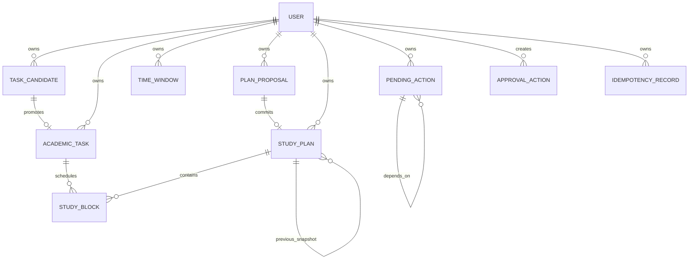
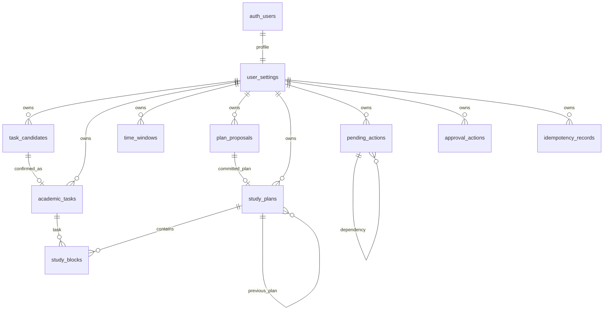

# StudyFlow AI — Database Design Baseline v1.1

**Status:** proposed physical baseline for team review  
**Logical source of truth:** [`schema_F1.md`](schema_F1.md), version **1.1**, agreed 04/11/2026  
**Scope:** F1 integration only; this document does not claim that migrations, ORM, repositories, RLS policies, or tests have been implemented.

## 1. Reconciliation result

`schema_F1.md` is authoritative. It supersedes conflicting decisions in the v1.0 database draft and earlier Phase 02 reviews. In particular, this baseline does **not** require a Course, SourceDocument, separate availability/busy tables, `plan_task_allocations`, `supersedes_plan_id`, source-block/change-type lineage, independent block status, or product TTLs for candidates, actions, or proposals.

The proposed physical model below keeps the logical contracts separate from storage details. A physical choice marked **TBD** must not be presented as an approved v1.1 contract.

F1 execution includes task candidate confirmation, task and TimeWindow persistence, policy configuration, automatic planning/replanning, proposal review, approval/rejection, current-plan retrieval, and conversation state. F2/F3, Course management, PDF/OCR, manual scheduling, individual block rescheduling, task update/cancel APIs, and StudySession are outside v1.1 execution scope.

## 2. Logical ERD (v1.1)



The logical `USER` is the authenticated principal’s business profile; credentials and provider data remain in the chosen authentication system. `PlanProposal` and `StudyPlan` are separate logical objects even if a deployment later co-locates them.

## 3. Proposed physical PostgreSQL ERD



`user_settings.current_plan_id` is a same-owner reference to `study_plans`; it is not a second active-plan status. `study_plans` are immutable snapshots after commit. A proposal payload is persisted in `plan_proposals` and a committed snapshot is persisted in `study_plans` plus `study_blocks`.

## 4. Entity-to-table mapping

| Logical contract | Proposed table | Notes |
|---|---|---|
| User | `user_settings` keyed by authenticated UUID | Stores timezone, locale, current pointer, revision, and policy. |
| TaskCandidate | `task_candidates` | Draft/confirmed/cancelled lifecycle; no TTL. |
| AcademicTask | `academic_tasks` | One-to-one promotion from candidate. |
| TimeWindow | `time_windows` | One union table; `kind` distinguishes availability and busy. |
| PlanProposal | `plan_proposals` | Full immutable payload; status may transition. |
| StudyPlan | `study_plans` | Committed immutable snapshot and history chain. |
| StudyBlock | `study_blocks` | Snapshot row PK `(plan_id, block_id)`; logical block ID is retained. |
| PendingAction | `pending_actions` | Conversation workflow and `requires_review`. |
| ApprovalAction | `approval_actions` | Contract/audit record with guarded polymorphic target. |
| IdempotencyRecord | `idempotency_records` | Shared side-effect replay record; only this entity has `expires_at`. |

No v1.1 table is proposed for Course, SourceDocument, PDF/OCR, StudySession, `plan_task_allocations`, or historical `source_block_id`/`change_type` lineage.

## 5. Column dictionary and constraints

The following is the complete v1.1 logical column set. Physical names may be adapted only without changing semantics.

### `user_settings`

`user_id UUID PK` (authenticated principal); `timezone TEXT NOT NULL` (IANA); `locale TEXT NOT NULL`; `current_plan_id UUID NULL`; `schedule_revision INTEGER NOT NULL DEFAULT 0 CHECK (>=0)`; `scheduling_policy JSONB NOT NULL` containing exactly the validated `SchedulingPolicy`; `created_at`, `updated_at` timestamps.

`current_plan_id` must be null or reference a plan with the same `user_id`. The composite FK requires a unique `(user_id, plan_id)` key on `study_plans`.

### `task_candidates`

`candidate_id UUID PK`; `user_id UUID NOT NULL`; `conversation_id UUID NOT NULL`; `version INTEGER NOT NULL CHECK (>=1)`; `status TEXT NOT NULL CHECK (DRAFT, CONFIRMED, CANCELLED)`; `slots JSONB NOT NULL` containing the CandidateTaskFields; `raw_expressions JSONB NOT NULL`; `field_sources JSONB NOT NULL`; `source_message_id UUID NOT NULL`; `confirmed_task_id UUID NULL`; `created_at`, `updated_at`.

The candidate payload has no entity owner/status fields inside `slots`. `confirmed_task_id` is non-null only for `CONFIRMED` and must identify the one same-owner `academic_tasks` row whose `candidate_id` is this candidate. No `expires_at` is stored.

### `academic_tasks`

`task_id UUID PK`; `user_id UUID NOT NULL`; `candidate_id UUID NOT NULL UNIQUE`; `version INTEGER NOT NULL CHECK (>=1)`; `title TEXT NOT NULL`; `description TEXT NULL`; `course_label TEXT NULL`; `available_from_at TIMESTAMPTZ NULL`; `deadline_at TIMESTAMPTZ NOT NULL`; `deadline_precision TEXT NOT NULL CHECK (DATE, DATETIME)`; `deadline_date DATE NULL`; `deadline_timezone TEXT NOT NULL`; `estimated_minutes INTEGER NOT NULL CHECK (>0)`; `remaining_minutes INTEGER NOT NULL CHECK (0<=remaining<=estimated)`; `priority TEXT NOT NULL CHECK (LOW, NORMAL, HIGH)`; `status TEXT NOT NULL CHECK (TODO, IN_PROGRESS, COMPLETED, CANCELLED)`; `confirmed_at TIMESTAMPTZ NOT NULL`; `created_at`, `updated_at`.

Checks include `available_from_at <= deadline_at`, `deadline_date IS NOT NULL` exactly when precision is DATE, and `deadline_date IS NULL` for DATETIME. Completion/progress is user-confirmed; scheduling never decrements `remaining_minutes`.

### `time_windows`

`window_id UUID PK`; `user_id UUID NOT NULL`; `version INTEGER NOT NULL CHECK (>=1)`; `kind TEXT NOT NULL CHECK (AVAILABILITY, BUSY)`; `label TEXT NULL`; `recurrence TEXT NOT NULL CHECK (NONE, WEEKLY)`; `timezone TEXT NOT NULL`; `start_at TIMESTAMPTZ NULL`; `end_at TIMESTAMPTZ NULL`; `weekday SMALLINT NULL CHECK (1..7)`; `start_time TIME NULL`; `end_time TIME NULL` (a separately represented local `24:00` boundary); `valid_from DATE NULL`; `valid_until DATE NULL`; `archived_at TIMESTAMPTZ NULL`; `created_at`, `updated_at`.

`NONE` requires start/end and all weekly fields null, with end > start. `WEEKLY` requires weekday, local times, valid_from, and null absolute timestamps; valid_until is null or > valid_from. Overnight intervals are split. DST-invalid/ambiguous local input is rejected by the service. Availability is unioned before BUSY subtraction; overlap between same-kind windows is not automatically an error.

### `plan_proposals`

`proposal_id UUID PK`; `user_id UUID NOT NULL`; `version INTEGER NOT NULL CHECK (>=1)`; `status TEXT NOT NULL CHECK (PROPOSED, APPROVED, REJECTED, STALE)`; `base_plan_id UUID NULL`; `base_plan_version INTEGER NULL CHECK (>=1 when present)`; `base_schedule_revision INTEGER NOT NULL CHECK (>=0)`; `generation_scope JSONB NOT NULL`; `payload JSONB NOT NULL` containing all blocks, task summaries, coverage, warnings, and diff; `algorithm_version TEXT NOT NULL`; `policy_snapshot JSONB NOT NULL`; `generated_at TIMESTAMPTZ NOT NULL`; `committed_plan_id UUID NULL`; `created_at`, `updated_at`.

`generation_scope` enforces `end_at > start_at`; SELECTED_TASKS has a non-empty task list, while ALL_ELIGIBLE has an empty list. Payload and policy snapshot are immutable after creation. `committed_plan_id` is non-null only for APPROVED and is unique, so one source proposal can commit at most one plan. No proposal TTL or `expires_at`.

The nested contract dictionaries are:

- `CandidateTaskFields`: `title?`, `description?`, `course_label?`, `available_from_at?`, `deadline_at?`, `deadline_precision?`, `deadline_date?`, `deadline_timezone?`, `estimated_minutes?`, `priority?`.
- `GenerationScope`: `start_at`, `end_at`, `selection_mode`, `task_ids` (empty for `ALL_ELIGIBLE`, non-empty for `SELECTED_TASKS`).
- `ProposalPayload`: `study_blocks[]`, `task_summaries[]`, `coverage`, `warnings[]`, `plan_diff` (`added[]`, `moved[]`, `removed[]`, `unchanged[]`).
- `ProposedStudyBlock`: `block_id`, `user_id`, `task_id`, `start_at`, `end_at`, `is_locked`; it has no `plan_id` until commit.
- `TaskSchedulingSummary`: `task_id`, `remaining_minutes`, `retained_future_minutes`, `newly_scheduled_minutes`, `unallocated_minutes`, `reason_codes[]`.

### `study_plans`

`plan_id UUID PK`; `user_id UUID NOT NULL`; `version INTEGER NOT NULL CHECK (>=1)` with unique `(user_id, version)`; `previous_plan_id UUID NULL`; `source_proposal_id UUID NOT NULL UNIQUE`; `approved_at TIMESTAMPTZ NOT NULL`; `created_at`.

The first plan has no previous plan; later plans point to the immediately prior current snapshot. Snapshot rows and their blocks are immutable after commit. `previous_plan_id` requires same-owner integrity.

### `study_blocks`

`plan_id UUID NOT NULL`; `block_id UUID NOT NULL`; `user_id UUID NOT NULL`; `task_id UUID NOT NULL`; `start_at TIMESTAMPTZ NOT NULL`; `end_at TIMESTAMPTZ NOT NULL`; `is_locked BOOLEAN NOT NULL DEFAULT FALSE`; PK `(plan_id, block_id)`.

Checks require end > start and same-owner plan/task references. Logical `block_id` is retained for carried-forward or moved blocks; a new logical block receives a new ID; a removed block is absent from the new snapshot. There is no block status, duration column, source-block ID, or change type.

### `pending_actions`

`action_id UUID PK`; `user_id UUID NOT NULL`; `conversation_id UUID NOT NULL`; `version INTEGER NOT NULL CHECK (>=1)`; `intent TEXT NOT NULL`; `state TEXT NOT NULL CHECK (AWAITING_CLARIFICATION, AWAITING_CONFIRMATION, AWAITING_APPROVAL, COMPLETED, CANCELLED)`; `requires_review BOOLEAN NOT NULL`; `candidate_id UUID NULL`; `proposal_id UUID NULL`; `draft_arguments JSONB NOT NULL`; `missing_fields JSONB NOT NULL`; `ambiguities JSONB NOT NULL`; `depends_on_action_id UUID NULL`; `created_at`, `updated_at`.

At most one action per user/conversation may be in any AWAITING state. All nullable references are same-owner. There is no product TTL.

### `approval_actions`

`approval_action_id UUID PK`; `user_id UUID NOT NULL`; `target_type TEXT NOT NULL CHECK (TASK_CANDIDATE, PENDING_ACTION, PLAN_PROPOSAL)`; `target_id UUID NOT NULL`; `target_version INTEGER NOT NULL CHECK (>=1)`; `decision TEXT NOT NULL CHECK (APPROVE, REJECT)`; `source TEXT NOT NULL CHECK (UI, CHAT)`; `source_message_id UUID NULL`; `created_at TIMESTAMPTZ NOT NULL`.

Because PostgreSQL cannot enforce a foreign key whose target table is selected by `target_type`, ownership, target version, state, and displayed-content checks are performed by the backend in the owner-lock transaction. A physical implementation may add nullable typed target columns and a constraint/trigger requiring exactly one target; choosing a trigger is **TBD**, not an assumed v1.1 feature. `source_message_id` is required when source is CHAT.

### `idempotency_records`

`user_id UUID NOT NULL`; `operation TEXT NOT NULL`; `idempotency_key TEXT NOT NULL`; `request_fingerprint TEXT NOT NULL`; `state TEXT NOT NULL CHECK (IN_PROGRESS, COMPLETED)`; `result_reference_or_response JSONB NULL`; `created_at TIMESTAMPTZ NOT NULL`; `expires_at TIMESTAMPTZ NOT NULL`; unique `(user_id, operation, idempotency_key)`.

Same key plus same normalized fingerprint replays the stored result; a different fingerprint returns `IDEMPOTENCY_CONFLICT`. Completion is in the same transaction as the business mutation. `expires_at` is operational retention for this table only and does not expire any candidate, action, proposal, or plan.

## 6. Same-owner composite-FK strategy

Every owner-scoped table has a unique key `(user_id, entity_id)` in addition to its primary key where needed. Child tables reference `(user_id, parent_id)` so a valid UUID from another user cannot satisfy a relationship. Required composite relationships include:

- candidate → task promotion (`task_candidates.user_id,candidate_id` to `academic_tasks.user_id,candidate_id`);
- `user_settings.current_plan_id` → `(study_plans.user_id, plan_id)`;
- `study_plans.previous_plan_id` → `(study_plans.user_id, plan_id)`;
- block → plan and task (`user_id,plan_id` and `user_id,task_id`);
- proposal base/committed plan and action candidate/proposal/dependency references.

If the selected migration strategy cannot express a composite FK, the service must enforce the same invariant in the owner-lock transaction and the limitation must remain an implementation blocker; a single-column FK alone is insufficient.

## 7. Current plan and revision transaction model

All scheduling-input writes, proposal generation, proposal rejection, and proposal approval use one centralized transaction helper. It derives the advisory-lock key from the trusted authenticated `user_id`, acquires the transaction-scoped lock on the same PostgreSQL connection, then reads authoritative state. The helper uses `READ COMMITTED` (or a documented equivalent that refreshes the snapshot after lock acquisition); a stale transaction-start snapshot must not be used after waiting for the lock.

After lock acquisition, capture `decision_at = clock_timestamp()` once and derive minute-aligned `scheduler_as_of` once. Reuse both values throughout the operation. External LLM/PDF/network calls run before the scheduling transaction; authoritative inputs are reloaded after the lock. Deterministic scheduling and proposal persistence use that one locked snapshot.

Approval rechecks owner, proposal status/version, base plan/version, `schedule_revision`, action target/version, time/task constraints, policy snapshot, and current time. In one transaction it inserts the immutable `study_plans` and all blocks, updates `current_plan_id`, increments `schedule_revision`, marks the proposal APPROVED, sets `committed_plan_id`, and completes idempotency. Any failure rolls back all changes. A proposal is never APPROVED without its committed plan.

Canonical approval shape (pseudocode, not executable SQL):

```text
begin READ COMMITTED
  acquire transaction-scoped owner lock(user_id) on this connection
  decision_at = clock_timestamp()
  scheduler_as_of = minute_floor(decision_at in trusted timezone)
  reload user, proposal, current plan, tasks, windows, policy, and action
  verify owner/version/revision/status and revalidate proposal payload
  if idempotency replay: return stored result
  insert immutable study_plan(version = current.version + 1,
                              previous_plan_id = current.plan_id)
  insert every study_block in the full payload
  update user_settings set current_plan_id = new.plan_id,
                           schedule_revision = schedule_revision + 1
  update proposal set status = APPROVED, committed_plan_id = new.plan_id
  complete idempotency record
commit
```

Proposal generation follows the same lock/read discipline for authoritative inputs, but LLM inference and other network work occur before the transaction. Read-only calendar retrieval is not a scheduling-input write and does not require this lock.

Any scheduling-affecting task, TimeWindow, timezone, policy, or current-plan change increments `schedule_revision` in the same transaction. A read-only calendar retrieval does not acquire the owner lock unless it is deliberately using a consistent current snapshot; it must never mutate state.

## 8. Scheduling policy and summary persistence

`SchedulingPolicy` is stored as a validated complete JSON object in `user_settings.scheduling_policy`. The agreed defaults (25/90 minutes, short final block allowed, 240 daily minutes, 10-minute break) apply only before user customization. `policy_patch` merges into the stored policy and increments `schedule_revision`; `policy_overrides` merge only for one generation and are copied into `plan_proposals.policy_snapshot`. An override never silently updates the profile.

`TaskSchedulingSummary` is part of the immutable proposal payload, not a separate F1 table. It may be materialized in a read model later. For every selected task: `remaining_minutes = retained_future_minutes + newly_scheduled_minutes + unallocated_minutes`. Retained future minutes include retained blocks outside the generation horizon; replaced, historical, and past blocks are not counted. Over-retention is a conflict, never clamped. `FULL`, `PARTIAL`, `NONE`, and `NO_CHANGE` retain the schema semantics; NONE/hard conflict is not committable.

## 9. Time, overlap, and reservation integrity

API timestamps are RFC3339 with offsets; persistence stores UTC instants. Local dates and recurrence times retain their IANA timezone. Intervals are half-open `[start_at,end_at)`, and adjacency is not overlap. Every proposal and committed snapshot is validated against task eligibility, deadline, availability, BUSY windows, retained blocks, workload, and locked blocks.

The physical database must not claim that a normal exclusion constraint can inspect parent plan status. Overlap enforcement is instead a locked service validation over the complete candidate snapshot, with a database exclusion constraint only where it can be scoped to a concrete confirmed-snapshot table without parent-state lookup. The exact implementation is **TBD** after migration review.

## 10. Security and trusted principal decisions

Logical ownership comes only from the authenticated backend principal. Browser clients cannot directly write task, proposal, plan, block, approval, or revision fields. Backend repositories/services must be reachable only through the centralized transaction helper; bypass attempts require integration tests.

RLS on every exposed user-owned table, grants by runtime role, whether direct PostgreSQL connections carry an `auth.uid()` context, and whether the chosen backend role bypasses RLS are **TBD** until the authentication/connection architecture is approved. Regardless of RLS, backend authorization and owner/version checks are mandatory. Do not use a privileged owner connection as an unexamined runtime authorization boundary.

## 11. Migration dependency order (design only)

1. Confirm authenticated-principal and runtime-role strategy.
2. Create `user_settings` and policy validation convention.
3. Create `task_candidates` and `academic_tasks` with promotion integrity.
4. Create `time_windows` and union-field constraints.
5. Create `plan_proposals` and `study_plans`; add deferred same-owner/current-pointer FKs after both exist.
6. Create `study_blocks` with composite snapshot key and same-owner references.
7. Create `pending_actions` and its awaiting-state uniqueness.
8. Create `approval_actions` and backend target-integrity contract.
9. Create `idempotency_records` and replay constraints.
10. Add indexes, grants, RLS policies, and tests only after the above logical decisions are approved.

This is dependency order, not executable SQL or evidence that migrations exist.

## 12. SRS versus v1.1 scope reconciliation

| SRS area | v1.1 treatment | Required action |
|---|---|---|
| AcademicTask status/progress | v1.1 fixes TODO/IN_PROGRESS/COMPLETED/CANCELLED; progress is user-confirmed; no update API in execution scope | Formal SRS clarification required. |
| Course ID/entity | v1.1 uses optional `course_label`; Course management is out of scope | Revise SRS references to `course_id` or mark future. |
| Availability and BusyInterval | v1.1 persists one TimeWindow union | Revise physical terminology while retaining API semantics. |
| StudyPlan lifecycle | One current pointer, immutable snapshots, `previous_plan_id`; no multiple active plans or `supersedes_plan_id` | Formal SRS revision required where legacy statuses appear. |
| Proposal expiry | No product TTL; stale only after revalidation detects changed inputs | Remove EXPIRED/TTL language from SRS. |
| Candidate/action expiry | No fixed TTL; states are DRAFT/CONFIRMED/CANCELLED and PendingAction states | Remove automatic expiry requirements. |
| PDF/OCR/source provenance | Outside v1.1 execution; no mandatory SourceDocument table | Mark PDF path future/TBD; do not promise implementation. |
| Manual scheduling/block rescheduling | Outside v1.1 | Keep as deferred capability, not an F1 API. |
| Task update/cancel and StudySession | Outside v1.1 execution | Revise SRS scope statement. |
| Deadline/date timezone | v1.1 defines DATE as local day ending at next midnight and DATETIME as instant | Align SRS wording and examples. |
| Scheduling policy | User policy plus one-time overrides; snapshot effective policy in proposal | Add explicit SRS contract if absent. |
| RLS/trusted principal | Required design goals, deployment details not approved | Keep SRS security requirements; mark role/RLS mechanism TBD. |

The SRS must not be silently edited as part of this baseline. Each row marked formal revision requires team acceptance and a versioned SRS change.

## 13. Remaining implementation decisions and blockers

- Approve the proposed PostgreSQL representation of nested policy, payload, scope, and issue objects as JSONB versus normalized support tables.
- Select a concrete same-owner composite-FK migration pattern, including the circular `current_plan_id` reference.
- Decide whether typed nullable target columns plus a database trigger will supplement backend polymorphic ApprovalAction checks; no generic FK is sufficient.
- Approve the overlap-enforcement implementation that does not inspect parent plan status from a normal exclusion constraint.
- Confirm authentication provider, runtime role, RLS context, and connection-pool identity isolation.
- Define idempotency-record retention/cleanup operational policy without turning it into product TTL.
- Approve index names/covering strategy and archival policy (none is implied by v1.1).
- Resolve SRS revisions listed above, especially deadline wording, task status scope, and removal of PDF/manual/update APIs from F1.
- Confirm that `schema_F1.md` itself is the reviewed team artifact and that the missing historical `phan_cong_backend_F1.md` is not required to override it.

## 14. Review readiness

The updated baseline is **ready for team review**, not ready for implementation. It is faithful to Official F1 Schema v1.1 and explicitly labels physical/security choices that remain unapproved. Implementation is blocked until the decisions in Section 13 and the corresponding SRS revisions are accepted.

