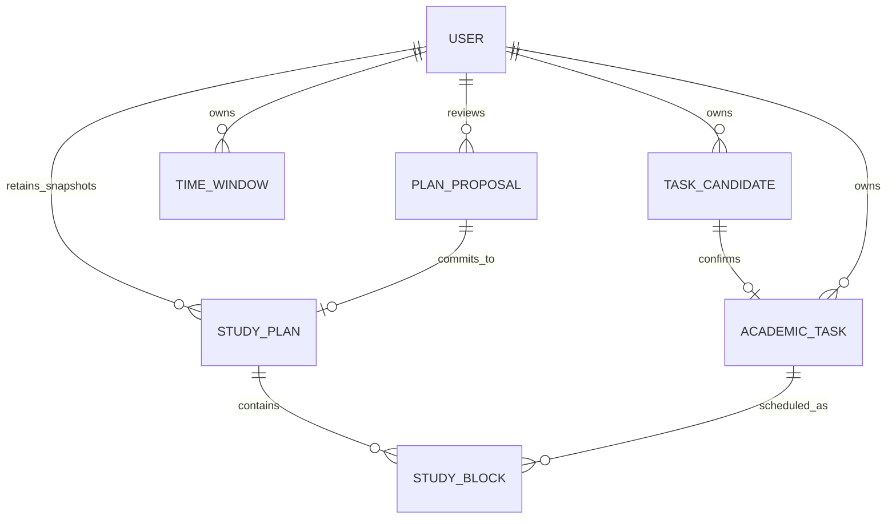

# StudyFlow AI — Schema chính thức F1

| Thuộc tính | Giá trị |
|---|---|
| Phiên bản schema | **1.1**; giá trị `schema_version` trên contract: `"1.1"` |
| Trạng thái | **ĐÃ THỐNG NHẤT — áp dụng cho giai đoạn tích hợp F1 hiện tại** |
| Ngày hiệu lực | 04/11/2026, múi giờ Việt Nam |
| Căn cứ phê duyệt | Nhóm thống nhất theo bản đề xuất F1 v0.1; người dùng xác nhận sửa hai phần: cho custom cấu hình học và bỏ thời hạn cố định cho nháp/yêu cầu chờ/proposal trong cuộc trao đổi ngày 04/11/2026. |
| Đối tượng sử dụng | Database, Tool Layer, Orchestrator, Scheduling Engine và bên tích hợp giao diện. |

Tài liệu này là nguồn chuẩn cho tên trường, kiểu dữ liệu, quan hệ, trạng thái và hợp đồng dữ liệu F1 trong giai đoạn hiện tại. Khi tài liệu hỗ trợ có khác biệt, áp dụng schema này cùng bộ contract máy đọc được trong `contracts/`.

Chi tiết tích hợp API FE–BE, Service/Tool và Data/RPC được chốt tại [Hợp đồng tích hợp chính thức](../../contracts/README.md), team phê duyệt theo [ghi nhận ngày 05/11/2026](../../contracts/APPROVAL.md). Việc phê duyệt này giữ nguyên schema logic v1.1.

Đây là đặc tả logic đã được thống nhất; không xác nhận implementation, migration hoặc kiểm thử đã hoàn tất. Không dùng tài liệu này làm bằng chứng đã đối chiếu proposal PDF gốc.

**Phạm vi áp dụng:** tạo và xác nhận task; khai báo khoảng rảnh/bận; tùy chỉnh cấu hình học; tự động lập và lập lại lịch trong phạm vi được chọn; xem lịch; duyệt/từ chối proposal; quản lý hội thoại và ghi dữ liệu có kiểm soát.

**Ngoài phạm vi giao diện thực thi v1.1:** F2/F3, quản lý Course riêng, PDF/OCR, tạo buổi thủ công, dời riêng từng block, cập nhật/hủy task và ghi nhận StudySession thực tế. Schema có trường tiến độ/trạng thái để giữ nhất quán dữ liệu; điều đó không tự công bố các API cập nhật này đã được hỗ trợ. Custom cấu hình độ dài buổi học áp dụng cho automatic planning, không tự mở rộng thành tạo/dời block thủ công.

## 1. Quyết định kiến trúc đã thống nhất

1. Candidate, task đã xác nhận, proposal và lịch đã duyệt là các đối tượng khác nhau.
2. Dữ liệu LLM trích xuất, command đã kiểm tra và bản ghi DB dùng các schema khác nhau; dùng chung tên và ý nghĩa trường nghiệp vụ.
3. Mỗi người dùng có **một lịch đang có hiệu lực**; mỗi lần duyệt tạo một snapshot mới, giữ lịch sử.
4. Proposal chứa toàn bộ snapshot lịch sau thay đổi; không chỉ chứa các block mới sinh trong horizon.
5. Dùng một kiểu `TimeWindow` cho khoảng rảnh/bận, với trường phân loại; Scheduler nhận các interval cụ thể đã được mở rộng từ lịch lặp.
6. Với MVP, dùng `course_label` tùy chọn; chưa cần bảng Course nếu nhóm chưa quản lý môn học như một thực thể riêng.
7. Người dùng được tùy chỉnh cấu hình học lưu trong hồ sơ hoặc áp dụng riêng cho một lần lập lịch. 25–90 phút/buổi, 240 phút/ngày và nghỉ 10 phút là giá trị khởi tạo khi chưa custom.
8. TaskCandidate, PendingAction và PlanProposal không tự hết hạn hoặc bị xóa sau một số phút/giờ cố định. Mỗi lần xác nhận phải kiểm tra đúng nội dung, ngữ cảnh và điều kiện hiện tại.

Lựa chọn 3–4 giúp giảm độ phức tạp khi ghép các kế hoạch chồng ngày. Đổi lại, lưu snapshot sẽ lặp dữ liệu block giữa các phiên bản; cần đánh giá lại nếu quy mô tăng. Đây là đơn giản hóa có chủ đích cho MVP.

## 2. Quy ước chung

| Nội dung | Quy định |
|---|---|
| Tên trường | `snake_case`; dùng `slots` cho trích xuất, `arguments` cho command/tool. |
| ID | ID entity là UUID do backend tạo; dùng tên rõ như `task_id`, `proposal_id`, `block_id`. `request_id` là chuỗi truy vết do server cấp, không bắt buộc là UUID. |
| Version | Integer >= 1. Dùng tên rõ `expected_candidate_version`, `expected_proposal_version`, `expected_plan_version`. |
| Thời điểm cụ thể | Chuỗi RFC 3339 có offset ở API; persistence giữ đúng instant UTC. |
| Múi giờ | Tên IANA, ví dụ `Asia/Ho_Chi_Minh`; timezone lấy từ cấu hình đã xác thực. |
| Ngày/giờ địa phương | `YYYY-MM-DD`, `HH:mm`; giờ bắt đầu từ 00:00–23:59. Chỉ giờ kết thúc của lịch lặp được dùng `24:00` để chỉ ranh giới cuối ngày. |
| Khoảng thời gian | Nửa mở `[start_at, end_at)`; hai block 08–09 và 09–10 không chồng nhau. |
| Độ chính xác | Lịch nghiệp vụ theo phút; timestamp hạ tầng có thể chính xác hơn. |
| Thời lượng | Integer phút, không dùng số thực hoặc chuỗi `2 tiếng` trong command chuẩn hóa. |
| Giá trị vắng mặt | Extraction có thể thiếu/null. Trong đối tượng chuẩn hóa, các field được liệt kê phải có mặt; dấu `?` chỉ cho phép giá trị null. Riêng SchedulingPolicyPatch cho phép bỏ field để giữ giá trị nền và không nhận null. UPDATE TimeWindow gửi toàn bộ nội dung chuẩn hóa; v1.1 không công bố PATCH task. |
| Trường lạ | Từ chối ở ranh giới command/tool; JSON hợp lệ chưa chứng minh quyền hoặc tính đúng nghiệp vụ. |
| Ownership | `user_id` lấy từ principal của backend, không nhận từ output LLM làm căn cứ quyền. |

Không dùng chung một trường `status` để diễn tả vừa validation, vừa hội thoại, vừa trạng thái task/proposal.

Kiểu `timestamp` trong tài liệu là thời điểm cụ thể có offset; `date` là ngày địa phương, không tự chuyển thành timestamp nếu chưa có quy tắc nghiệp vụ. `version` của entity tăng khi nội dung hoặc trạng thái có thể sửa thay đổi; riêng version proposal định danh nội dung bất biến được trình duyệt, không tăng chỉ vì đổi trạng thái.

## 3. Mô hình dữ liệu nghiệp vụ

Các field dưới đây phải có mặt trong bản ghi/đối tượng chuẩn hóa; field có dấu `?` được nhận null. Mảng rỗng dùng `[]`, không dùng null. Mỗi đối tượng nghiệp vụ có `created_at: timestamp`; User, TaskCandidate, AcademicTask, TimeWindow và PlanProposal có thêm `updated_at: timestamp`. Snapshot StudyPlan/StudyBlock không được sửa sau commit.

### 3.1. User

```text
user_id: UUID
timezone: string
locale: string
current_plan_id: UUID?
schedule_revision: integer >= 0
scheduling_policy: SchedulingPolicy
```

`current_plan_id` tham chiếu một StudyPlan cùng người dùng; null khi chưa duyệt lịch nào. User là hồ sơ nghiệp vụ, không tự quy định password/provider xác thực.

Khi khởi tạo hồ sơ và người dùng chưa custom, scheduling_policy nhận bộ mặc định tại mục 6. Người dùng có thể sửa cấu hình qua set_scheduling_preferences. Backend lưu đủ policy của user; override chỉ cho một lần lập lịch không tự ghi vào hồ sơ. Chi tiết thứ tự áp dụng và xác nhận ở mục 6.

`schedule_revision` tăng trong cùng transaction khi task, time window, timezone, scheduling policy hoặc lịch hiện hành thay đổi theo cách ảnh hưởng việc xếp lịch. Dùng nó phát hiện proposal dựa trên dữ liệu nền cũ.

### 3.2. TaskCandidate — thông tin đang làm rõ/chờ xác nhận

```text
candidate_id: UUID
user_id: UUID
conversation_id: UUID
version: integer >= 1
status: DRAFT | CONFIRMED | CANCELLED
slots: CandidateTaskFields
raw_expressions: object
field_sources: object
source_message_id: UUID
confirmed_task_id: UUID?
```

`CandidateTaskFields` chỉ gồm `title`, `description`, `course_label`, `available_from_at`, `deadline_at`, `deadline_precision`, `deadline_date`, `deadline_timezone`, `estimated_minutes`, `priority`, dùng kiểu tương ứng trong AcademicTask và cho phép thiếu/null ở giai đoạn trích xuất. Không gồm ID, owner, status hoặc bằng chứng xác nhận. `raw_expressions` là map từ tên field sang chuỗi gốc, ví dụ `deadline: "thứ Sáu"`.

`field_sources` là map từ tên field sang `{source: USER_MESSAGE | CONFIRMED_CONTEXT | SYSTEM_DEFAULT | DERIVED, reference: string|null}`. Orchestrator kiểm chứng và ghi nguồn khi chuẩn hóa; provenance do LLM tự khai không cấp thêm quyền.

Validation report được tính lại từ dữ liệu hiện tại, không coi danh sách trường thiếu do LLM khai báo là kết luận chính thức. Sửa candidate tăng version và làm mất hiệu lực xác nhận cho nội dung cũ.

confirmed_task_id chỉ khác null khi status=CONFIRMED và phải khớp AcademicTask.candidate_id; xác nhận candidate cùng tạo task trong một transaction. Retry không tạo task thứ hai.

Nháp được giữ để người dùng tiếp tục hoặc hủy, không tự hết hạn sau 24 giờ. Khi mở lại, hiển thị dữ liệu đã chuẩn hóa và validate lại trước khi xác nhận. Ngày tương đối như "mai" đã phân giải phải giữ ngày tuyệt đối theo tin nhắn gốc; không tự đổi thành "ngày mai" ở thời điểm mở lại. Nếu deadline đã qua, nêu rõ và để người dùng chọn sửa hoặc xác nhận giữ nguyên.

### 3.3. AcademicTask — việc đã được người dùng xác nhận

```text
task_id: UUID
user_id: UUID
candidate_id: UUID                    # unique: một candidate chỉ tạo một task
version: integer >= 1
title: string                        # trim, không rỗng
description: string?
course_label: string?
available_from_at: timestamp?
deadline_at: timestamp
deadline_precision: DATE | DATETIME
deadline_date: date?                  # bắt buộc khi precision=DATE
deadline_timezone: string
estimated_minutes: integer > 0
remaining_minutes: integer >= 0
priority: LOW | NORMAL | HIGH
status: TODO | IN_PROGRESS | COMPLETED | CANCELLED
confirmed_at: timestamp
```

Quy tắc bắt buộc:

- Task chính thức bắt buộc có title, deadline và estimated effort; thiếu thì giữ candidate để hỏi tiếp.
- `available_from_at` null nghĩa là không có mốc bắt đầu bổ sung; scheduler vẫn không xếp vào quá khứ.
- Nếu có available_from_at thì mốc này phải không muộn hơn deadline_at. Task quá hạn vẫn được lưu sau khi người dùng xác nhận nhưng scheduler phải trả rõ phần chưa xếp và lý do.
- Priority vắng mặt mặc định `NORMAL`, nhưng phải hiển thị trong nội dung xác nhận.
- Khi tạo, `remaining_minutes = estimated_minutes`, status=`TODO`.
- `0 <= remaining_minutes <= estimated_minutes`; khi người dùng ước tính lại cần cập nhật hai trường nhất quán.
- `COMPLETED` tương ứng remaining=0; task còn hoạt động phải remaining>0. `CANCELLED` không đủ điều kiện xếp lịch.
- Task tồn tại trong bảng này đã được xác nhận; `TODO` là trạng thái công việc. Quy ước này thay cách dùng `CONFIRMED` làm task status trong ví dụ cũ.
- Xếp hoặc duyệt một block **không giảm** remaining. Giờ học đã trôi qua cũng không tự chứng minh đã hoàn thành. Nguồn tiến độ là thông tin người dùng xác nhận; API thay đổi tiến độ chưa thuộc giao diện thực thi v1.1.
- Không hard-delete task đã được tham chiếu trong lịch sử. Nếu chưa triển khai hủy/cập nhật task thì capability đó phải được đánh dấu chưa hỗ trợ.

Deadline chỉ có ngày: hiểu “deadline ngày 06/11” là hết ngày 06/11 theo timezone của deadline, chuẩn hóa cutoff thành 00:00 ngày 07/11. Giữ `deadline_date=2026-11-06`, precision=`DATE` để hiển thị đúng. Phải cho người dùng thấy quy tắc này trước khi xác nhận; không áp dụng máy móc với câu “trước ngày 06/11” còn mơ hồ.

Deadline DATETIME dùng instant người dùng xác nhận, `deadline_date=null`. Block phải kết thúc `<= deadline_at`; nếu có `available_from_at` thì block phải bắt đầu không sớm hơn mốc đó.

### 3.4. TimeWindow — khoảng rảnh hoặc khoảng bận

```text
window_id: UUID
user_id: UUID
version: integer >= 1
kind: AVAILABILITY | BUSY
label: string?
recurrence: NONE | WEEKLY
timezone: string
start_at: timestamp?                  # NONE
end_at: timestamp?                    # NONE
weekday: integer 1..7?                # WEEKLY; thứ Hai=1
start_time: local_time?               # WEEKLY
end_time: local_end_time?             # WEEKLY; cho phép 24:00
valid_from: date?                     # WEEKLY; bao gồm ngày này
valid_until: date?                    # WEEKLY; không bao gồm ngày này
archived_at: timestamp?
```

Đây là union có điều kiện, không phải mọi field tùy chọn độc lập:

- NONE: bắt buộc start_at/end_at, end>start; các trường WEEKLY phải null.
- WEEKLY: bắt buộc weekday/start_time/end_time/valid_from; start_at/end_at phải null. valid_until null = chưa có ngày kết thúc; nếu có thì >valid_from.
- MVP chỉ nhận một interval trong một ngày địa phương, có thể kết thúc đúng ranh giới đầu ngày kế tiếp; giờ kết thúc phải lớn hơn giờ bắt đầu. Khoảng qua nửa đêm phải tách rõ thành hai interval. Ví dụ lịch lặp 23:00–01:00 được tách thành 23:00–24:00 và 00:00–01:00 ở hai ngày tương ứng. `24:00` chỉ là ký hiệu local end boundary; khi tạo timestamp phải chuyển thành 00:00 ngày kế tiếp, không xuất `T24:00` trong API timestamp.
- Mở rộng WEEKLY theo timezone đã lưu và horizon hữu hạn. Với giờ địa phương không tồn tại hoặc có hai cách hiểu khi đổi DST, trả `INVALID_PARAMETER` và hỏi thời điểm rõ ràng; không đoán instant.
- Hợp nhất availability chồng nhau trước khi tính thời gian; BUSY được trừ khỏi availability. Hai loại chồng nhau không mặc nhiên là lỗi.
- Thêm/sửa/xóa đều qua dữ liệu chuẩn hóa và xác nhận; khi sửa/xóa dùng window_id + expected version. Không để một lần khai báo giờ rảnh vô tình thay toàn bộ tuần.
- Thay giờ rảnh/bận không tự di chuyển lịch đã duyệt. Backend trả cảnh báo lịch bị ảnh hưởng và cho phép đề xuất lập lại.

### 3.5. StudyPlan — snapshot đã được duyệt

```text
plan_id: UUID
user_id: UUID
version: integer >= 1                 # unique(user_id, version)
previous_plan_id: UUID?
source_proposal_id: UUID              # unique
approved_at: timestamp
```

Lịch đầu tiên có version=1, previous_plan_id=null. Mỗi lần commit tiếp theo tạo plan_id mới, previous_plan_id trỏ đúng lịch hiện hành làm nền và version tăng 1 trong chuỗi lịch của user. Snapshot và các block thuộc snapshot là bất biến sau commit. Không cần cột `ACTIVE` ở mọi snapshot: lịch hiện hành là `User.current_plan_id`; các snapshot khác là lịch sử.

Lưu snapshot chỉ ghi nhận nội dung từng được duyệt, không chứng minh lịch đó vẫn thỏa dữ liệu task/availability hiện tại. Khi truy vấn lịch hiện hành cần trả cảnh báo nếu ràng buộc đã đổi.

### 3.6. StudyBlock — khoảng học cụ thể của một task

```text
plan_id: UUID
block_id: UUID
user_id: UUID
task_id: UUID
start_at: timestamp
end_at: timestamp
is_locked: boolean
```

- Khóa chính `(plan_id, block_id)`. Một block logic giữ nguyên block_id qua các snapshot; block mới được backend cấp ID. Dời block giữ ID, bỏ block thì ID không xuất hiện trong snapshot mới.
- Mỗi block thuộc đúng một task và một plan của cùng user. Quan hệ task → block là `1 : 0..N` trong một snapshot.
- end_at phải lớn hơn start_at và thời lượng là số phút nguyên dương. Block sinh mới chỉ nằm trong một ngày địa phương, có thể kết thúc đúng ranh giới ngày kế tiếp. Block mới mặc định is_locked=false; thao tác khóa/mở khóa chưa được công bố thành operation v1.1.
- Không lưu thêm duration nếu có thể tính từ start/end, tránh hai nguồn thời lượng lệch nhau.
- `is_locked=true` nghĩa là replan không được tự dời/bỏ block. Block khóa vi phạm ràng buộc mới phải được báo xung đột để người dùng xử lý.
- Schema v1.1 không bao gồm trạng thái hoàn thành block hoặc bảng StudySession. Nếu cần đo thời gian thực học, thiết kế contract riêng; không suy ra từ lịch.

### 3.7. PlanProposal — snapshot đề xuất chưa có hiệu lực

```text
proposal_id: UUID
user_id: UUID
version: integer >= 1
status: PROPOSED | APPROVED | REJECTED | STALE
base_plan_id: UUID?
base_plan_version: integer >= 1?
base_schedule_revision: integer >= 0
generation_scope: GenerationScope
payload: ProposalPayload
algorithm_version: string
policy_snapshot: SchedulingPolicy
generated_at: timestamp
committed_plan_id: UUID?
```

Lịch đầu tiên có base_plan_id/base_plan_version cùng null; không dùng version=0 của một plan giả.

`GenerationScope`:

```text
start_at: timestamp
end_at: timestamp
selection_mode: ALL_ELIGIBLE | SELECTED_TASKS
task_ids: UUID[]
```

end>start. SELECTED_TASKS yêu cầu task_ids không rỗng; ALL_ELIGIBLE yêu cầu mảng rỗng và service tự tải task đủ điều kiện. ID phải được resolve và kiểm tra quyền.

Đủ điều kiện xét xếp lịch nghĩa là task đã xác nhận, status TODO/IN_PROGRESS và remaining>0; không có nghĩa chắc chắn xếp được trong horizon. Task quá hạn hoặc chưa đến available_from vẫn phải có summary/lý do như `DEADLINE_PASSED` hoặc `OUTSIDE_HORIZON`, không bị loại âm thầm để tạo cảm giác mọi việc đã được xếp đủ.

`ProposalPayload`:

```text
study_blocks: ProposedStudyBlock[]    # toàn bộ snapshot sau thay đổi
task_summaries: TaskSchedulingSummary[]
coverage: FULL | PARTIAL | NONE | NO_CHANGE
warnings: Issue[]
plan_diff: {added: UUID[], moved: UUID[], removed: UUID[], unchanged: UUID[]}
```

ProposedStudyBlock có block_id/user_id/task_id/start_at/end_at/is_locked; chưa có plan_id vì snapshot chưa commit. ID block mới do service cấp sau khi nhận kết quả engine.

Chỉ tái phân bổ block tương lai chưa khóa, thuộc task được chọn, nằm trọn trong horizon. Giữ block lịch sử, block khóa, block ngoài horizon, block giao ranh horizon và block của task không được chọn. Chúng vẫn xuất hiện trong snapshot kết quả; không được xóa vì không nằm trong đầu ra engine.

Block đang diễn ra: chặn tái phân bổ task liên quan và yêu cầu làm rõ tiến độ trước, tránh tính toàn bộ duration là công việc chưa làm hoặc đã làm. Đây là giới hạn áp dụng trong giai đoạn hiện tại.

Payload đã hiển thị để duyệt phải được cố định. Chỉnh nội dung tạo proposal mới; không sửa ngầm cùng ID/version. Việc status đổi không được thay nội dung được duyệt.

Proposal mới có version=1. Đổi generation_scope, payload, policy_snapshot hoặc dữ liệu nền để sinh lịch khác phải tạo proposal_id mới; version được giữ như trường ràng buộc contract, không dùng để ghi đè payload. Proposal chỉ có committed_plan_id khác null khi status=APPROVED.

Proposal không tự hết hạn sau 30 phút. Nếu lúc duyệt vẫn cùng dữ liệu nền và toàn bộ điều kiện hiện tại còn hợp lệ, có thể commit đúng nội dung cũ. Nếu version/revision hoặc ràng buộc đã đổi, hay block mới đã trở thành quá khứ, chuyển STALE và giữ bản cũ để xem lại; sinh proposal mới từ dữ liệu hiện tại và yêu cầu duyệt lại. Không sửa thời gian trong proposal cũ rồi tự ghi lịch.

## 4. State và dữ liệu hạ tầng cần lưu

Không nhất thiết mỗi kiểu dưới đây là một bảng độc lập; persistence owner chọn cách lưu nhưng phải bảo đảm semantics.

### PendingAction

```text
action_id: UUID
user_id: UUID
conversation_id: UUID
version: integer >= 1
intent: string                        # thuộc catalog intent tại mục 5
state: AWAITING_CLARIFICATION | AWAITING_CONFIRMATION | AWAITING_APPROVAL
       | COMPLETED | CANCELLED
requires_review: boolean              # cần hiển thị lại nội dung trước khi nhận xác nhận
candidate_id: UUID?
proposal_id: UUID?
draft_arguments: object               # slots/arguments theo intent
missing_fields: string[]
ambiguities: Issue[]
depends_on_action_id: UUID?
created_at: timestamp
updated_at: timestamp
```

Mỗi conversation chỉ có một action ở một trong ba trạng thái AWAITING. Nhiều intent được xử lý theo thứ tự phụ thuộc; xác nhận giờ rảnh xong mới lấy context để sinh lịch. Câu trả lời ngắn được merge vào đúng action/version. Tham chiếu conversation, candidate, proposal và action phụ thuộc phải cùng user.

| Trạng thái hiện tại / sự kiện | Kết quả |
|---|---|
| AWAITING_CLARIFICATION / bổ sung dữ liệu | Merge và validate; còn thiếu thì giữ trạng thái, đủ thì chuyển AWAITING_CONFIRMATION hoặc tạo proposal và chuyển AWAITING_APPROVAL. |
| AWAITING_CONFIRMATION / chấp nhận nội dung hợp lệ | Ghi task/time window/cấu hình học qua service; thành công mới chuyển COMPLETED. |
| AWAITING_APPROVAL / chấp nhận proposal hợp lệ | Revalidate và commit; thành công mới chuyển COMPLETED. |
| Bất kỳ AWAITING / sửa yêu cầu | Tăng action version, bỏ ràng buộc duyệt cũ; proposal cũ không được tự duyệt theo nội dung mới. |
| Bất kỳ AWAITING / hủy hoặc từ chối | Chuyển CANCELLED; proposal bị từ chối chuyển REJECTED; giữ lịch hiện hành. |
| Quay lại action sau khi khôi phục hội thoại hoặc ngữ cảnh đã bị gián đoạn | Đặt requires_review=true, tăng action version; hiển thị lại nội dung và đích xác nhận trước khi nhận quyết định. Không xóa draft. |
| Đổi chủ đề | Tạm giữ action và đánh dấu cần xem lại khi xử lý đọc độc lập; nếu yêu cầu mới cần action ghi thì giải quyết hoặc hủy action cũ trước. |

Candidate và proposal có vòng đời riêng: DRAFT → CONFIRMED/CANCELLED; PROPOSED → APPROVED/REJECTED/STALE. Terminal state không được quay về draft/proposed; tạo đối tượng mới khi cần bắt đầu lại. PendingAction không hết hạn theo đồng hồ; không được hiểu một câu "đồng ý" là chấp nhận action cũ chỉ vì DB còn đúng một action đang chờ.

Khi requires_review=true, trước hết trả bản tóm tắt đúng target/version để người dùng xem lại, rồi đặt false và tăng action version. Lần xem lại này không được tự tính là approval; quyết định phải tham chiếu nội dung vừa trình bày. Nếu đích câu trả lời vẫn mơ hồ, hỏi lại. Khi ngữ cảnh vẫn rõ và dữ liệu không đổi, thời gian chờ dài tự nó không bắt buộc hủy hay tạo lại action.

### ApprovalAction

```text
approval_action_id: UUID
user_id: UUID
target_type: TASK_CANDIDATE | PENDING_ACTION | PLAN_PROPOSAL
target_id: UUID
target_version: integer >= 1
decision: APPROVE | REJECT
source: UI | CHAT
source_message_id: UUID?              # bắt buộc khi source=CHAT
created_at: timestamp
```

Backend tạo bản ghi này từ hành động UI đã xác thực hoặc tin nhắn người dùng trong đúng context. `target_version` phải ràng buộc với nội dung bất biến đã hiển thị. “Đồng ý” chỉ hợp lệ khi có đúng một đối tượng đang chờ và tham chiếu đích được xác định; không dùng boolean do LLM sinh làm bằng chứng.

### IdempotencyRecord

```text
user_id: UUID
operation: string                    # thuộc catalog operation
idempotency_key: string               # unique(user_id, operation, key)
request_fingerprint: string
state: IN_PROGRESS | COMPLETED
result_reference_or_response: object?
created_at: timestamp
expires_at: timestamp
```

Cùng key/cùng request chuẩn hóa trả kết quả cũ; cùng key/khác request trả `IDEMPOTENCY_CONFLICT`. Hoàn thành record cùng transaction với thay đổi nghiệp vụ. Sau timeout, retry phải tra kết quả commit cũ trước khi kết luận stale. Unique candidate_id của task và source_proposal_id của plan còn ngăn tạo trùng khi client gửi key khác.

## 5. Contract Orchestrator và Tool Layer

### Các kiểu ở ranh giới

| Kiểu | Trường chính / trách nhiệm |
|---|---|
| UserMessage | `schema_version: "1.1"`, `conversation_id: UUID`, `text: string` không rỗng; server cấp message_id và timestamp. |
| TrustedContext | `request_id: string`, `message_id: UUID`, principal có user_id, `received_at: timestamp`, `timezone: string`, `locale: string`; server xây, không cho LLM ghi đè. |
| ExtractionResult | `intents[]`; mỗi item có intent, slots, raw_expressions, ambiguities. Task reference còn có thể là tên tự nhiên. Không coi missing_fields từ LLM là kết luận cuối. |
| ValidationReport | `status: READY / NEEDS_CLARIFICATION / INVALID / UNSUPPORTED`, missing_fields, issues, resolved references. READY chưa có nghĩa được duyệt. |
| ValidatedCommand | `schema_version`, operation, arguments chuẩn hóa; principal/approval/idempotency context đi riêng do server gắn. |
| ToolResult | `schema_version`, `request_id`, `outcome: READ / DRAFTED / PROPOSED / COMMITTED / REJECTED / ERROR`, `data: object?`, `error: Error?`, `warnings: Issue[]`. Mỗi outcome có data schema riêng. ERROR yêu cầu data=null/error khác null; các outcome khác yêu cầu error=null. |
| OrchestratorReply | `schema_version`, `request_id`, `state: NEEDS_CLARIFICATION / AWAITING_APPROVAL / SUCCEEDED / ERROR`, `message: string`, `action_reference: ActionReference?`, `questions: Question[]`, `result: ToolResult?`, `error: Error?`. UI dựa vào state và typed data để hiển thị. |

`AWAITING_APPROVAL` cũng dùng cho xác nhận candidate/time-window/cấu hình học của người dùng ở giao diện; PendingAction vẫn phân biệt AWAITING_CONFIRMATION với AWAITING_APPROVAL của lịch. Mọi câu trả lời thành công phải dựa vào ToolResult thực tế.

```text
ActionReference:
  action_id: UUID
  action_version: integer >= 1
  target_type: TASK_CANDIDATE | PENDING_ACTION | PLAN_PROPOSAL
  target_id: UUID
  target_version: integer >= 1

Question:
  field: string
  message: string
  choices: {label: string, value: string}[]

UserDecision:
  schema_version: "1.1"
  conversation_id: UUID
  action_reference: ActionReference
  decision: APPROVE | REJECT
```

UserDecision là dữ liệu client gửi; server phải tải và đối chiếu đích, owner, version, trạng thái, requires_review và nội dung đã hiển thị trước khi tạo ApprovalAction. Field do client gửi không tự cấp quyền. Với chat, server lưu tin nhắn gốc và gắn source_message_id sau khi xác định đúng action đích. Khi còn mơ hồ phải hỏi lại; không dùng thời gian đã trôi qua làm bằng chứng đồng ý hay từ chối.

Intent chuẩn trong giai đoạn này: `CREATE_TASK`, `SEARCH_TASKS`, `SET_AVAILABILITY`, `SET_BUSY_INTERVAL`, `SET_SCHEDULING_PREFERENCES`, `GENERATE_STUDY_PLAN`, `GET_STUDY_PLAN`. Extraction dùng `UNKNOWN` khi chưa phân loại được và `UNSUPPORTED` cho khả năng ngoài phạm vi. Chấp nhận/từ chối đi qua UserDecision hoặc routing pending action được backend kiểm chứng; không dùng intent LLM làm bằng chứng duyệt.

Mỗi ExtractionResult item có `{intent: string, slots: object, raw_expressions: map<string,string>, ambiguities: Issue[]}`. Field slots chỉ được lấy trong allowlist của intent. ValidationReport có `{status, missing_fields: string[], issues: Issue[], resolved_references: map<string,UUID>}`; entity chỉ được thêm vào resolved_references sau khi lookup và kiểm tra quyền.

### Danh mục operation chính thức

Các operation dưới đây là hợp đồng phải triển khai trong giai đoạn này. Tên operation không tự quyết định HTTP route và không chứng minh handler đã tồn tại.

| Operation | Input nghiệp vụ chính | Output / tác động |
|---|---|---|
| `create_task_candidate` | slots + nguồn tin nhắn | Candidate; chỉ ghi nháp. |
| `confirm_task` | candidate_id, expected_candidate_version | Task; server gắn approval hợp lệ, ghi chính thức. |
| `search_tasks` | query?, status filter?, phân trang | Task của user; chỉ đọc. |
| `set_availability` | thao tác ADD/UPDATE/ARCHIVE, window payload/version | TimeWindow kind=AVAILABILITY; ghi sau xác nhận. |
| `set_busy_interval` | tương tự, kind=BUSY | TimeWindow bận; ghi sau xác nhận. |
| `set_scheduling_preferences` | policy_patch, expected_schedule_revision | Cập nhật policy lưu trong hồ sơ sau xác nhận; trả policy đầy đủ và schedule_revision. Không tự sửa lịch hiện hành. |
| `generate_study_plan` | GenerationScope + policy_overrides | PlanProposal có policy_snapshot thực tế; override chỉ cho lần lập lịch này. |
| `get_study_plan` | view CURRENT/HISTORY/PROPOSAL, khoảng truy vấn?, version?, proposal_id? | Snapshot hoặc proposal theo kiểu riêng; chỉ đọc. |
| `approve_study_plan` | proposal_id, expected_proposal_version, expected_plan_version? | Plan đã commit; approval và idempotency context do server gắn. |
| `reject_study_plan` | proposal_id, expected_proposal_version | Proposal REJECTED; không đổi lịch. Có thể là application action thay vì tool LLM. |

`get_scheduling_context` là service nội bộ. Các tên cũ `list_tasks`, `preview_study_plan`, `get_current_plan` không phải operation riêng: lần lượt ánh xạ về `search_tasks`, `generate_study_plan`, `get_study_plan` view CURRENT. Không công bố hai operation trùng nghĩa.

### Kiểu arguments theo operation

```text
create_task_candidate:
  slots: CandidateTaskFields
  # source_message_id/conversation_id lấy từ TrustedContext đã kiểm chứng

confirm_task:
  candidate_id: UUID
  expected_candidate_version: integer >= 1

search_tasks:
  query: string?
  status_filter: TaskStatus[]           # [] = mọi status
  page_size: integer > 0               # giới hạn tối đa do transport công bố
  cursor: string?                     # null = trang đầu

set_availability / set_busy_interval:
  change_type: ADD | UPDATE | ARCHIVE
  window_id: UUID?
  expected_window_version: integer >= 1?
  window: TimeWindowInput?

set_scheduling_preferences:
  policy_patch: SchedulingPolicyPatch  # không rỗng; merge vào policy lưu trong User
  expected_schedule_revision: integer >= 0

generate_study_plan:
  generation_scope: GenerationScope
  policy_overrides: SchedulingPolicyPatch # {} = dùng policy đang lưu của user

get_study_plan:
  view: CURRENT | HISTORY | PROPOSAL
  version: integer >= 1?
  proposal_id: UUID?
  start_at: timestamp?
  end_at: timestamp?

approve_study_plan:
  proposal_id: UUID
  expected_proposal_version: integer >= 1
  expected_plan_version: integer >= 1? # null chỉ khi proposal cho lịch đầu tiên

reject_study_plan:
  proposal_id: UUID
  expected_proposal_version: integer >= 1
```

`TaskStatus` chính là enum AcademicTask.status. `TimeWindowInput` gồm kind, label, recurrence, timezone và toàn bộ các field thời gian của TimeWindow; không có window_id, user_id, version, timestamps hạ tầng hoặc archived_at. kind phải khớp operation. ADD yêu cầu window khác null, window_id/expected_window_version=null; UPDATE yêu cầu cả ba khác null; ARCHIVE yêu cầu ID/version và window=null. Không hỗ trợ bulk overwrite ngầm.

view CURRENT yêu cầu version/proposal_id=null; HISTORY yêu cầu version khác null và proposal_id=null; PROPOSAL yêu cầu proposal_id khác null và version=null. Khoảng truy vấn phải cùng null hoặc cùng có giá trị với end>start. Cùng null nghĩa là trả toàn bộ snapshot, không tự đoán "tuần này". Filter chỉ tác động view trả về, không sửa payload đã duyệt. CURRENT chưa có lịch trả kết quả đọc plan=null và study_blocks=[]; HISTORY/PROPOSAL không tìm thấy trả ENTITY_NOT_FOUND.

`get_study_plan` trả dữ liệu `PlanView {plan: StudyPlan|null, study_blocks: StudyBlock[]}` hoặc `ProposalView {proposal: PlanProposal}`, kèm discriminator `kind: PLAN_VIEW | PROPOSAL_VIEW`. `search_tasks` trả `{items: AcademicTask[], next_cursor: string|null}`. Candidate trả ở outcome DRAFTED; Task/TimeWindow/StudyPlan sau ghi thành công trả ở COMMITTED; cập nhật cấu hình trả `{scheduling_policy: SchedulingPolicy, schedule_revision: integer >= 0}` ở COMMITTED; PlanProposal trả ở PROPOSED; proposal từ chối trả ở REJECTED. Mọi response phải có typed payload tương ứng với operation và outcome.

Các operation có ghi bắt buộc có idempotency context. `confirm_task`, `set_availability`, `set_busy_interval`, `set_scheduling_preferences`, `approve_study_plan` còn cần approval context đúng đích do backend gắn; những context này không nằm trong arguments cho LLM. Xác nhận sửa policy gắn với PENDING_ACTION và phải hiển thị toàn bộ policy sau merge. Kiểm tra expected_schedule_revision và tăng schedule_revision cùng transaction ghi User.scheduling_policy; revision cũ trả STALE_ENTITY_VERSION. Candidate được sửa qua service nội bộ với expected_candidate_version, tăng version và validate lại trước khi hiển thị xác nhận; không chỉnh trực tiếp AcademicTask.

`update_task`, hủy task, `propose_reschedule` một block và `CREATE_STUDY_BLOCK` chưa thuộc danh mục thực thi v1.1. Yêu cầu các khả năng này trả `UNSUPPORTED_OPERATION`; không tự ánh xạ thành một thao tác khác có tác động dữ liệu.

### Error chung

```json
{
  "schema_version": "1.1",
  "request_id": "req-example",
  "outcome": "ERROR",
  "data": null,
  "error": {
    "code": "STALE_PROPOSAL",
    "message": "Dữ liệu giờ rảnh đã đổi. Cần tạo đề xuất mới.",
    "field": null,
    "details": {},
    "retryable": false
  },
  "warnings": []
}
```

Mã lỗi chuẩn: `INVALID_PARAMETER`, `MISSING_REQUIRED_FIELD`, `AMBIGUOUS_REFERENCE`, `ENTITY_NOT_FOUND`, `FORBIDDEN`, `TIME_CONFLICT`, `ACTIVE_BLOCK_REQUIRES_REVIEW`, `APPROVAL_REQUIRED`, `ACTION_REVIEW_REQUIRED`, `STALE_ENTITY_VERSION`, `STALE_PROPOSAL`, `STALE_PLAN_VERSION`, `IDEMPOTENCY_CONFLICT`, `UNSUPPORTED_OPERATION`, `INTERNAL_ERROR`.

Issue chung: `{code: string, message: string, field: string|null, details: object}`. Error gồm toàn bộ field của Issue và `retryable: boolean`. Code biểu thị loại lỗi, message dùng để giải thích; client không parse message để rẽ nhánh. Lỗi stale/review-required không được retry ghi nguyên request như lỗi mạng; phải tải hoặc xác nhận dữ liệu mới. ACTION_REVIEW_REQUIRED yêu cầu trình bày lại nội dung đích; draft/proposal vẫn được giữ.

Không đủ thời gian với đầu vào hợp lệ là kết quả nghiệp vụ, không mặc định thành lỗi hệ thống. Thiếu dữ liệu bắt buộc thì hỏi lại, không trả “lịch trống thành công”. Candidate/action/window version cũ trả STALE_ENTITY_VERSION; plan nền đổi trả STALE_PLAN_VERSION; task/availability/policy nền đổi hoặc block mới đã trở thành quá khứ dù plan version giữ nguyên trả STALE_PROPOSAL.

## 6. Contract Scheduling Engine

Engine thuần không đọc DB, không gọi LLM, không tự cấp proposal_id hay commit.

```text
SchedulingContext:
  now: timestamp
  timezone: string
  generation_scope: GenerationScope
  selected_task_ids: UUID[]           # service resolve cả ALL_ELIGIBLE thành ID thật
  tasks: AcademicTask[]               # task được chọn + task của retained_blocks
  available_intervals: Interval[]     # đã mở rộng recurrence và hợp nhất
  busy_intervals: Interval[]
  retained_blocks: StudyBlock[]       # block không được tái phân bổ
  replaceable_blocks: StudyBlock[]    # block sẽ bị thay trong lần sinh này
  policy: SchedulingPolicy            # policy hiệu lực đã merge cho lần chạy này

SchedulingResult:
  generated_blocks: EngineBlock[]     # task_id, start_at, end_at; chưa cấp ID
  task_summaries: TaskSchedulingSummary[]
  coverage: FULL | PARTIAL | NONE | NO_CHANGE
  conflicts: Issue[]
  warnings: Issue[]
  algorithm_version: string
```

Service ghép retained_blocks với generated_blocks, cấp/giữ block_id, tính diff và tạo payload snapshot đầy đủ. Không lưu proposal có hard conflict như một proposal được phép duyệt.

`Interval = {start_at: timestamp, end_at: timestamp}` và `EngineBlock = {task_id: UUID, start_at: timestamp, end_at: timestamp}`. Mọi interval phải end>start. Available/busy intervals được mở rộng đủ cho horizon và các block tương lai được giữ cần kiểm tra; không chỉ nhìn dữ liệu trong horizon rồi bỏ qua xung đột ngoài horizon.

TaskSchedulingSummary chỉ được tính cho selected_task_ids. Các task khác trong context phục vụ kiểm tra block được giữ; không tự trở thành đối tượng cần tái phân bổ. Các block giữ nguyên task/start/end/is_locked phải giữ block_id cũ. Mọi block_id trong diff phải được đối chiếu với snapshot nền/kết quả, không do LLM đặt.

`TaskSchedulingSummary`:

```text
task_id: UUID
remaining_minutes: integer >= 0
retained_future_minutes: integer >= 0
newly_scheduled_minutes: integer >= 0
unallocated_minutes: integer >= 0
reason_codes: string[]
```

Với từng task được lập lịch:

```text
remaining_minutes = retained_future_minutes
                  + newly_scheduled_minutes
                  + unallocated_minutes
```

Chỉ trừ phần việc được block tương lai giữ lại bao phủ, gồm cả block ngoài horizon. Không trừ block lịch sử hoặc block sẽ bị thay thế. Retained vượt remaining là conflict cần xử lý, không ép số âm thành 0.

- FULL: toàn bộ công việc còn lại của các task được chọn đã được bao phủ.
- PARTIAL: có phần được bao phủ nhưng vẫn còn unallocated.
- NONE: chưa bao phủ được công việc nào dù có nhu cầu; không tạo proposal rỗng để người dùng duyệt.
- NO_CHANGE: không có thay đổi cần commit và không còn phần thiếu; trả trạng thái này cùng dữ liệu đọc thay vì tạo snapshot trùng.

Nếu diff rỗng nhưng vẫn còn phần thiếu, giữ coverage=PARTIAL hoặc NONE đúng thực tế và trả kết quả đọc kèm task_summaries; không tạo proposal/snapshot trùng. Coverage thể hiện mức bao phủ công việc, không thay thế trạng thái lỗi hoặc quyền commit.

Ví dụ một task còn 180 phút: giữ 60 phút tương lai, xếp mới 90 phút, chưa xếp 30 phút. Task vẫn remaining=180 sau khi duyệt; chưa có bằng chứng học thực tế.

Lưu ý: baseline tham lam trả PARTIAL/NONE chỉ nói thuật toán này chưa xếp đủ trong scope hiện tại; không chứng minh mọi phương án khác đều bất khả thi. UI không nên tuyên bố “chắc chắn không có lịch khả thi”.

### SchedulingPolicy — mặc định và cấu hình người dùng

```text
min_block_minutes: integer > 0
max_block_minutes: integer >= min_block_minutes
allow_short_final_block: boolean
max_daily_minutes: integer > 0
break_minutes: integer >= 0
```

Các field trên là cấu hình người dùng, không phải giới hạn cố định cho mọi tài khoản. Bộ mặc định dưới đây chỉ dùng khi khởi tạo và chưa có lựa chọn riêng:

| Field | Mặc định | Ý nghĩa khi chưa custom |
|---|---|---|
| min_block_minutes | 25 | Buổi học thông thường dài ít nhất 25 phút. |
| max_block_minutes | 90 | Một buổi học dài tối đa 90 phút. |
| allow_short_final_block | true | Cho phép buổi cuối dưới 25 phút để xếp nốt công việc còn lại của task. |
| max_daily_minutes | 240 | Tổng thời lượng học được xếp tối đa 4 giờ/ngày; không tính thời gian nghỉ. |
| break_minutes | 10 | Hai buổi học liên tiếp phải cách nhau ít nhất 10 phút. |

```json
{
  "min_block_minutes": 25,
  "max_block_minutes": 90,
  "allow_short_final_block": true,
  "max_daily_minutes": 240,
  "break_minutes": 10
}
```

`SchedulingPolicyPatch` có thể chứa bất kỳ tập con nào của năm field SchedulingPolicy, dùng cùng kiểu dữ liệu; không nhận null hoặc field lạ. Field không xuất hiện giữ giá trị nền. Sau merge, policy đầy đủ phải có min>0, max>=min, max_daily>0, break>=0 và allow_short_final_block là boolean. Không áp trần 90 phút/buổi, 240 phút/ngày hoặc sàn nghỉ 10 phút cho cấu hình người dùng.

Thứ tự áp dụng:

1. Mặc định hệ thống dùng để khởi tạo policy khi user chưa custom.
2. Policy đầy đủ đã lưu trong User là nền của mỗi lần lập lịch.
3. policy_overrides trong generate_study_plan ghi đè các field được nêu, chỉ cho lần lập lịch đó. `{}` nghĩa là dùng nguyên policy của user.

Muốn lưu cho những lần sau, dùng set_scheduling_preferences và xác nhận policy sau merge. Muốn thay đổi tạm thời, dùng policy_overrides rồi xem/duyệt proposal; không gọi operation lưu hồ sơ. Nếu câu nói chưa rõ phạm vi như "đổi sang 120 phút", Orchestrator hỏi áp dụng lần này hay lưu mặc định; không tự chọn.

Ví dụ user lưu cấu hình buổi 45–60 phút bằng policy_patch dưới đây; tổng phút/ngày, khoảng nghỉ và quy tắc buổi cuối được giữ từ hồ sơ:

```json
{
  "min_block_minutes": 45,
  "max_block_minutes": 60
}
```

Ví dụ yêu cầu các buổi sinh mới trong lần lập lịch này dài đúng 120 phút dùng policy_overrides:

```json
{
  "min_block_minutes": 120,
  "max_block_minutes": 120,
  "allow_short_final_block": false
}
```

Override áp dụng cho các block được sinh trong GenerationScope; task_ids giới hạn các task liên quan. Nó chưa phải contract để sửa riêng một block đã tồn tại. Nếu người dùng chỉ muốn ưu tiên 120 phút nhưng chấp nhận buổi cuối ngắn hơn, giữ allow_short_final_block=true và trình bày rõ trong proposal. Không được lặng lẽ cắt yêu cầu đúng 120 phút về 90 phút hoặc xếp vượt remaining_minutes; nếu chưa đủ thời gian thì báo phần chưa xếp và hỏi lựa chọn phù hợp.

Backend snapshot **policy hiệu lực sau merge** vào PlanProposal.policy_snapshot và hiển thị cùng lịch đề xuất. Scheduler và validator dùng đúng policy này; không tự thay bằng mặc định của hệ thống lúc duyệt. Sửa policy trong hồ sơ tăng schedule_revision, có thể làm proposal cũ STALE và phải được xem lại. Lịch đã duyệt được giữ; nếu cấu hình mới gây xung đột, trả cảnh báo và chỉ đổi lịch qua proposal mới được duyệt.

Không được âm thầm dùng policy khác nhau giữa các mô-đun; thay đổi mặc định phải tuân thủ mục 9. Bộ mặc định là cấu hình khởi điểm, không phải kết quả tối ưu hóa hoặc benchmark thói quen học.

Độ dài block mới phải nằm trong [min_block_minutes, max_block_minutes] của policy hiệu lực. Khi allow_short_final_block=true, một block ngắn hơn min chỉ được tạo nếu xếp nốt toàn bộ phần việc chưa phân bổ của task trong lần chạy; các giới hạn khác vẫn áp dụng. Không làm tròn effort xuống để bỏ phần dư.

max_daily_minutes tính tổng thời lượng các block trong snapshot kết quả theo ngày ở timezone của user, gồm block được giữ và block mới, không gồm khoảng nghỉ. break_minutes là khoảng cách tối thiểu giữa hai buổi học liên tiếp; không cần tạo block riêng cho nghỉ. Validator phải kiểm tra cả các buổi sát ranh horizon, không chỉ cặp buổi do engine vừa sinh.

Thứ tự baseline: deadline tăng dần → HIGH/NORMAL/LOW → task_id ổn định; chọn slot theo thời gian tăng dần. Không xếp trước now/available_from, sau deadline, ngoài availability, đè BUSY hoặc block được giữ, vượt lượng việc còn lại hay giới hạn ngày. Kiểm tra kết quả trên toàn bộ các block tương lai liên quan; block lịch sử chỉ được giữ để lưu vết.

## 7. Duyệt và commit

1. Xác thực principal; tra idempotency để trả kết quả lần commit trước nếu có.
2. Khóa/cơ chế đồng thời bảo vệ lịch của user và dữ liệu ảnh hưởng. Giai đoạn này dùng cơ chế khóa theo user hoặc cơ chế tương đương giữ cùng bảo đảm; **mọi writer liên quan** cùng tuân thủ giao thức này.
3. Kiểm tra proposal thuộc user; trạng thái, proposal version và ngữ cảnh action; kiểm chứng ApprovalAction đúng target/version/nội dung. Nếu cần xem lại hoặc đích còn mơ hồ thì trình bày lại/hỏi lại trước khi nhận quyết định.
4. So sánh current_plan_id, base_plan_version và schedule_revision với snapshot gốc. Khác thì trả stale; không âm thầm tái sinh nội dung rồi commit.
5. Kiểm tra lại bằng now tại lúc commit, dữ liệu nhất quán và policy_snapshot của proposal: các block mới không trở thành quá khứ, không vi phạm deadline/availability/busy/workload/ownership. Không tự bỏ override đã được người dùng xem và duyệt.
6. Trong cùng transaction: tạo StudyPlan và toàn bộ StudyBlock snapshot, đổi current_plan_id, tăng schedule_revision, chuyển proposal APPROVED, gắn committed_plan_id, hoàn thành idempotency record.
7. Commit thành công mới trả `COMMITTED`. Lỗi giữa chừng rollback; APPROVED không được tồn tại mà thiếu plan đã ghi.

Proposal PARTIAL chỉ được duyệt khi UI đã hiển thị rõ phần chưa xếp và được người dùng chấp nhận. Proposal NONE/hard conflict không có đường commit trong v1.1. Proposal không tự hết hạn theo đồng hồ; bắt buộc kiểm tra lại trên mỗi lần duyệt, kể cả vừa sinh cách đây vài giây.

Nếu kiểm tra lại không đạt, giữ dữ liệu proposal và đánh dấu STALE để người dùng xem lại; không ghi lịch. Proposal mới có nội dung khác phải được trình bày và duyệt lại. Từ chối proposal cũng phải kiểm tra quyền/version; không cần tạo StudyPlan mới.

## 8. Quan hệ và ràng buộc tối thiểu



- Cưỡng chế cùng owner cho liên kết block–task–plan và proposal–base plan; kiểm tra tồn tại FK riêng lẻ chưa đủ. Dùng khóa ngoại ghép hoặc cơ chế tương đương theo DB đã chọn.
- Index chuẩn cho các đường truy vấn hiện tại: task(user_id, status, deadline_at), window(user_id, kind), proposal(user_id, status, generated_at), block(plan_id, start_at), block(task_id, plan_id).
- Uniqueness: task.candidate_id, plan.source_proposal_id, plan(user_id, version), block(plan_id, block_id), idempotency(user_id, operation, key).
- Candidate/task/plan/proposal version và constraints phải được kiểm tra cả khi gọi service trực tiếp, không chỉ trong prompt hay dispatcher.
- DB engine, framework và cách ánh xạ kiểu vật lý được chọn khi triển khai nhưng phải giữ nguyên contract này. JSON Schema/validator và migration được sinh hoặc viết từ đặc tả này, không được tự thay đổi ý nghĩa trường.

## 9. Cấu hình triển khai và quản lý thay đổi

### 9.1. Giữ dữ liệu và kiểm tra lại khi tiếp tục

Không có thời hạn 24 giờ cho nháp task hoặc 30 phút cho action/proposal trong schema v1.1. Việc chờ lâu không tự xóa dữ liệu và không tự chứng minh một đề xuất còn hợp lệ:

| Đối tượng | Cách lưu và xử lý khi tiếp tục |
|---|---|
| TaskCandidate | Giữ bản nháp để bổ sung/xác nhận hoặc hủy; mở lại phải hiển thị dữ liệu tuyệt đối đã chuẩn hóa và validate lại. |
| PendingAction | Giữ trạng thái; nếu hội thoại bị gián đoạn hoặc đích xác nhận không rõ, hiển thị lại/hỏi lại. Không gắn câu "đồng ý" tùy tiện vào action cũ. |
| PlanProposal | Giữ nội dung bất biến; mỗi lần duyệt kiểm tra version, revision, thời gian hiện tại và toàn bộ ràng buộc liên quan. Hợp lệ thì commit đúng nội dung; không hợp lệ thì giữ bản STALE và tạo đề xuất mới để duyệt lại. |
| AcademicTask / StudyPlan đã xác nhận | Không bị bỏ hoặc xóa vì các cơ chế nháp/hội thoại/proposal ở trên. Deadline của task vẫn là ràng buộc học tập, không phải thời điểm tự xóa task. |

Ví dụ: đề xuất sinh lúc 10h cho buổi 14h–16h vẫn có thể được duyệt lúc 12h nếu dữ liệu không đổi và còn hợp lệ. Đến 15h thì không được tạo mới nguyên buổi đã bắt đầu từ 14h; proposal phải được đánh dấu STALE và sinh lịch mới để người dùng xem lại. Ngược lại, một proposal vừa sinh cũng có thể STALE ngay nếu user vừa thêm lịch bận hoặc đổi task.

Chuyển STALE, CANCELLED hay REJECTED là thay trạng thái nghiệp vụ, không phải xóa dữ liệu. Schema này không đặt chính sách tự dọn/xóa task nháp hay lịch đã lưu. Nếu bổ sung chính sách lưu trữ/xóa riêng sau này, phải công bố phạm vi và không được suy ra từ thời gian chờ duyệt.

### 9.2. Thông số triển khai và thay đổi contract

Các quyết định schema và giá trị mặc định ở trên đã có hiệu lực. Các lựa chọn hạ tầng bên dưới được cấu hình khi triển khai và phải giữ nguyên các bảo đảm của schema:

| Nội dung cần cung cấp khi triển khai | Quy tắc |
|---|---|
| SchedulingPolicy | Dùng mặc định tại mục 6 khi user chưa custom; lưu policy của user và snapshot policy sau override khi sinh proposal. |
| Candidate, pending action và proposal | Không cấu hình TTL sản phẩm; áp dụng việc xem lại ngữ cảnh và revalidation tại mục 9.1. |
| Thời gian lưu IdempotencyRecord | Thông số vận hành riêng để lưu kết quả chống ghi trùng, phải bao phủ khoảng retry được transport công bố; expires_at của record này không làm task/proposal hết hạn hoặc bị xóa. |
| DB, framework, xác thực, transport | Lựa chọn triển khai; principal phải đến từ cơ chế xác thực hợp lệ và giữ các bảo đảm quyền/giao dịch đã quy định. |
| Giới hạn độ dài text, phân trang, request/file nếu có | Công bố trong contract transport trước khi tích hợp; không đoán đây là ngưỡng đã được nhóm phê duyệt. |

Thiếu cấu hình bắt buộc không được làm scheduler tự đoán giá trị; trả lỗi có cấu trúc hoặc chặn khởi động theo quy ước vận hành được công bố.

Thay đổi tên trường, kiểu, nullability, enum, side effect, đơn vị hoặc cách hiểu thời gian là thay đổi contract. Người thay đổi phải ghi lý do, xác định mô-đun bị ảnh hưởng, cập nhật phiên bản và thống nhất với các bên sử dụng trước khi tích hợp. Không âm thầm đổi schema trong PR triển khai một mô-đun.

## 10. Điều kiện triển khai theo schema v1.1

- Mỗi ranh giới có validator khớp kiểu/enum/nullability và xử lý trường lạ.
- Có dữ liệu mẫu dùng chung cho đủ dữ liệu, thiếu dữ liệu, partial và lỗi.
- Kiểm chứng việc xác nhận candidate, quyền sở hữu, duyệt đúng proposal và bảo toàn block ngoài phạm vi thay đổi.
- Kiểm chứng deadline chỉ có ngày, recurrence, khoảng sát nhau và số phút còn lại.
- Kiểm chứng mặc định chỉ dùng khi chưa custom; custom lưu cho những lần sau khác override một lần, policy_snapshot được giữ đúng khi commit và thay cấu hình không tự sửa lịch đã duyệt.
- Kiểm chứng nháp vẫn được giữ khi quay lại, không đổi nghĩa ngày tương đối cũ, câu "đồng ý" khi ngữ cảnh mơ hồ phải hỏi lại và proposal cũ còn hợp lệ vẫn duyệt được.
- Kiểm chứng stale revision dù plan version không đổi, proposal có giờ học đã qua, retry/double approval và rollback transaction.
- Các operation ngoài phạm vi trả chưa hỗ trợ; không báo thành công giả.

Danh sách này là tiêu chí phải kiểm chứng khi triển khai, không phải báo cáo đã chạy kiểm thử.

## 11. Lịch sử phiên bản

Thay đổi contract từ 1.0 sang 1.1: bỏ expires_at khỏi TaskCandidate, PendingAction, PlanProposal và ActionReference; bỏ EXPIRED cùng các mã lỗi hết hạn của ba đối tượng sản phẩm này; thêm requires_review cho PendingAction, operation set_scheduling_preferences và policy_overrides cho generate_study_plan. expires_at của IdempotencyRecord vẫn là trường hạ tầng riêng. Validator phải nhận đúng schema_version; không âm thầm coi payload 1.0 là 1.1.

| Phiên bản | Ngày | Nội dung |
|---|---|---|
| 1.1 | 04/11/2026 | Cho custom policy lưu trong hồ sơ hoặc override cho một lần lập lịch; 25–90/240/10 chỉ là mặc định. Bỏ thời hạn cố định của nháp/action/proposal; giữ dữ liệu, xem lại ngữ cảnh và kiểm tra lại trước mỗi lần ghi. Thay thế quy định TTL sản phẩm ở 1.0. |
| 1.0 | 04/11/2026 | Chính thức hóa phương án F1 v0.1 sau khi nhóm thống nhất; chuẩn hóa dữ liệu nghiệp vụ, I/O, trạng thái, thời gian, quyền, duyệt và giao dịch; chốt mặc định 25–90 phút/buổi, 240 phút/ngày, nghỉ 10 phút, cho phép buổi cuối ngắn và TTL 1440/30/30 phút. |
