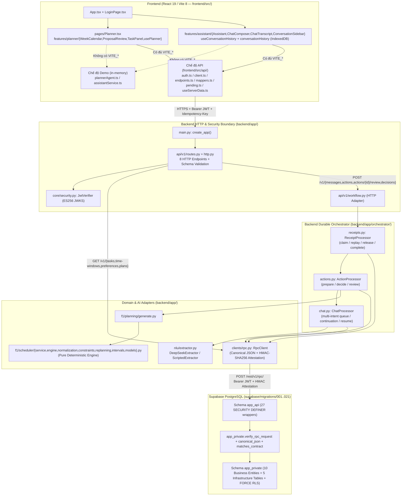

# Kiến Trúc & Quy Tắc Runtime (Architecture & Runtime Rules)

| Thuộc tính | Giá trị |
|---|---|
| **Mục đích (Purpose)** | Tóm lược bản đồ runtime thực tế trên `main` (`7837050`), quy định ranh giới giữa các tầng (Layer/Trust/Transaction/Testing Boundaries) và liệt kê các kết nối bị cấm |
| **Thẩm quyền (Authority)** | Quy tắc kiến trúc bắt buộc cho cả 6 vai trò; dẫn chiếu từ [`docs/architecture/F1_File_Organization_Proposal.md`](../architecture/F1_File_Organization_Proposal.md), [`contracts/README.md`](../../contracts/README.md) và các ADR `ADR-001`..`ADR-005` |
| **Chủ sở hữu (Owner)** | `BE-4` (API/Orchestrator), `BE-2` (Scheduler/Planning), `BE-1` (DB/RPC boundary), `BE-3` (NLU/Ingestion), `FE-1` & `FE-2` (Frontend) |
| **Base commit kiểm chứng** | `main` @ `7837050` (`Merge pull request #21 from chp0703/feat/f1-frontend-integration`) |
| **Cập nhật lần cuối** | 11/11/2026 (`Asia/Ho_Chi_Minh`) |

---

## 1. Tài liệu Nguồn cần Đối chiếu

Tài liệu này không sao chép lại toàn bộ chi tiết thiết kế mà đóng vai trò bản đồ điều hướng và quy tắc ranh giới. Khi cần chi tiết sâu hơn, hãy đọc:

- **Bản đồ file và quá trình refactor F1:** [`docs/architecture/F1_File_Organization_Proposal.md`](../architecture/F1_File_Organization_Proposal.md) (lưu ý cập nhật PR #21 bên dưới).
- **Quyết định kiến trúc (ADRs):**
  - [`ADR-001-database-and-backend-stack.md`](../architecture/decisions/ADR-001-database-and-backend-stack.md)
  - [`ADR-002-authentication-and-runtime-authorization.md`](../architecture/decisions/ADR-002-authentication-and-runtime-authorization.md)
  - [`ADR-003-data-access-and-rpc-boundaries.md`](../architecture/decisions/ADR-003-data-access-and-rpc-boundaries.md)
  - [`ADR-004-database-migration-strategy.md`](../architecture/decisions/ADR-004-database-migration-strategy.md)
  - [`ADR-005-concurrency-and-transaction-strategy.md`](../architecture/decisions/ADR-005-concurrency-and-transaction-strategy.md)
- **Kiến trúc Frontend & CSS cascade:** [`frontend/DESIGN.md`](../../frontend/DESIGN.md).
- **Hợp đồng tích hợp 3 ranh giới (FE↔BE, Orchestrator↔Service, BE↔DB):** [`contracts/README.md`](../../contracts/README.md).

---

## 2. Bản đồ Đường chạy Thực tế tại `main` @ `7837050` (Verified Runtime Map)

Sau khi các PR [#25](https://github.com/chp0703/StudyFlow-AI/pull/25)–[#29](https://github.com/chp0703/StudyFlow-AI/pull/29), [#20](https://github.com/chp0703/StudyFlow-AI/pull/20) và [#21](https://github.com/chp0703/StudyFlow-AI/pull/21) được hợp nhất vào `main` (`7837050`), luồng gọi thực tế từ trình duyệt xuống cơ sở dữ liệu như sau:

### Phân biệt Code Đang Chạy Runtime vs. Mã Nháp / Chỗ Dành Sẵn

| Nhóm | Đường dẫn thực tế trên `main` (`7837050`) | Trạng thái trong Runtime | Quy tắc cho Agent |
|---|---|---|---|
| **Backend Runtime Chính** | `backend/app/main.py`, `core/{config,security,contract}.py`, `clients/rpc.py`, `api/v1/{routes,http,workflow,chat}.py`, `orchestrator/{actions,chat,receipts,workflow_ports,workflow_shared}.py`, `nlu/{extractor,evaluation}.py`, `f1/planning/generate.py`, `f1/scheduler/*.py` | **ĐANG CHẠY** trong `create_app()` | Mọi tính năng backend F1 phải đi qua đường chạy này |
| **Backend Mã Nháp (Legacy Draft)** | `backend/app/orchestrator/{dispatcher,registry}.py`, `backend/app/services/{tasks,settings,plans,scheduling_policy}.py`, `contracts/schemas/{validated_command,tool_result}.json` | **KHÔNG gắn vào `create_app()`**; đang được kiểm thử bởi `tests/test_*.py` ở thư mục gốc | **Không xóa** (để không làm gãy root `tests/`), **không tự ý nối thẳng** vào runtime khi chưa có thiết kế chuyển đổi được duyệt |
| **Backend Placeholders** | `backend/app/domain/scheduling/`, `backend/app/f1/{tasks,availability,approval}/`, `backend/app/repositories/`, `backend/app/schemas/`, `backend/app/validation/` | Chỉ có `__init__.py` | Không tự ý nhét code thừa vào đây chỉ để "lấp đầy thư mục" nếu chưa có task giao rõ |
| **Frontend Runtime Chính** | `frontend/src/main.tsx`, `App.tsx`, `api/*.ts`, `components/**`, `features/auth/LoginPage.tsx`, `features/assistant/*.{tsx,ts}`, `features/planner/*.{tsx,ts}`, `pages/{Planner,Study}.tsx`, `styles/*.css`, `types/*.ts`, `utils/date.ts` | **ĐANG CHẠY** (hỗ trợ cả Chế độ Demo và Chế độ API; riêng `Study.tsx` và đính kèm tệp vẫn là Demo/Disabled) | Lưu ý trong `frontend/src/api/endpoints.ts` hiện đã bọc 7/8 endpoint (`POST /v1/actions` chưa được tạo hàm gọi trong `endpoints.ts`) |
| **Frontend Placeholders** | `frontend/src/features/{availability,chat,proposals,schedule,tasks}/`, `frontend/src/{hooks,i18n/vi,lib}/`, `frontend/mocks/`, `frontend/tests/{component,e2e}/` | Chỉ có `.gitkeep` | Chỉ sử dụng khi task spec cho phép rõ ràng |

---

## 3. Ranh giới Kiến trúc & Bảo mật (Architectural & Trust Boundaries)

### 3.1. Ranh giới HTTP & Xác thực (`FE ↔ FastAPI`)
- Mọi request tới 8 endpoint `/v1/*` bắt buộc có `Authorization: Bearer <Supabase access JWT>`.
- `backend/app/core/security.py` (`JwtVerifier`) xác minh chữ ký ES256 qua JWKS (`/auth/v1/.well-known/jwks.json`), kiểm tra `iss`, `aud="authenticated"`, `exp` và trích xuất `sub` làm `user_id` tin cậy duy nhất.
- Mọi `POST` bắt buộc có `Content-Type: application/json`, header `Idempotency-Key` khớp `^[A-Za-z0-9._:-]{16,128}$`, kích thước body tối đa `64 KiB` (`65,536` bytes), và văn bản tin nhắn tối đa `8,000` ký tự.
- Server tự sinh `request_id` mới cho mỗi HTTP request (không tin `X-Request-ID` từ client) và trả cùng giá trị trong cả header `X-Request-ID` lẫn body JSON.

### 3.2. Ranh giới AI / NLU & File Ingestion (`Orchestrator ↔ DeepSeek / File Parser`)
- `DEEPSEEK_API_KEY` chỉ được đọc ở backend (`backend/app/core/config.py`).
- Không bao giờ giữ transaction DB mở trong lúc chờ gọi mạng tới DeepSeek hoặc khi phân tích tệp tải lên.
- Đầu ra của `extractor.extract()` phải được kiểm tra bằng `contract.is_valid("ExtractionResult", result)` trước khi khởi tạo hàng đợi `workflow_continuations`.
- **Planned Boundary cho File Ingestion (`BE-3` ↔ `BE-4` ↔ `FE-2`):** Hiện tại pipeline tải tệp và trích xuất từ `image` / `calendar` / `document` đang ở trạng thái **PLANNED** (chưa có endpoint/table trong contract `1.0.1`). Khi thiết kế và triển khai, nội dung tệp phải được xem là untrusted input (có phòng chống prompt injection), từ chối hoàn toàn tệp âm thanh (`audio`), và chỉ được tạo candidate để người dùng xem lại/chỉnh sửa/xác nhận trước khi đi vào luồng Task Draft / Proposal.

### 3.3. Ranh giới Bộ lập lịch Thuần (`Orchestrator/Planning ↔ Pure Scheduler`)
- `backend/app/f1/planning/generate.py` đọc snapshot nhất quán từ RPC `get_scheduling_context`, chuyển đổi sang model trong `backend/app/f1/scheduler/models.py`, gọi `normalize_time_windows()` và `PlanningService.generate_proposal_payload()`.
- `backend/app/f1/scheduler/` hoàn toàn độc lập với FastAPI, HTTPX, Supabase và DeepSeek. Không một file nào trong `backend/app/f1/scheduler/` được phép import `fastapi`, `httpx`, `api/v1`, `orchestrator` hoặc `clients/rpc.py`.

### 3.4. Ranh giới Persistence, RPC Attestation & Transaction (`FastAPI ↔ Supabase PostgreSQL`)
- FastAPI gọi PostgREST tại `/rest/v1/rpc/<routine>` với `Content-Profile: app_api`, chuyển tiếp nguyên vẹn `Authorization: Bearer <user JWT>` của người dùng (tuyệt đối không dùng `service_role` key cho request người dùng thông thường).
- Mỗi hàm trong `app_api` (tổng cộng 27 routines theo contract `1.0.1`) chỉ nhận một tham số `p_request jsonb`.
- Mọi RPC có khả năng ghi (bao gồm cả `ensure_user_context`, `record_source_message`, `claim/renew/release/complete_api_receipt`, `initialize/checkpoint_workflow_continuation`) bắt buộc có chữ ký `attestation` HMAC-SHA256 (`v=1`, TTL 60 giây, clock skew tối đa 5 giây) trên canonical JSON digest của toàn bộ envelope (trừ `attestation`).
- Tại DB, mọi thao tác ghi của một người dùng đều khóa dòng `app_private.user_profiles FOR UPDATE` trước khi đọc/ghi trạng thái có thẩm quyền, kiểm tra idempotency hai lần (trước và sau khi lấy khóa), và commit nguyên tử trong cùng một giao dịch RPC.

---

## 4. Các Kết nối & Hành vi Bị Cấm (Forbidden Coupling & Anti-Patterns)

| STT | Hành vi bị cấm | Lý do & Hậu quả |
|---|---|---|
| 1 | **Frontend import bất kỳ file nào từ `backend/` hoặc `contracts/*.py`** | Phá vỡ ranh giới build Vite/TypeScript và lộ logic nội bộ server |
| 2 | **Frontend giữ `DEEPSEEK_API_KEY`, `RPC_SIGNING_SECRET_BASE64`, `SUPABASE_SERVICE_ROLE_KEY` hoặc gọi trực tiếp DeepSeek / `app_private`** | Vi phạm nghiêm trọng quy tắc bảo mật và trust boundary |
| 3 | **Các module trong `backend/app/orchestrator/` hoặc `backend/app/f1/` import ngược `backend/app/api/v1/*` hoặc `fastapi`** | Vi phạm chiều phụ thuộc (`api/v1` → `orchestrator` → `f1` / `clients`); làm hỏng tính độc lập của tầng điều phối |
| 4 | **`backend/app/f1/scheduler/*` thực hiện I/O, gọi `datetime.now()` ngầm, gọi DB hoặc gọi LLM** | Làm mất tính tất định (determinism) của bộ lập lịch |
| 5 | **LLM hoặc File Parser trực tiếp gọi tool ghi hoặc tự sinh `ApprovalAction`** | Vi phạm nguyên tắc "explicit user approval"; mọi quyết định phải từ `POST /v1/decisions` |
| 6 | **Dùng state cục bộ cũ ở Frontend để tự quyết định duyệt mà không gửi `ActionReference` của server** | Gây lỗi ghi đè dữ liệu cũ (`STALE_*`); chỉ server/DB mới là nguồn xác thực khi commit |
| 7 | **Tạo bản sao thứ hai của DTO/Schema hoặc sửa tay migration `202611050012_f1_contract_schema.sql`** | Migration `012` được sinh tự động từ `contracts/schemas/f1.schema.json` qua `backend/scripts/generate_contract_schema_migration.py` |
| 8 | **Sửa lịch sử các file migration đã merge (`202611050001`..`202611050021`) để thêm tính năng mới** | Làm gãy kiểm tra `upgrade route matches clean replay` trong CI (`.github/workflows/database-tests.yml`). Mọi thay đổi DB mới phải tạo migration mới có số thứ tự tiếp theo |

---

## 5. Ranh giới Kiểm thử (Testing Boundaries)

Mỗi tầng có bộ kiểm thử riêng và **không thể thay thế cho nhau**:

| Cấp kiểm thử | Vị trí & Lệnh chạy | Chứng minh được gì | KHÔNG chứng minh được gì |
|---|---|---|---|
| **1. Contract & Schema Static Check** | `python -B contracts/check_contract.py` `python -B backend/scripts/generate_contract_schema_migration.py --check` | Cú pháp JSON Schema 2020-12, OpenAPI 3.1.1, 100 fixtures hợp lệ/không hợp lệ, và đồng bộ migration `012` | Không chứng minh runtime FastAPI, SQL RPC hay UI hoạt động |
| **2. Pure Scheduler & Unit Tests** | `python -B -m unittest discover -s backend/tests/unit -t . -v` `python -B -m unittest discover -s backend/tests/acceptance_sol -v` `python -B backend/scripts/evaluate_planner.py` | Tính đúng đắn tất định của bộ lập lịch, chuẩn hóa `TimeWindow`, DST, giữ ID block và unit logic | Không chứng minh giao dịch DB hay HTTP API |
| **3. Legacy Draft Service Regression** | `python -B -m unittest discover -s tests -v` | Giữ tương thích cho bộ `dispatcher.py` / `services/*.py` nháp | Không kiểm tra `create_app()` của FastAPI |
| **4. HTTP Adapter & Addendum Acceptance (Mock Transport)** | `python -B -m unittest discover -s backend/tests/acceptance_api_sol -p test_contract_addendum.py -v` `python -B -m unittest discover -s backend/tests/acceptance_api_sol -p test_http_contract.py -v` | Xác thực JWT, ký HMAC, ánh xạ mã lỗi HTTP, giới hạn body và luồng điều phối qua transport giả lập | Không chứng minh SQL RPC, RLS hay khóa đồng thời trên PostgreSQL thật |
| **5. Real Local Supabase DB, pgTAP & Concurrency** | `supabase db reset --yes && supabase test db` `python -B -m unittest discover -s backend/tests/integration -t . -v` `python -B -m unittest discover -s supabase/tests_concurrency -v` | Ràng buộc khóa ngoại, RLS, `verify_rpc_request`, atomic commit/rollback, chống race condition và luồng HTTP↔DB thật trên Postgres local | Không chứng minh chất lượng trích xuất của model DeepSeek thật hoặc UI trên trình duyệt |
| **6. Frontend Unit & Build Check** | `node --test frontend/src/features/assistant/conversationHistory.test.ts frontend/src/features/assistant/apiAssistant.test.ts frontend/src/features/planner/plannerAgent.test.ts frontend/src/features/planner/proposal.test.ts frontend/src/api/client.test.ts frontend/src/api/mappers.test.ts` `npm --prefix frontend run build && npx --prefix frontend tsc --noEmit` | Logic mapper DTO, client HTTP, lịch sử IndexedDB, diff proposal, kiểm tra kiểu TypeScript và đóng gói Vite | Không thay thế kiểm thử tương tác UI và khả năng tiếp cận (accessibility) trên trình duyệt thật |
| **7. Live Provider & E2E Acceptance (Gate G3)** | `python -B backend/scripts/evaluate_nlu.py` (cần `DEEPSEEK_API_KEY`) + 42 ca trong [`contracts/acceptance-cases.md`](../../contracts/acceptance-cases.md) | Độ chính xác trích xuất tiếng Việt thực tế (`>= 38/40`) và tích hợp đầu cuối trên môi trường thật | Hiện tại đang ở trạng thái **`NOT_RUN`** trên repo |
