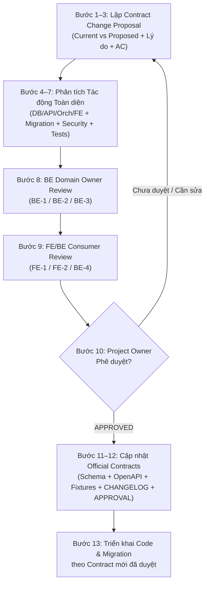

# Giao Thức Thay Đổi Hợp Đồng & Schema (Contract Change Protocol)

| Thuộc tính | Giá trị |
|---|---|
| **Mục đích (Purpose)** | Quy định quy trình 13 bước bắt buộc khi bất kỳ vai trò nào cần đề xuất bổ sung, điều chỉnh hoặc mở rộng bộ hợp đồng tích hợp chính thức |
| **Thẩm quyền (Authority)** | Bảo vệ tính toàn vẹn của Unified F1 Integration Contract **Package `1.0.1 — APPROVED`** và Logical Schema **F1 `v1.1`** |
| **Chủ sở hữu (Owner)** | Project Owner (Phê duyệt cuối cùng) · `BE-4` (Điều phối kỹ thuật) · `BE-1` (Schema Authority) |
| **Base commit kiểm chứng** | `main` @ `7837050` |
| **Cập nhật lần cuối** | 11/11/2026 (`Asia/Ho_Chi_Minh`) |

---

## 1. Baseline Chính thức Đang Có Hiệu lực (Approved Baseline)

Tại thời điểm hiện tại (`main` @ `7837050`), nguồn chuẩn hợp đồng duy nhất đang có hiệu lực thi hành là:

- **Contract Package:** **`1.0.1 — APPROVED / CHÍNH THỨC`** (hiệu lực ngày 05/11/2026, giờ Việt Nam `Asia/Ho_Chi_Minh`).
- **Logical Schema:** **`F1 v1.1`**, `schema_version: "1.1"` ([`docs/database/schema_F1.md`](../database/schema_F1.md)).
- **Bộ Artifact Chính thức trong [`contracts/`](../../contracts/README.md):**
  1. [`contracts/README.md`](../../contracts/README.md) & [`contracts/APPROVAL.md`](../../contracts/APPROVAL.md) & [`contracts/CHANGELOG.md`](../../contracts/CHANGELOG.md)
  2. [`contracts/openapi.yaml`](../../contracts/openapi.yaml) — 8 HTTP endpoints công khai (`info.version: "1.0.1"`).
  3. [`contracts/schemas/f1.schema.json`](../../contracts/schemas/f1.schema.json) — 122 definitions (`$id: "urn:studyflow:f1:1.1:integration:1.0.1"`), 27 nhánh `RpcRequest.oneOf`.
  4. [`contracts/service-contract.json`](../../contracts/service-contract.json) — 10 public domain/LLM operations và 18 internal RPC interfaces.
  5. [`contracts/data-contract.json`](../../contracts/data-contract.json) — Ánh xạ 10 thực thể nghiệp vụ (`app_private.*`) và 5 bảng hạ tầng (`infrastructure_records`).
  6. [`contracts/examples/manifest.json`](../../contracts/examples/manifest.json) — 100 fixtures hợp lệ và không hợp lệ.
  7. [`contracts/check_contract.py`](../../contracts/check_contract.py) & `backend/scripts/generate_contract_schema_migration.py` (sinh tự động `supabase/migrations/202611050012_f1_contract_schema.sql`).

---

## 2. Quy trình 13 Bước Thay Đổi Contract (13-Step Change Workflow)

Khi một yêu cầu sản phẩm mới (như 13 yêu cầu trong [`PRODUCT_REQUIREMENTS_AND_DECISIONS.md`](PRODUCT_REQUIREMENTS_AND_DECISIONS.md)) hoặc một phát hiện kỹ thuật đòi hỏi thay đổi schema/API/RPC, các agent **BẮT BUỘC** thực hiện tuần tự 13 bước sau:

### Chi tiết từng bước:

1. **Tạo Đề xuất Thay đổi Hợp đồng (`Contract Change Proposal`):**
   Sử dụng [`templates/DECISION_RECORD_TEMPLATE.md`](templates/DECISION_RECORD_TEMPLATE.md) và đăng ký mã quyết định trong [`OPEN_DECISIONS.md`](OPEN_DECISIONS.md) với trạng thái `PROPOSED`.
2. **Chỉ rõ Hành vi Hiện tại vs. Hành vi Đề xuất (`Current vs. Proposed Behavior`):**
   Trích dẫn chính xác định nghĩa hiện tại trong `f1.schema.json` / `openapi.yaml` / `schema_F1.md` và biểu diễn JSON/schema cụ thể của phần đề xuất mới.
3. **Nêu rõ Lý do, Nguồn Yêu cầu & Tiêu chí Nghiệm thu (`Rationale, Requirement Source & AC`):**
   Liên kết tới mã yêu cầu trong [`PRODUCT_REQUIREMENTS_AND_DECISIONS.md`](PRODUCT_REQUIREMENTS_AND_DECISIONS.md) và viết các tiêu chí kiểm chứng được.
4. **Phân tích Tác động Liên tầng (`Cross-Layer Impact Analysis`):**
   Liệt kê đầy đủ ảnh hưởng lên:
   - **Database & Migrations (`BE-1`):** Bảng `app_private.*`, cột, kiểu dữ liệu, ràng buộc `CHECK`/FK, `data-contract.json`.
   - **Service/RPC & Scheduler (`BE-1`, `BE-2`):** Chữ ký hàm `app_api.*`, `service-contract.json`, `f1/scheduler/models.py`, `constraints.py`.
   - **AI/NLU & File Ingestion (`BE-3`):** `ExtractionResult`, prompt DeepSeek, bộ dữ liệu 40 câu `nlu_eval_vi.json`, parser matrix.
   - **Orchestrator & HTTP API (`BE-4`):** `openapi.yaml`, `routes.py`, `actions.py`, `chat.py`, `ActionPresentation`.
   - **Frontend (`FE-1`, `FE-2`):** `frontend/src/api/{types,endpoints,mappers}.ts` và các màn hình liên quan.
5. **Đánh giá Tương thích Ngược & Di trú Dữ liệu (`Backward Compatibility & Data Migration`):**
   Xác định xem thay đổi là bổ sung tương thích (`additive`, ví dụ versión `1.0.2` / `1.1.0`) hay thay đổi phá vỡ (`breaking`, ví dụ đổi enum `priority` từ chuỗi sang số thực hoặc đổi `schema_version`), và cách nâng cấp từ chuỗi 21 migrations hiện có mà không sửa lịch sử `001`–`021`.
6. **Đánh giá Tác động Bảo mật, Phân quyền, Idempotency & Concurrency:**
   Kiểm tra tác động lên:
   - `app_private.canonical_json` (lưu ý: `canonical_json` hiện tại trong migration `010` **từ chối số thập phân/float** với SQLSTATE `22023` theo quy tắc "chỉ integer an toàn, cấm float" tại `contracts/README.md` mục 6.2 — điểm này cực kỳ quan trọng nếu đề xuất `priority: 0.1 | 0.5 | 1` đi qua RPC envelope!).
   - Chữ ký HMAC (`verify_rpc_request`), RLS policies, `sf_rpc_owner` grants, fingerprint idempotency và khóa dòng `user_profiles FOR UPDATE`.
7. **Xác định Danh sách Fixtures & Tests cần Cập nhật:**
   Liệt kê các file trong `contracts/examples/valid/`, `contracts/examples/invalid/`, `contracts/examples/manifest.json`, `contracts/check_contract.py` và các bài test unit/acceptance cần bổ sung.
8. **Review của Chủ sở hữu Miền Backend (`BE Domain Owner Review`):**
   `BE-1` (nếu chạm DB/Task/Timezone/Working Time), `BE-2` (nếu chạm Scheduler/Proposal/Approval), `BE-3` (nếu chạm NLU/File Ingestion) thẩm định tính khả thi kỹ thuật.
9. **Review của Consumer Frontend & Điều phối viên (`FE/BE Consumer Review`):**
   `FE-1`, `FE-2` và `BE-4` xác nhận cấu trúc DTO phục vụ đủ cho giao diện mà không cần chế biến dữ liệu trái chuẩn ở client.
10. **Phê duyệt của Project Owner (`Project Owner Approval`):**
    Trình người dùng / Project Owner xác nhận rõ ràng. Trước khi có bước này, trạng thái giữ nguyên là `PROPOSED` / `NEEDS_PRODUCT_OWNER`.
11. **Cập nhật Đồng bộ Bộ Official Contracts (Chỉ thực hiện SAU Bước 10):**
    Cập nhật đồng bộ trong một PR contract riêng (`INT-001`):
    - `docs/database/schema_F1.md` (và đồng bộ bản `/schema_F1.md` ở root nếu giữ cả hai)
    - `contracts/schemas/f1.schema.json`
    - `contracts/openapi.yaml`
    - `contracts/service-contract.json` & `contracts/data-contract.json`
    - `contracts/examples/**` & `contracts/check_contract.py`
12. **Cập nhật Phiên bản, Changelog & Bản ghi Phê duyệt:**
    Ghi rõ phiên bản mới, ngày hiệu lực và căn cứ phê duyệt vào [`contracts/CHANGELOG.md`](../../contracts/CHANGELOG.md), [`contracts/APPROVAL.md`](../../contracts/APPROVAL.md) và [`contracts/VALIDATION.md`](../../contracts/VALIDATION.md); chạy `python -B contracts/check_contract.py` đạt 100%.
13. **Triển khai Code & Migration theo Contract Mới:**
    Sau khi PR contract hoàn tất kiểm tra, các role `BE-1`..`BE-4` và `FE-1`..`FE-2` mới triển khai migration/code theo trình tự tại [`INTEGRATION_PROTOCOL.md`](INTEGRATION_PROTOCOL.md).

---

## 3. Các Hành vi Bị Cấm Tuyệt Đối (Strict Prohibitions)

- **CẤM** thêm field mới vào `contracts/schemas/f1.schema.json` chỉ vì một agent đang viết code cần dùng tạm.
- **CẤM** sửa `contracts/openapi.yaml` mà không cập nhật `f1.schema.json`, `service-contract.json`, `data-contract.json` và `contracts/examples/`.
- **CẤM** sao chép nội dung OpenAPI/JSON Schema sang một file Markdown trong `docs/team-coordination/` rồi chỉnh sửa file đó như một nguồn chuẩn riêng.
- **CẤM** tự ý thêm HTTP endpoint công khai thứ 9+ hoặc domain operation thứ 11+ khi chưa có phê duyệt ở Bước 10.
- **CẤM** ghi nhận một yêu cầu mới của người dùng là `APPROVED CONTRACT` khi chưa hoàn tất Bước 10–12.
- **CẤM** xóa bỏ lịch sử các phiên bản `1.0.0` và `1.0.1` trong `contracts/CHANGELOG.md` hoặc `contracts/APPROVAL.md`.
