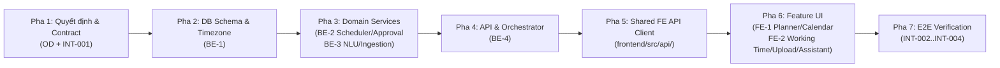

# Giao Thức Tích Hợp & Làm Việc Song Song 6 Agents (Integration Protocol)

| Thuộc tính | Giá trị |
|---|---|
| **Mục đích (Purpose)** | Quy định cách 6 thành viên sử dụng OpenAI Codex và Claude Code làm việc song song trên các nhánh/worktree độc lập, trình tự phụ thuộc, quy trình PR/review/merge, bàn giao và xử lý xung đột |
| **Thẩm quyền (Authority)** | Quy trình vận hành bắt buộc cho mọi phiên làm việc của agent trong dự án `StudyFlow-AI` |
| **Chủ sở hữu (Owner)** | Project Owner & `BE-4` (Integration Coordinator) |
| **Base commit kiểm chứng** | `main` @ `7837050` |
| **Cập nhật lần cuối** | 11/11/2026 (`Asia/Ho_Chi_Minh`) |

---

## 1. Nguyên tắc Contract-First (Hợp đồng đi trước Code)

1. **Frontend không tự đoán cấu trúc payload:**
   - `FE-1` và `FE-2` chỉ sử dụng các kiểu dữ liệu và endpoint đã được định nghĩa trong [`contracts/openapi.yaml`](../../contracts/openapi.yaml), [`contracts/schemas/f1.schema.json`](../../contracts/schemas/f1.schema.json) và đồng bộ tại `frontend/src/api/types.ts`.
   - Khi chờ Backend triển khai một endpoint hoặc trường mới đã được duyệt contract, Frontend được phép dựng khung giao diện (`UI skeleton`) bằng các fixture chính thức trong [`contracts/examples/valid/`](../../contracts/examples/valid/), nhưng **bắt buộc ghi rõ trạng thái `FIXTURE / MOCK_PENDING_BE`** trong PR và không được báo cáo task tích hợp là `DONE`.
2. **Backend không tự ý sửa đổi OpenAPI hoặc JSON Schema đã phê duyệt:**
   - `BE-1`, `BE-2`, `BE-3`, `BE-4` không được tự thêm trường bắt buộc, đổi tên enum hay đổi mã lỗi HTTP khác với Package `1.0.1` khi chưa đi qua [`CONTRACT_CHANGE_PROTOCOL.md`](CONTRACT_CHANGE_PROTOCOL.md).
3. **Không giả lập endpoint thật thành nghiệm thu sản phẩm:**
   - Các adapter giả lập ở chế độ Demo (`plannerAgent.ts`, `assistantService.ts`) hoặc `MockTransport` trong test chỉ phục vụ phát triển/kiểm thử cô lập, không được tính là hoàn thành tích hợp thật (`INT-002` / `INT-003`).

---

## 2. Phát triển Song song & Cách ly Phiên Làm việc (Parallel Development & Session Isolation)

### 2.1. Quy ước đặt tên Branch theo Vai trò

Mỗi thành viên / mỗi phiên agent làm việc trên **một nhánh riêng biệt** gắn với vai trò và mã task trong [`TASK_BOARD.md`](TASK_BOARD.md):

| Vai trò | Mẫu tên nhánh (Branch Naming Pattern) | Ví dụ cụ thể |
|---|---|---|
| **FE-1** | `feat/fe1-<task-id-hoặc-slug>` hoặc `fix/fe1-<slug>` | `feat/fe1-sticky-date-header` |
| **FE-2** | `feat/fe2-<task-id-hoặc-slug>` hoặc `fix/fe2-<slug>` | `feat/fe2-working-time-ui` |
| **BE-1** | `feat/be1-<task-id-hoặc-slug>` hoặc `fix/be1-<slug>` | `feat/be1-task-schema-impact` |
| **BE-2** | `feat/be2-<task-id-hoặc-slug>` hoặc `fix/be2-<slug>` | `feat/be2-approval-revalidation` |
| **BE-3** | `feat/be3-<task-id-hoặc-slug>` hoặc `fix/be3-<slug>` | `feat/be3-file-ingestion-parser` |
| **BE-4** | `feat/be4-<task-id-hoặc-slug>` hoặc `docs/<slug>` | `feat/be4-task-draft-editing` |

### 2.2. Cách ly bằng `git worktree` (Bắt buộc khi chạy nhiều phiên trên cùng máy)

- **Một phiên Codex/Claude = Một Task = Một Worktree riêng:** Không bao giờ mở hai phiên AI coding agent cùng sửa chung một thư mục working tree.
- Cách tạo worktree chuẩn (đặt trong `.tools/worktrees/` vốn đã được `.gitignore` loại trừ):
  ```powershell
  git fetch origin
  git worktree add -b feat/<role>-<slug> .tools/worktrees/<role>-<slug> origin/main
  ```
- Trước khi bắt đầu sửa code, agent phải kiểm tra danh sách `Allowed Files` và `Forbidden Files` trong Task Spec và đối chiếu với [`FILE_OWNERSHIP.md`](FILE_OWNERSHIP.md).
- Nếu phát hiện cần sửa một file nằm ngoài quyền sở hữu của vai trò mình: **Dừng phần đó**, tạo yêu cầu phụ thuộc (`Dependency Request`) theo mẫu bàn giao, và không tự ý sửa lấn vùng.

---

## 3. Quy trình Nhánh, Pull Request, Kiểm duyệt & Hợp nhất (Branch / PR / Review / Merge Workflow)

### 3.1. Tạo nhánh & Làm việc an toàn
- Mọi nhánh tính năng mới phải xuất phát từ `origin/main` mới nhất (hoặc nhánh tích hợp được Project Owner chỉ định bằng văn bản rõ ràng). Không tự ý tạo nhánh mới từ một nhánh tính năng cũ chưa merge.
- **Cấm tuyệt đối:** commit trực tiếp lên `main`, push lên `main`, `git push --force`, `git reset --hard`, `git clean -fd`, hoặc tự ý merge PR.

### 3.2. Kiểm tra bắt buộc trước khi mở PR (Pre-PR Verification Gate)
Trước khi commit và đẩy nhánh lên remote, agent bắt buộc thực hiện:

1. **Kiểm tra trạng thái và phạm vi file:**
   ```powershell
   git status --short --branch
   git diff --stat
   git diff --check
   ```
   Xác nhận mọi file thay đổi đều thuộc `Allowed Files` của vai trò mình và không có lỗi khoảng trắng/conflict markers.
2. **Quét bảo mật (Secret Scan):**
   Xác nhận trong diff không có `.env`, API key, JWT, password hay secret signing key.
3. **Chạy bộ kiểm thử bắt buộc theo tầng thay đổi:**
   - **Nếu chạm vào `contracts/` hoặc migration `012`:**
     ```powershell
     python -B contracts/check_contract.py
     python -B backend/scripts/generate_contract_schema_migration.py --check
     python -B -m unittest discover -s backend/tests/acceptance_api_sol -p test_contract_addendum.py -v
     ```
   - **Nếu chạm vào Backend Python (`backend/app/`):**
     ```powershell
     python -B -m unittest discover -s tests -v
     python -B -m unittest discover -s backend/tests/unit -t . -v
     python -B -m unittest discover -s backend/tests/acceptance_sol -v
     python -B -m unittest discover -s backend/tests/acceptance_api_sol -p test_http_contract.py -v
     ```
   - **Nếu chạm vào Database / Migrations (`supabase/`):**
     ```powershell
     supabase db reset --yes
     supabase test db
     ```
   - **Nếu chạm vào Frontend (`frontend/`):**
     ```powershell
     node --test frontend/src/features/assistant/conversationHistory.test.ts frontend/src/features/assistant/apiAssistant.test.ts frontend/src/features/planner/plannerAgent.test.ts frontend/src/features/planner/proposal.test.ts frontend/src/api/client.test.ts frontend/src/api/mappers.test.ts
     npm --prefix frontend run format
     npm --prefix frontend run build
     npx --prefix frontend tsc --noEmit
     ```

### 3.3. Quy trình Mở PR & Phê duyệt (Review Matrix)
- Mọi PR mở về `main` phải điền đầy đủ [`templates/PR_TEMPLATE.md`](templates/PR_TEMPLATE.md) và để ở chế độ **Draft** (hoặc ghi rõ `DO NOT MERGE — AWAITING REVIEW`) cho đến khi đủ chữ ký duyệt:
  1. **Domain Owner Review:** Chủ sở hữu chính của module theo [`FILE_OWNERSHIP.md`](FILE_OWNERSHIP.md) kiểm tra logic và kiểm thử.
  2. **Co-Reviewer / Consumer Review:** Các vai trò bị ảnh hưởng (ví dụ `FE-1`/`FE-2` khi đổi API; `BE-1` khi có migration; `BE-4` khi chạm luồng điều phối/shared API) kiểm tra tính tương thích.
  3. **Project Owner Merge Decision:** Chỉ Project Owner (hoặc người được Project Owner ủy quyền rõ) mới thực hiện merge PR sau khi CI xanh và đủ review.

---

## 4. Trình tự Phụ thuộc & Thứ tự Hợp nhất (Dependency & Merge Sequencing)

Để không làm gãy nhánh chính khi 6 agent phát triển song song, việc hợp nhất các thay đổi liên miền phải tuân theo thứ tự **7 pha tuần tự**:



1. **Pha 1 — Chốt Quyết định & Contract Addendum (`INT-001`):** Mọi thay đổi về field/enum/endpoint phải được duyệt và cập nhật trong `contracts/` trước tiên.
2. **Pha 2 — Database Schema, Timezone & Working Time Persistence (`BE-1`):** Công bố migration, kiểu dữ liệu, quy tắc múi giờ và đồng bộ `012_f1_contract_schema.sql`.
3. **Pha 3 — Domain Services (`BE-2` & `BE-3` song song):**
   - `BE-2` cập nhật Scheduler / Proposal / Approval revalidation theo schema của `BE-1`.
   - `BE-3` cập nhật DeepSeek adapter / File Ingestion parser & audio rejection.
4. **Pha 4 — Orchestrator & HTTP API (`BE-4`):** Hợp nhất luồng điều phối `chat.py`, `actions.py`, `routes.py` để nối các dịch vụ của `BE-1`, `BE-2`, `BE-3` ra HTTP contract.
5. **Pha 5 — Shared Frontend API Layer (`frontend/src/api/`):** Cập nhật `types.ts`, `endpoints.ts`, `mappers.ts` theo đúng commit contract/BE đã merge.
6. **Pha 6 — Frontend Feature UI (`FE-1` & `FE-2` song song):**
   - Trong lúc chờ Pha 2–4 hoàn tất, `FE-1` và `FE-2` có thể phát triển các phần UI độc lập (như `FE1-003` Sticky Date Header) hoặc dựng UI bằng approved fixtures, nhưng chỉ mở PR tích hợp chính thức sau Pha 5.
7. **Pha 7 — Luồng Kiểm chứng Tích hợp Cuối cùng (`End-to-End Flow`):**
   Kiểm tra xuyên suốt chuỗi nghiệp vụ bất biến:
   ```text
   Task Input / File Upload
     → Extraction Review & Correction (FE-2 + BE-3)
     → Task Draft / TaskCandidate (BE-4 + BE-1)
     → Explicit Task Confirmation → AcademicTask + Working Time (BE-1)
     → Deterministic Scheduler → PlanProposal Preview + Warnings + Unscheduled Duration (BE-2 + FE-1)
     → Explicit Plan Approval → DB Revalidation & Atomic Commit → StudyPlan + StudyBlocks (BE-2 + BE-1)
     → Reload & Read Verification trên Calendar / Assistant (FE-1 + FE-2)
   ```

---

## 5. Giao thức Bàn giao Công việc (Handoff Protocol)

Mỗi khi kết thúc một phiên làm việc của Codex/Claude hoặc khi chuyển giao kết quả cho vai trò phụ thuộc, agent bắt buộc tạo bản ghi bàn giao theo [`templates/WORK_HANDOFF_TEMPLATE.md`](templates/WORK_HANDOFF_TEMPLATE.md) gồm đủ **10 thông tin**:

1. **Định danh:** `Task ID`, `Owner Role`, tên nhánh (`Branch`) và đường dẫn PR (nếu đã tạo).
2. **Mốc Git:** `Base Commit SHA` và `Head Commit SHA`.
3. **Danh sách file thay đổi (`Files Changed`):** Phân loại rõ file tạo mới, file sửa và xác nhận đúng ownership.
4. **Phiên bản Contract/Schema áp dụng:** Ví dụ `Contract Package 1.0.1 / Logical Schema F1 v1.1`.
5. **Thay đổi API Request/Response (nếu có):** Nêu rõ endpoint, trường dữ liệu, mã lỗi.
6. **Chi tiết Migration (nếu có):** Tên file migration, bảng/RPC bị ảnh hưởng, kết quả kiểm tra replay & upgrade route.
7. **Lệnh chạy Test & Kết quả thực tế:** Ghi chính xác câu lệnh và số lượng `passed / failed / skipped / not_run` (phân biệt rõ Mock vs. Local DB vs. Live Provider).
8. **Bằng chứng đã làm sạch (`Sanitized Evidence`):** Log hoặc mô tả kết quả đã loại bỏ hoàn toàn token/key/thông tin nhạy cảm.
9. **Giới hạn đã biết & Blockers (`Known Limitations / Blockers`):** Nêu trung thực những gì chưa làm hoặc chưa chạy được.
10. **Các vai trò bị ảnh hưởng tiếp theo (`Downstream Impacted Roles`):** Chỉ rõ role nào (`FE-1`, `FE-2`, `BE-1`..`BE-4`) cần đọc bàn giao này để làm bước tiếp theo.

---

## 6. Cơ chế Leo thang & Phân xử Xung đột (Conflict Escalation)

Khi hai agent hoặc hai tài liệu có xung đột, **cấm tự ý chọn một phía để ghi đè phía kia**. Áp dụng bảng phân quyền phân xử sau:

| Loại xung đột | Người điều phối / Chủ trì kỹ thuật | Các bên tham gia Review | Quyền chốt cuối cùng | Nơi ghi nhận bắt buộc |
|---|---|---|---|---|
| **Xung đột quyền sở hữu file (`File Ownership Conflict`)** | `BE-4` | Hai vai trò liên quan | `BE-4` + Project Owner | [`FILE_OWNERSHIP.md`](FILE_OWNERSHIP.md) / [`templates/CONFLICT_REPORT_TEMPLATE.md`](templates/CONFLICT_REPORT_TEMPLATE.md) |
| **Xung đột Schema / Database / Timezone / Working Time** | `BE-1` | `BE-2`, `BE-4`, `FE-1`, `FE-2` | Project Owner (nếu đổi contract) | [`OPEN_DECISIONS.md`](OPEN_DECISIONS.md) / Decision Record |
| **Xung đột Thuật toán Lập lịch / Proposal / Approval Transaction** | `BE-2` | `BE-1`, `BE-4`, `FE-1` | Project Owner (nếu đổi hành vi sản phẩm) | [`OPEN_DECISIONS.md`](OPEN_DECISIONS.md) / Decision Record |
| **Xung đột AI Prompt / DeepSeek / File Ingestion Pipeline** | `BE-3` | `BE-4`, `FE-2` | Project Owner (nếu đổi phạm vi tệp hỗ trợ) | [`OPEN_DECISIONS.md`](OPEN_DECISIONS.md) / Decision Record |
| **Xung đột API Transport / Orchestration / Idempotency** | `BE-4` | `BE-1`, `BE-2`, `BE-3`, `FE-1`, `FE-2` | Project Owner | [`CONTRACT_CHANGE_PROTOCOL.md`](CONTRACT_CHANGE_PROTOCOL.md) |
| **Xung đột Hành vi Giao diện / UX (`UI Behavior Conflict`)** | `FE-1` (Planner) / `FE-2` (Assistant & Settings) | `BE-4` + FE còn lại | **Project Owner** | [`PRODUCT_REQUIREMENTS_AND_DECISIONS.md`](PRODUCT_REQUIREMENTS_AND_DECISIONS.md) |
| **Xung đột Phạm vi Sản phẩm / Độ ưu tiên (`Scope / Priority`)** | Project Owner | Toàn nhóm | **Project Owner** | [`OPEN_DECISIONS.md`](OPEN_DECISIONS.md) (`NEEDS_PRODUCT_OWNER`) |
