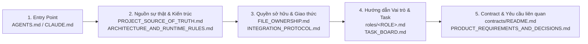

# Bộ Tài liệu Điều phối Đa Agent (Multi-Agent Coordination Kit) — StudyFlow-AI

| Thuộc tính | Giá trị |
|---|---|
| **Mục đích (Purpose)** | Điểm vào trung tâm (Central Hub) điều phối 6 thành viên sử dụng AI coding agents (OpenAI Codex & Claude Code) làm việc song song trên dự án `StudyFlow-AI` |
| **Thẩm quyền (Authority)** | Quy chuẩn vận hành, phân quyền sở hữu file, quy trình tích hợp và quản trị thay đổi contract cấp nhóm; dẫn chiếu tới contract chính thức `1.0.1` và logical schema `F1 v1.1` |
| **Chủ sở hữu (Owner)** | Project Owner & Repository Governance (`BE-4` điều phối tích hợp) |
| **Base commit kiểm chứng** | `main` @ `7837050` (`Merge pull request #21 from chp0703/feat/f1-frontend-integration`) |
| **Cập nhật lần cuối** | 11/11/2026 (`Asia/Ho_Chi_Minh`) |

---

## 1. Giới thiệu & Sứ mệnh

Bộ tài liệu `docs/team-coordination/` được thiết kế để 6 thành viên trong nhóm (`FE-1`, `FE-2`, `BE-1`, `BE-2`, `BE-3`, `BE-4`), dù sử dụng **OpenAI Codex** hay **Claude Code** trong các phiên làm việc độc lập, đều tuân thủ:

1. **Một nguồn sự thật duy nhất** về yêu cầu sản phẩm và phân biệt rõ phần đã duyệt (`APPROVED`) với phần đang đề xuất (`PROPOSED` / `NOT YET APPLIED`).
2. **Một bộ hợp đồng tích hợp chính thức** ([Unified F1 Integration Contract package 1.0.1](../../contracts/README.md) và [Logical Schema F1 v1.1](../database/schema_F1.md)).
3. **Một bản đồ kiến trúc và đường chạy thực tế (runtime map)** đã đối chiếu với `main` @ `7837050`.
4. **Ranh giới quyền sở hữu file/module (File Ownership)** rõ ràng, không sửa chồng lấn.
5. **Đồ thị phụ thuộc công việc (DAG) và quy trình bàn giao có bằng chứng kiểm thử thực tế**.

> **Lưu ý quan trọng:** Bộ tài liệu này **không thay thế** và **không tạo bản sao** của `contracts/openapi.yaml`, `contracts/schemas/f1.schema.json`, `contracts/service-contract.json`, `contracts/data-contract.json` hay `docs/database/schema_F1.md`. Khi cần tra cứu kiểu dữ liệu, tên trường hay chữ ký RPC, agent bắt buộc đọc trực tiếp các file nguồn chuẩn đó.

---

## 2. Thứ tự đọc bắt buộc cho mỗi phiên Agent (Reading Order)

Mọi phiên làm việc của Codex hoặc Claude Code phải đọc tài liệu theo đúng trình tự 5 bước sau trước khi viết hoặc sửa code:



### Danh mục tài liệu trong `docs/team-coordination/`

| STT | Tài liệu | Mục đích chính | Ai phải đọc |
|---|---|---|---|
| 0 | [`../../AGENTS.md`](../../AGENTS.md) / [`../../CLAUDE.md`](../../CLAUDE.md) | Quy tắc toàn cục bắt buộc cho Codex và Claude Code | Mọi agent |
| 1 | [`PROJECT_SOURCE_OF_TRUTH.md`](PROJECT_SOURCE_OF_TRUTH.md) | Thứ tự ưu tiên nguồn sự thật, bất biến nghiệp vụ F1, phân xử mâu thuẫn tài liệu cũ/mới, phần "What this repo is NOT" | Mọi agent |
| 2 | [`ARCHITECTURE_AND_RUNTIME_RULES.md`](ARCHITECTURE_AND_RUNTIME_RULES.md) | Bản đồ runtime thực tế tại `7837050`, ranh giới tầng (FE, API, Orchestrator, Scheduler, NLU, RPC/DB) và các kết nối bị cấm | Mọi agent |
| 3 | [`FILE_OWNERSHIP.md`](FILE_OWNERSHIP.md) | Ma trận quyền sở hữu file/module cho 6 vai trò, file dùng chung (`Shared`), quy tắc migration và co-review | Mọi agent |
| 4 | [`TASK_BOARD.md`](TASK_BOARD.md) | Danh mục work packages / tasks (`COORD`, `BE1`..`BE4`, `FE1`..`FE2`, `INT`), trạng thái kiểm chứng và phụ thuộc DAG | Mọi agent |
| 5 | [`INTEGRATION_PROTOCOL.md`](INTEGRATION_PROTOCOL.md) | Quy tắc làm việc song song, đặt tên branch, dùng `git worktree`, trình tự tích hợp, PR/review và leo thang xung đột | Mọi agent |
| 6 | [`CONTRACT_CHANGE_PROTOCOL.md`](CONTRACT_CHANGE_PROTOCOL.md) | Quy trình 13 bước bắt buộc khi cần đề xuất thay đổi contract `1.0.1` hoặc logical schema `F1 v1.1` | Mọi agent chạm vào API/Schema |
| 7 | [`PRODUCT_REQUIREMENTS_AND_DECISIONS.md`](PRODUCT_REQUIREMENTS_AND_DECISIONS.md) | Ma trận 13 yêu cầu F1 mới từ người dùng, đánh giá tác động contract (`NOT YET APPLIED`) và yêu cầu ADR/test | Mọi agent |
| 8 | [`OPEN_DECISIONS.md`](OPEN_DECISIONS.md) | Danh sách các câu hỏi kiến trúc/sản phẩm đang chờ Project Owner hoặc nhóm chốt (`NEEDS_PRODUCT_OWNER` / `OPEN`) | Mọi agent |

---

## 3. Hướng dẫn theo Vai trò (6 AI Coding Roles)

Mỗi phiên làm việc của agent chỉ được đảm nhận **đúng một vai trò** được người dùng chỉ định:

| Mã vai trò | Nhóm | Công cụ hỗ trợ | Phạm vi cốt lõi | Tài liệu hướng dẫn |
|---|---|---|---|---|
| **FE-1** | Frontend | Claude Code / Codex | Task form & detail, tách hiển thị Title/Course, Planner/Calendar view, Sticky Date Header, Proposal/Confirmation Preview, hiển thị PARTIAL/unscheduled, nút Approve/Reject | [`roles/FE-1.md`](roles/FE-1.md) |
| **FE-2** | Frontend | Claude Code / Codex | Personalized Working Time UI (thay Free Time trên UI khi được duyệt), Upload UI (image/calendar/document), chặn audio ở client, Extraction Review/Correction UI, Assistant & Task Draft UI | [`roles/FE-2.md`](roles/FE-2.md) |
| **BE-1** | Backend | Codex | Database/Task schema & migrations, ngữ nghĩa và chuyển đổi Timezone (`Asia/Ho_Chi_Minh`), lưu trữ & kiểm tra Personalized Working Time / `TimeWindow`, bảo toàn khái niệm `BUSY`/conflict cho Scheduler | [`roles/BE-1.md`](roles/BE-1.md) |
| **BE-2** | Backend | Codex | Tích hợp Scheduler (`f1/planning`, `f1/scheduler`), ngữ nghĩa `FULL`/`PARTIAL`/`NONE`/`NO_CHANGE`, thời lượng/lý do chưa xếp (`unscheduled`), kiểm tra lại khi duyệt (`approval-time validation`), transaction/locking/concurrency RPC | [`roles/BE-2.md`](roles/BE-2.md) |
| **BE-3** | Backend | Codex | DeepSeek server-side adapter & benchmark 40 câu tiếng Việt, pipeline đọc/trích xuất tệp (image/calendar/document), từ chối audio server-side, bảo mật lưu trữ tệp, chống prompt injection, biểu diễn trung gian candidate cho FE-2 review | [`roles/BE-3.md`](roles/BE-3.md) |
| **BE-4** | Backend | Codex | Điều phối Chat & chỉnh sửa Task Draft, quản lý `PendingAction` / recovery / cancel / resume / idempotency (`orchestrator/`), điều phối API liên miền (`api/v1/`), duy trì ma trận tương thích contract FE↔BE | [`roles/BE-4.md`](roles/BE-4.md) |

---

## 4. Bộ Biểu mẫu Chuẩn (Templates)

Khi giao việc, mở PR, đề xuất quyết định hoặc bàn giao giữa các phiên agent, sử dụng các biểu mẫu tại `docs/team-coordination/templates/`:

- [`templates/TASK_SPEC_TEMPLATE.md`](templates/TASK_SPEC_TEMPLATE.md) — Đặc tả một task cụ thể giao cho agent (ID, role, dependencies, allowed/forbidden paths, AC, tests).
- [`templates/PR_TEMPLATE.md`](templates/PR_TEMPLATE.md) — Mẫu mô tả Pull Request kèm checklist an toàn Git, bảo mật secret, tác động contract/migration và bằng chứng test.
- [`templates/DECISION_RECORD_TEMPLATE.md`](templates/DECISION_RECORD_TEMPLATE.md) — Mẫu ghi nhận quyết định kiến trúc/sản phẩm (ADR / Decision Record).
- [`templates/WORK_HANDOFF_TEMPLATE.md`](templates/WORK_HANDOFF_TEMPLATE.md) — Mẫu bàn giao kết quả giữa các phiên làm việc hoặc giữa các role phụ thuộc nhau.
- [`templates/CONFLICT_REPORT_TEMPLATE.md`](templates/CONFLICT_REPORT_TEMPLATE.md) — Mẫu báo cáo xung đột contract, yêu cầu sản phẩm hoặc quyền sở hữu file khi agent cần dừng và báo `BLOCKED`.

---

## 5. Cách khởi chạy một phiên làm việc an toàn (Quick Start cho Thành viên)

1. **Cập nhật remote và kiểm tra nhánh:**
   ```powershell
   git fetch origin
   git status --short --branch
   ```
2. **Tạo branch/worktree riêng cho task từ `origin/main` (không làm trên `main`):**
   ```powershell
   git worktree add -b feat/<role>-<task-slug> .tools/worktrees/<role>-<task-slug> origin/main
   ```
3. **Giao prompt cho Codex hoặc Claude Code:**
   - Yêu cầu agent đọc [`AGENTS.md`](../../AGENTS.md) (hoặc [`CLAUDE.md`](../../CLAUDE.md)), `docs/team-coordination/roles/<ROLE>.md` và mã task tương ứng trong [`TASK_BOARD.md`](TASK_BOARD.md).
   - Yêu cầu agent kiểm tra phạm vi file trong [`FILE_OWNERSHIP.md`](FILE_OWNERSHIP.md) trước khi sửa và xuất báo cáo bàn giao theo [`templates/WORK_HANDOFF_TEMPLATE.md`](templates/WORK_HANDOFF_TEMPLATE.md) khi hoàn tất.
