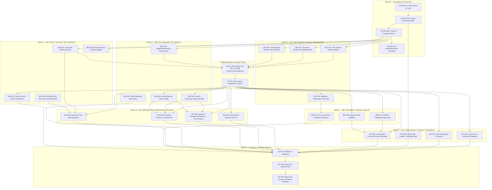

# Bảng Điều Phối Công Việc & Đồ Thị Phụ Thuộc (Task Board)

| Thuộc tính | Giá trị |
|---|---|
| **Mục đích (Purpose)** | Danh mục trung tâm quản lý các Work Packages / Tasks của 6 vai trò (`FE-1`, `FE-2`, `BE-1`, `BE-2`, `BE-3`, `BE-4`), trạng thái dựa trên bằng chứng thực tế, phụ thuộc DAG và tiêu chí nghiệm thu |
| **Thẩm quyền (Authority)** | Nguồn theo dõi tiến độ thực thi; không một task nào được chuyển sang `DONE` nếu thiếu bằng chứng test và PR/commit đã kiểm chứng |
| **Chủ sở hữu (Owner)** | Project Owner & `BE-4` (Coordinator) — các role cập nhật phần task của mình khi bàn giao |
| **Base commit kiểm chứng** | `main` @ `7837050` (`Merge pull request #21 from chp0703/feat/f1-frontend-integration`) |
| **Cập nhật lần cuối** | 11/11/2026 (`Asia/Ho_Chi_Minh`) |

---

## 1. Quy ước Trạng thái (Status Definitions)

Để tránh báo cáo hoàn thành ảo, mọi task trên bảng này chỉ được gắn một trong 6 trạng thái chuẩn sau:

| Trạng thái | Ý nghĩa & Điều kiện áp dụng |
|---|---|
| **`DONE`** | Đã hoàn tất code/tài liệu trên nhánh quy định, pass toàn bộ kiểm thử bắt buộc (kèm số lượng pass/fail thực tế), không còn phần phụ thuộc mở và có commit/PR chứng minh. **Không gắn `DONE` cho task implementation chỉ vì đã có thiết kế hoặc chỉ mới pass mock/baseline cũ khi yêu cầu mới chưa làm.** |
| **`IN_PROGRESS`** | Đã có nền tảng implementation/PR cho contract `1.0.1` / schema `v1.1` trên `main` (`7837050`), hoặc đang được thực hiện trong nhánh hiện tại nhưng chưa hoàn tất toàn bộ tiêu chí nghiệm thu hoặc yêu cầu mới. |
| **`NEEDS_DECISION`** | Task phụ thuộc trực tiếp vào quyết định sản phẩm của Project Owner hoặc phê duyệt Contract Addendum (`OD-001`..`OD-008` tại [`OPEN_DECISIONS.md`](OPEN_DECISIONS.md)) trước khi được phép sửa schema/contract/code. |
| **`BLOCKED`** | Chưa thể thực hiện hoặc chưa thể hoàn tất nghiệm thu do đang chờ task tiền đề của role khác hoặc thiếu môi trường/khóa dịch vụ thật (ví dụ: `DEEPSEEK_API_KEY` thật, cloud Supabase). |
| **`NOT_STARTED`** | Đã rõ phạm vi hoặc chỉ chờ bắt đầu theo thứ tự ưu tiên, chưa có code/PR cho phần việc này. |
| **`DEFERRED`** | Đã được quyết định hoãn sang giai đoạn sau (ví dụ F2/F3 hoặc tính năng ngoài phạm vi F1 hiện hành). |

---

## 2. Đồ thị Phụ thuộc Tổng thể (Acyclic Dependency DAG)

Đồ thị dưới đây là **DAG (Directed Acyclic Graph)** — tuyệt đối không có chu trình phụ thuộc vòng:

---

## 3. Danh mục Công việc Chi tiết (Task Registry)

### Nhóm A — Foundation & Governance (`COORD`)

| Task ID | Tên công việc | Owner | Dependencies | Contract Dependency | Trạng thái | Bằng chứng & PR/Commit trên `main` (`7837050`) | Tiêu chí nghiệm thu (Acceptance Criteria) |
|---|---|---|---|---|---|---|---|
| **COORD-001** | Audit nguồn sự thật & phân xử mâu thuẫn tài liệu | `BE-4` | Không | Package `1.0.1` / Schema `v1.1` | **`IN_PROGRESS`** *(hoàn tất trên nhánh `docs/multi-agent-coordination-kit`, chờ PR review)* | Đối chiếu `main` @ `7837050`, PR [#20](https://github.com/chp0703/StudyFlow-AI/pull/20)–[#29](https://github.com/chp0703/StudyFlow-AI/pull/29); tạo [`PROJECT_SOURCE_OF_TRUTH.md`](PROJECT_SOURCE_OF_TRUTH.md) và [`ARCHITECTURE_AND_RUNTIME_RULES.md`](ARCHITECTURE_AND_RUNTIME_RULES.md) | <ul><li>[x] Xác định thứ tự ưu tiên 9 cấp nguồn sự thật</li><li>[x] Ghi nhận bảng 8 mâu thuẫn tài liệu (`CF-01`..`CF-08`)</li><li>[x] Phân biệt rõ `APPROVED` (`1.0.1`) vs `NOT YET APPLIED` (13 yêu cầu mới)</li></ul> |
| **COORD-002** | Đóng băng ma trận quyền sở hữu file (File Ownership Matrix) | `BE-4` | `COORD-001` | Không | **`IN_PROGRESS`** *(chờ PR review)* | Kiểm chứng 100% đường dẫn trên `main` @ `7837050`; tạo [`FILE_OWNERSHIP.md`](FILE_OWNERSHIP.md) và 6 file [`roles/*.md`](roles/FE-1.md) | <ul><li>[x] Mọi đường dẫn thực tế có đúng 1 Primary Owner</li><li>[x] Shared files và migrations có quy tắc Co-Review rõ ràng</li><li>[x] Đường dẫn chưa tồn tại được gắn nhãn `[PLANNED]`</li></ul> |
| **COORD-003** | Thiết lập giao thức thay đổi API/Data Contract | `BE-4` | `COORD-002` | Package `1.0.1` / Schema `v1.1` | **`IN_PROGRESS`** *(chờ PR review)* | Tạo [`CONTRACT_CHANGE_PROTOCOL.md`](CONTRACT_CHANGE_PROTOCOL.md), [`PRODUCT_REQUIREMENTS_AND_DECISIONS.md`](PRODUCT_REQUIREMENTS_AND_DECISIONS.md), [`OPEN_DECISIONS.md`](OPEN_DECISIONS.md) | <ul><li>[x] Quy trình 13 bước từ Proposal → Consumer Review → Project Owner Approval → Implementation</li><li>[x] Cấm sửa ngầm `contracts/` bằng prompt đơn lẻ</li></ul> |
| **COORD-004** | Thiết lập bộ biểu mẫu Task Spec, PR, Decision & Handoff | `BE-4` | `COORD-003` | Không | **`IN_PROGRESS`** *(chờ PR review)* | Tạo 5 templates tại `docs/team-coordination/templates/` và entry points [`AGENTS.md`](../../AGENTS.md), [`CLAUDE.md`](../../CLAUDE.md) | <ul><li>[x] Có đủ `TASK_SPEC_TEMPLATE.md`, `PR_TEMPLATE.md`, `DECISION_RECORD_TEMPLATE.md`, `WORK_HANDOFF_TEMPLATE.md`, `CONFLICT_REPORT_TEMPLATE.md`</li><li>[x] `CLAUDE.md` được Git track qua `!/CLAUDE.md` mà không lộ `.claude/`</li></ul> |

---

### Nhóm B — `BE-1` (Database / Task Schema / Timezone / Working Time)

| Task ID | Tên công việc | Owner | Dependencies | Contract Dependency | Trạng thái | Bằng chứng & Hiện trạng trên `main` (`7837050`) | Tiêu chí nghiệm thu (Acceptance Criteria) |
|---|---|---|---|---|---|---|---|
| **BE1-001** | Phân tích tác động & cập nhật Task Schema cho các trường F1 mới (`title`/`course_label`, `duration`, `priority` `0.1\|0.5\|1`, `color`, `description`, `start time`) | `BE-1` | `COORD-003` | **Cần Addendum** (`OD-001`, `OD-002`) trên `f1.schema.json` & `data-contract.json` | **`NEEDS_DECISION`** | Baseline `v1.1` đã có trong `supabase/migrations/202611050001_*.sql`, `012`, `014`, `015` (`priority: LOW\|NORMAL\|HIGH`, `estimated_minutes`, `course_label`, `description`, `available_from_at`). Các trường `priority` số (`0.1, 0.5, 1`), `color` và ngữ nghĩa `start time` **chưa có** trong contract `1.0.1`. | <ul><li>[ ] Lập bảng ánh xạ từng trường mới sang `TaskCandidate` và `AcademicTask`</li><li>[ ] Trình Project Owner chốt `OD-001` (priority/color/duration) và `OD-002` (`start time` semantics)</li><li>[ ] Cập nhật migration mới và `generate_contract_schema_migration.py` sau khi contract addendum được duyệt</li></ul> |
| **BE1-002** | Phân tích & đảm bảo ngữ nghĩa Timezone (`Asia/Ho_Chi_Minh`) xuyên suốt DB/Domain | `BE-1` | `COORD-003` | Package `1.0.1` (`OD-005` nếu khóa cứng timezone) | **`IN_PROGRESS`** | Đã có `backend/app/f1/scheduler/normalization.py`, `intervals.py` (33/33 acceptance tests trong `test_normalization_contract.py` pass) và bootstrap mặc định `Asia/Ho_Chi_Minh` ở migration `013`. Cần rà soát lại nếu yêu cầu mới khóa cứng hay chuẩn hóa hiển thị `Asia/Ho_Chi_Minh`. | <ul><li>[ ] Xác minh mọi phép chuyển đổi `DATE` deadline cutoff (`00:00` ngày kế tiếp), `WEEKLY` `24:00` và DST hoạt động đúng với `Asia/Ho_Chi_Minh`</li><li>[ ] Bổ sung test hồi quy nếu có thay đổi quy tắc timezone tại `OD-005`</li></ul> |
| **BE1-003** | Rà soát dữ liệu & API cho Personalized Working Time (thay thế Free Time trên UI) | `BE-1` | `COORD-003` | **Cần chốt `OD-003`** (giữ `TimeWindow.kind=AVAILABILITY` ở DB hay thêm khái niệm mới) | **`NEEDS_DECISION`** | Hiện DB/RPC (`016_f1_wp2b4_windows_preferences.sql`, `021_f1_wp2c4_window_warnings.sql`) đang dùng `TimeWindow` (`kind: AVAILABILITY \| BUSY`) và `SchedulingPolicy`. Chưa chốt xem Personalized Working Time chỉ là đổi tên tầng UI hay thay đổi cấu trúc lưu trữ. | <ul><li>[ ] Phối hợp `BE-2`, `BE-4`, `FE-2` phân tích phương án ánh xạ Personalized Working Time vào `TimeWindow` (`AVAILABILITY` + giữ `BUSY` nội bộ cho Scheduler)</li><li>[ ] Đảm bảo không làm mất khả năng biểu diễn khoảng bận/xung đột của `BE-2`</li></ul> |
| **BE1-004** | Quản lý chuỗi Migration mới & Kế hoạch kiểm thử nâng cấp DB | `BE-1` | `BE1-001`, `BE1-002`, `BE1-003`, `INT-001` | Phụ thuộc Contract Addendum được duyệt | **`BLOCKED`** *(chờ `INT-001`)* | Hiện có 21 migrations (`001`–`021`) và 14 file pgTAP (`03`–`16`) đã merge trong PR [#20](https://github.com/chp0703/StudyFlow-AI/pull/20) (`1276e8f`). | <ul><li>[ ] Không sửa các file migration `001`–`021` đã merge</li><li>[ ] Mọi migration mới (`022+`) pass `supabase db reset --yes`, `supabase test db` và kiểm tra upgrade route trong `.github/workflows/database-tests.yml`</li></ul> |

---

### Nhóm C — `BE-2` (Scheduler / Proposal / Approval)

| Task ID | Tên công việc | Owner | Dependencies | Contract Dependency | Trạng thái | Bằng chứng & Hiện trạng trên `main` (`7837050`) | Tiêu chí nghiệm thu (Acceptance Criteria) |
|---|---|---|---|---|---|---|---|
| **BE2-001** | Đảm bảo luồng kết quả `PARTIAL` / `unscheduled duration` & lý do không xếp được lịch | `BE-2` | `COORD-002` | Package `1.0.1` (`PlanProposal`, `SchedulingResult`) + `INT-001` (nếu đổi trọng số priority) | **`IN_PROGRESS`** | Engine thuần (`backend/app/f1/scheduler/engine.py`, `service.py`) và adapter `f1/planning/generate.py` đã hỗ trợ `FULL`/`PARTIAL`/`NONE`/`NO_CHANGE`, `unallocated` và warnings (33 acceptance tests + 24 unit tests pass). Cần đối chiếu với yêu cầu hiển thị confirmation mới của `FE-1` và trọng số priority mới (`0.1, 0.5, 1`) nếu `OD-001` được duyệt. | <ul><li>[ ] Đảm bảo `PlanProposal` trả đầy đủ danh sách task/số phút chưa xếp (`unallocated_minutes` / `unscheduled`) và mã cảnh báo rõ ràng cho `FE-1`</li><li>[ ] Giữ bất biến `remaining = retained_future + newly_scheduled + unallocated` (ca `PLAN-04`, `API-07`)</li></ul> |
| **BE2-002** | Hoàn thiện kiểm tra lại tại thời điểm duyệt (`Approval-Time Validation`) | `BE-2` | `COORD-002`, `BE1-002` | Package `1.0.1` (`approve_study_plan`) | **`IN_PROGRESS`** | Migration `020_f1_wp2c3_approve_reject_plan.sql` đã kiểm tra owner lock, revision, base plan, task status, deadline và độ dài block. Tuy nhiên theo [`WP2C_NOTES.md`](../implementation/WP2C_NOTES.md) (mục 2c-3 & 2c-4), bước duyệt **chưa kiểm tra lại toàn diện việc block nằm ngoài `AVAILABILITY` / rơi vào `BUSY` hoặc block mới bắt đầu trong quá khứ** theo đồng hồ kiểm soát được. | <ul><li>[ ] Bổ sung đầy đủ kiểm tra `approval-time revalidation` theo `contracts/README.md` mục 7 (ca `PLAN-06`, `DB-06`)</li><li>[ ] Đảm bảo trạng thái `STALE` được lưu bền vững và phát lại đúng khi retry cùng `Idempotency-Key`</li></ul> |
| **BE2-003** | Bằng chứng kiểm thử Concurrency & Rollback trên PostgreSQL thật | `BE-2` | `BE2-002`, `BE1-004` | Package `1.0.1` | **`IN_PROGRESS`** | Đã có `supabase/tests_concurrency/test_transactions.py` (6 kịch bản) và pgTAP `14`–`16` được tích hợp trong `.github/workflows/database-tests.yml` (ghi nhận pass 6/6 trên Postgres local tại [`WP2C_NOTES.md`](../implementation/WP2C_NOTES.md)). Cần tái chạy và ghi nhận bằng chứng cho mọi thay đổi mới ở `BE2-002` / `BE1-004` và đóng các ca `DB-01`..`DB-16` trong `contracts/acceptance-cases.md`. | <ul><li>[ ] Chạy pass 100% `supabase/tests_concurrency` và pgTAP `14`–`16` trên PostgreSQL thật sau khi hoàn tất `BE2-002`</li><li>[ ] Cập nhật kết quả và SHA bằng chứng cho các ca `DB-04`..`DB-10`, `PLAN-01`..`PLAN-07`</li></ul> |

---

### Nhóm D — `BE-3` (AI / DeepSeek / File Ingestion)

| Task ID | Tên công việc | Owner | Dependencies | Contract Dependency | Trạng thái | Bằng chứng & Hiện trạng trên `main` (`7837050`) | Tiêu chí nghiệm thu (Acceptance Criteria) |
|---|---|---|---|---|---|---|---|
| **BE3-001** | Chuẩn bị & chạy Benchmark DeepSeek thật trên bộ 40 câu tiếng Việt | `BE-3` | `COORD-002` | Package `1.0.1` (`ExtractionResult`) | **`BLOCKED`** *(thiếu `DEEPSEEK_API_KEY` thật trong môi trường kiểm thử)* | Đã có `backend/app/nlu/extractor.py`, `evaluation.py`, `backend/scripts/evaluate_nlu.py` và `backend/tests/fixtures/nlu_eval_vi.json` (40 câu). Theo [`WP4_NOTES.md`](../implementation/WP4_NOTES.md), unit test của bộ chấm đã pass nhưng **chưa chạy với DeepSeek API thật (`NOT_RUN`)**. | <ul><li>[ ] Khi có `DEEPSEEK_API_KEY` ở môi trường server, chạy `python -B backend/scripts/evaluate_nlu.py` đạt `>= 38/40` (`>= 95%`)</li><li>[ ] Đảm bảo 0 trường hợp tin nhắn mơ hồ hoặc giả mạo phê duyệt tự tạo lệnh ghi trái phép (`ORCH-01`, `ORCH-05`)</li></ul> |
| **BE3-002** | Thiết kế ma trận định dạng & bộ đọc (Parser Matrix) cho `image`, `calendar file`, `document` | `BE-3` | `COORD-003` | **Cần Addendum** (`OD-004`: mở rộng scope upload ngoài v1.1) | **`NEEDS_DECISION`** | Trong schema `v1.1` và contract `1.0.1` hiện tại, đọc tệp/OCR đang được đánh dấu ngoài phạm vi. Chưa có code parser hoặc endpoint nhận tệp trong `backend/app/`. | <ul><li>[ ] Lập đề xuất kỹ thuật (ADR / Contract Change Proposal) định nghĩa rõ MIME types, giới hạn dung lượng, thư viện đọc lịch (`.ics`), tài liệu (`.pdf`/`.docx`/`.txt`) và ảnh (`.png`/`.jpg`/`.webp`)</li><li>[ ] Định nghĩa cơ chế phòng chống prompt injection từ nội dung tệp</li></ul> |
| **BE3-003** | Xây dựng biểu diễn trung gian (Extraction Candidate) & Handoff an toàn sang Review Flow | `BE-3` | `BE3-002`, `INT-001` | Phụ thuộc Contract Addendum từ `BE3-002` / `INT-001` | **`BLOCKED`** *(chờ `OD-004` & `INT-001`)* | Chưa có trên `main` (`7837050`). | <ul><li>[ ] Kết quả trích xuất từ tệp chỉ tạo candidate trung gian kèm độ tin cậy (`confidence`) và danh sách trường thiếu/mơ hồ (`unresolved fields`)</li><li>[ ] Tuyệt đối không tự tạo `AcademicTask` hoặc tự chạy `generate_study_plan` khi người dùng chưa review/confirm</li><li>[ ] Phối hợp `BE-4` để chuyển candidate đã được người dùng chỉnh sửa/xác nhận vào luồng `TaskCandidate` / `PendingAction`</li></ul> |
| **BE3-004** | Thực thi cơ chế từ chối tệp âm thanh (`Audio Rejection`) ở tầng Server | `BE-3` | `BE3-002`, `INT-001` | Phụ thuộc Contract Addendum từ `BE3-002` / `INT-001` | **`BLOCKED`** *(chờ `OD-004` & `INT-001`)* | Chưa có endpoint upload trên `main` (`7837050`). | <ul><li>[ ] Từ chối tuyệt đối mọi tệp `audio/*`, phần mở rộng âm thanh (`.mp3`, `.wav`, `.m4a`, `.ogg`, `.flac`, `.webm` audio, voice note) và magic bytes âm thanh ở tầng server với mã lỗi chuẩn trong catalog</li><li>[ ] Có unit test và HTTP test chứng minh không hỗ trợ audio transcription</li></ul> |

---

### Nhóm E — `BE-4` (Chat / Task Draft / API Integration Coordinator)

| Task ID | Tên công việc | Owner | Dependencies | Contract Dependency | Trạng thái | Bằng chứng & Hiện trạng trên `main` (`7837050`) | Tiêu chí nghiệm thu (Acceptance Criteria) |
|---|---|---|---|---|---|---|---|
| **BE4-001** | Chuẩn hóa hợp đồng chỉnh sửa Task Draft (`Task Draft Editing Contract`) | `BE-4` | `COORD-003`, `BE1-001`, `BE3-002` | Package `1.0.1` + **Cần chốt `OD-001`, `OD-004`, `OD-006`** | **`NEEDS_DECISION`** | Hiện tại `orchestrator/chat.py` và migration `014` có `update_candidate_draft` nội bộ khi trả lời câu hỏi làm rõ (`NEEDS_CLARIFICATION`), còn `POST /v1/actions` chỉ cho phép `create_task_candidate` mới. Chưa có cơ chế công khai để UI sửa trực tiếp một `TaskCandidate` đang nháp hoặc nhận candidate từ bước review tệp (`BE-3`). | <ul><li>[ ] Xác định rõ giao thức chỉnh sửa `TaskCandidate` từ UI (`FE-1`/`FE-2`) và từ bước xác nhận kết quả trích xuất tệp (`BE-3`)</li><li>[ ] Đảm bảo mọi chỉnh sửa draft đều tăng `candidate.version`, vô hiệu hóa `ActionPresentation` cũ và phát hành `ActionReference` mới trước khi duyệt</li></ul> |
| **BE4-002** | Hoàn thiện & kiểm chứng khôi phục, hủy, tiếp tục `PendingAction` (`Recovery / Cancel / Resume`) | `BE-4` | `COORD-002` | Package `1.0.1` (`orchestrator/{actions,chat,receipts}.py`) | **`IN_PROGRESS`** | Đã triển khai trong PR [#20](https://github.com/chp0703/StudyFlow-AI/pull/20), [#25](https://github.com/chp0703/StudyFlow-AI/pull/25), [#26](https://github.com/chp0703/StudyFlow-AI/pull/26), [#27](https://github.com/chp0703/StudyFlow-AI/pull/27) và bổ sung `test_action_rejection.py` ở PR [#21](https://github.com/chp0703/StudyFlow-AI/pull/21) (`7837050`). Tuy nhiên [`WP4_NOTES.md`](../implementation/WP4_NOTES.md) còn ghi nhận giới hạn khi hàng đợi chưa hoàn tất gặp action bị đóng từ nơi khác (tin nhắn kế tiếp chỉ heal trạng thái `FAILED` rồi yêu cầu gửi lại). | <ul><li>[ ] Đảm bảo các ca `ORCH-02`, `ORCH-03`, `ORCH-04`, `ORCH-06`, `DB-11`, `DB-15` hoạt động nhất quán giữa Chat và Form UI</li><li>[ ] Kiểm chứng luồng hủy (`REJECT` trên candidate/window/policy → `cancel_pending_action`) không ghi dữ liệu nghiệp vụ và giải phóng khóa hội thoại đúng cách</li></ul> |
| **BE4-003** | Duy trì Sổ đăng ký Tích hợp API & Ma trận Tương thích Contract (`API Integration Registry`) | `BE-4` | `COORD-003` | Package `1.0.1` (`contracts/`) | **`IN_PROGRESS`** | `contracts/check_contract.py` (122 definitions, 100 fixtures) và `test_contract_addendum.py` (16/16) đã có trên `main`. Cần cập nhật khi xử lý các đề xuất thay đổi contract từ `BE-1`, `BE-2`, `BE-3`, `FE-1`, `FE-2`. | <ul><li>[ ] Giữ `python -B contracts/check_contract.py` và `generate_contract_schema_migration.py --check` luôn xanh</li><li>[ ] Kiểm soát không để bất kỳ PR nào sửa lệch giữa `openapi.yaml`, `f1.schema.json`, `service-contract.json`, `data-contract.json` và `frontend/src/api/types.ts`</li></ul> |
| **BE4-004** | Điều phối tích hợp E2E liên miền (`Cross-Domain E2E Orchestration`) | `BE-4` | `INT-001`, `BE1-004`, `BE2-002`, `BE3-003`, `BE4-001`, `BE4-002` | Phụ thuộc `INT-001` | **`BLOCKED`** *(chờ `INT-001` và các module domain)* | Hiện có `backend/tests/integration/test_http_local_supabase.py` và `test_chat_local_supabase.py` cho luồng v1.1 cơ bản. | <ul><li>[ ] Nối thông suốt chuỗi: Upload/Chat/Form → Extraction Review → Task Draft → Confirm Task → Working Time → Generate Proposal → Revalidate & Approve → Read Current Plan</li><li>[ ] Bổ sung bài test tích hợp liên miền trên Supabase local thật</li></ul> |

---

### Nhóm F — `FE-1` (Task / Planner / Calendar / Confirmation)

| Task ID | Tên công việc | Owner | Dependencies | Contract Dependency | Trạng thái | Bằng chứng & Hiện trạng trên `main` (`7837050`) | Tiêu chí nghiệm thu (Acceptance Criteria) |
|---|---|---|---|---|---|---|---|
| **FE1-001** | Biểu mẫu Task & Ánh xạ UI theo Schema (`Task Form / Schema UI Mapping`: tách `title`/`course`, `duration`, `priority`, `color`, `description`, `start time`) | `FE-1` | `BE1-001`, `BE4-001`, `INT-001` | **Cần chốt `OD-001`, `OD-002`, `OD-006`** | **`NEEDS_DECISION`** | Hiện tại `TaskPanel.tsx` chỉ hiển thị danh sách/lọc task; việc tạo task trên `Planner.tsx` đang đi qua ô nhập lệnh chat (`POST /v1/messages` hoặc regex demo), chưa có Task Form / Task Detail modal tách riêng `title` (không gộp tên môn), `course_label`, `duration`, `priority` (`0.1, 0.5, 1`), `color`, `description` và `POST /v1/actions` trong `frontend/src/api/endpoints.ts`. | <ul><li>[ ] Xây dựng Task Form & Task Detail hiển thị tách biệt `title` (chỉ tên công việc) và `course_label`</li><li>[ ] Ánh xạ đúng các trường được duyệt tại `INT-001` mà không tự chế payload ngoài contract</li><li>[ ] Bổ sung hàm gọi `POST /v1/actions` (`create_task_candidate`) trong `frontend/src/api/endpoints.ts` nếu được chốt tại `OD-006`</li></ul> |
| **FE1-002** | Đồng bộ Lịch Tuần (`Planner / Calendar`) với Timezone sản phẩm (`Asia/Ho_Chi_Minh`) | `FE-1` | `BE1-002`, `INT-001` | Package `1.0.1` + `OD-005` | **`IN_PROGRESS`** | `WeekCalendar.tsx` và `frontend/src/api/mappers.ts` đã được nối ở PR [#21](https://github.com/chp0703/StudyFlow-AI/pull/21) (`7837050`) và PR [#29](https://github.com/chp0703/StudyFlow-AI/pull/29), nhưng theo [`frontend/DESIGN.md`](../../frontend/DESIGN.md) mục 4: hiện lịch hiển thị theo múi giờ trình duyệt và chỉ hiển thị khung `8h–17h`. | <ul><li>[ ] Đảm bảo hiển thị và quy đổi ngày/giờ trên lịch tuần nhất quán với múi giờ sản phẩm `Asia/Ho_Chi_Minh`</li><li>[ ] Không làm rơi hoặc lệch ngày của các `StudyBlock` và `TimeWindow` ở các khung giờ ngoài `8h–17h` (nếu có trong kế hoạch từ server)</li></ul> |
| **FE1-003** | Triển khai `Sticky Date Header` & hiển thị ngày cụ thể cạnh/dưới thứ trong tuần (`Weekday`) | `FE-1` | `COORD-002` | Không (cải tiến UI thuần trong `WeekCalendar.tsx` / `planner.css`) | **`NOT_STARTED`** | Đã tách `WeekCalendar.tsx` ở PR [#29](https://github.com/chp0703/StudyFlow-AI/pull/29), sẵn sàng để thực hiện độc lập. | <ul><li>[ ] Header thứ/ngày của lịch tuần cố định (`sticky`) khi cuộn dọc vùng giờ</li><li>[ ] Mỗi cột thứ trong tuần hiển thị rõ ngày cụ thể (ví dụ `Thứ 2` kèm ngày `dd/MM`) của tuần đang xem</li><li>[ ] Đảm bảo responsive ở các breakpoint `1250px / 800px / 480px` và pass `npm run build && npx tsc --noEmit`</li></ul> |
| **FE1-004** | Hoàn thiện `Confirmation Preview` trên Lịch, hiển thị Warnings & `Unscheduled Duration` (`PARTIAL`) | `FE-1` | `BE2-001`, `INT-001` | Package `1.0.1` (`ActionPresentation`, `PlanProposal`) | **`IN_PROGRESS`** | Đã có `ProposalReview.tsx` và `mappers.ts:proposalFromReply()` (PR [#21](https://github.com/chp0703/StudyFlow-AI/pull/21), [#29](https://github.com/chp0703/StudyFlow-AI/pull/29)). Cần kiểm chứng và hoàn thiện việc hiển thị đầy đủ timetable/calendar preview, danh sách warnings và thời lượng chưa xếp được (`unscheduled duration`) cho cả đề xuất từ API thật. | <ul><li>[ ] Hiển thị trực quan trên calendar preview các khối đề xuất mới, khối giữ nguyên, khối thay đổi</li><li>[ ] Hiển thị rõ cảnh báo (`warnings`) và thời lượng chưa xếp được (`unallocated_minutes` / `unscheduled duration`) khi `coverage = PARTIAL` trước khi người dùng bấm Duyệt (`API-07`)</li><li>[ ] Gửi nguyên vẹn `ActionReference` qua `POST /v1/decisions` khi bấm Duyệt/Từ chối</li></ul> |

---

### Nhóm G — `FE-2` (Personalized Working Time / Upload Review / Assistant)

| Task ID | Tên công việc | Owner | Dependencies | Contract Dependency | Trạng thái | Bằng chứng & Hiện trạng trên `main` (`7837050`) | Tiêu chí nghiệm thu (Acceptance Criteria) |
|---|---|---|---|---|---|---|---|
| **FE2-001** | Xây dựng giao diện `Personalized Working Time` & gỡ bỏ các điểm vào "Free Time" trên UI người dùng | `FE-2` | `BE1-003`, `INT-001` | **Cần chốt `OD-003`** | **`NEEDS_DECISION`** | Hiện tại UI và gợi ý lệnh trên `Assistant.tsx` / `Planner.tsx` vẫn dùng thuật ngữ "giờ rảnh / giờ bận" (`Free Time` / `AVAILABILITY`), chưa có màn hình/form `Personalized Working Time` riêng. | <ul><li>[ ] Thay thế toàn bộ entry points "Free Time" trên giao diện người dùng bằng trải nghiệm `Personalized Working Time` theo quyết định tại `OD-003`</li><li>[ ] Gửi yêu cầu chuẩn bị và xác nhận đúng qua contract đã duyệt (`set_availability` / `set_scheduling_preferences`)</li></ul> |
| **FE2-002** | Giao diện Upload tệp (`image`, `calendar file`, `document`) & chặn `audio` ở Client | `FE-2` | `BE3-002`, `BE3-004`, `INT-001` | **Cần chốt `OD-004`** & Contract Addendum | **`NEEDS_DECISION`** | Theo [`frontend/DESIGN.md`](../../frontend/DESIGN.md) mục 1 & 4: ở chế độ API hiện tại nút đính kèm tệp trong `ChatComposer.tsx` đang bị khóa, còn ở chế độ Demo chỉ lưu tên tệp giả lập. | <ul><li>[ ] Chỉ cho phép chọn/kéo-thả tệp thuộc 3 nhóm: `image`, `calendar file` (`.ics`), `document` (`.pdf`, `.docx`, `.txt` theo ma trận `BE3-002`)</li><li>[ ] Chặn hoàn toàn tệp `audio` / voice note ngay tại client kèm thông báo rõ ràng, đồng thời xử lý đúng lỗi từ chối từ server (`BE3-004`)</li></ul> |
| **FE2-003** | Giao diện Xem lại, Chỉnh sửa & Xác nhận kết quả trích xuất từ tệp (`Extraction Review / Correction UI`) | `FE-2` | `FE2-002`, `BE3-003`, `INT-001` | Phụ thuộc Contract Addendum từ `BE3-003` / `INT-001` | **`BLOCKED`** *(chờ `OD-004`, `BE3-003`, `INT-001`)* | Chưa có trên `main` (`7837050`). | <ul><li>[ ] Hiển thị các trường candidate trích xuất từ tệp kèm cảnh báo các trường độ tin cậy thấp hoặc còn thiếu để người dùng sửa trực tiếp</li><li>[ ] Chỉ khi người dùng bấm xác nhận mới chuyển dữ liệu đã review vào luồng Task Draft / Proposal</li></ul> |
| **FE2-004** | Tích hợp Assistant Chat với luồng Task Draft & `ActionReference` | `FE-2` | `BE4-001`, `BE4-002`, `INT-001` | Package `1.0.1` + `BE4-001` | **`IN_PROGRESS`** | `Assistant.tsx` và `apiAssistant.ts` đã được nối với `POST /v1/messages`, `POST /v1/decisions` và `POST /v1/actions/{id}/review` trong PR [#21](https://github.com/chp0703/StudyFlow-AI/pull/21) (`7837050`) và tách component ở PR [#28](https://github.com/chp0703/StudyFlow-AI/pull/28). Cần tích hợp thêm luồng chỉnh sửa Task Draft mới (`BE4-001`) và handoff từ Extraction Review (`FE2-003`). | <ul><li>[ ] Bảo toàn cơ chế lưu lịch sử hội thoại trong IndexedDB (`studyflow-assistant-history`) và cờ `requires_review` sau khi tải lại trang</li><li>[ ] Tuyệt đối không gọi DeepSeek trực tiếp từ trình duyệt</li><li>[ ] Đồng bộ state với `App.tsx` (`onServerChange`) sau khi xác nhận task/lịch</li></ul> |

---

### Nhóm H — Integration & Release Evidence (`INT`)

| Task ID | Tên công việc | Owner | Dependencies | Contract Dependency | Trạng thái | Bằng chứng & Hiện trạng trên `main` (`7837050`) | Tiêu chí nghiệm thu (Acceptance Criteria) |
|---|---|---|---|---|---|---|---|
| **INT-001** | Đóng băng Contract Addendum cho các yêu cầu F1 mới (`BE Contract Freeze`) | `BE-4` *(điều phối)* + `BE-1`, `BE-2`, `BE-3` | `COORD-003`, `OD` (`OD-001`..`OD-008`), `BE1-001`, `BE1-003`, `BE3-002`, `BE4-001` | Nâng cấp có kiểm soát từ Package `1.0.1` / Schema `v1.1` | **`NEEDS_DECISION`** | Hiện tại Package `1.0.1` đã `APPROVED` (05/11/2026). Mọi thay đổi cho 13 yêu cầu mới đang chờ quyết định tại [`OPEN_DECISIONS.md`](OPEN_DECISIONS.md). | <ul><li>[ ] Project Owner phê duyệt các quyết định `OD-001`..`OD-008`</li><li>[ ] Cập nhật đồng bộ `openapi.yaml`, `f1.schema.json`, `service-contract.json`, `data-contract.json`, `CHANGELOG.md`, `APPROVAL.md` và fixtures</li><li>[ ] `python -B contracts/check_contract.py` pass 100%</li></ul> |
| **INT-002** | Tích hợp đầu cuối Frontend ↔ Backend (`FE/BE Integration`) | `BE-4` + `FE-1` + `FE-2` | `FE1-001`..`004`, `FE2-001`..`004`, `BE4-004`, `BE2-003`, `BE3-001` | Contract đã đóng băng tại `INT-001` | **`BLOCKED`** *(chờ các task thành phần)* | Tích hợp bước 1 cho contract `1.0.1` đã merge ở PR [#21](https://github.com/chp0703/StudyFlow-AI/pull/21) (`7837050`). Cần tích hợp đầy đủ các luồng mới sau khi hoàn tất Nhóm B–G. | <ul><li>[ ] Toàn bộ luồng từ tạo task / upload review / working time → lập lịch → preview → duyệt → tải lại trang hoạt động ở Chế độ API thật (không dùng dữ liệu giả lập)</li></ul> |
| **INT-003** | Kiểm thử E2E với Xác thực thật & Trình duyệt thật (`Real Auth / Browser E2E`) | `FE-1` + `FE-2` + `BE-4` | `INT-002` | Contract đã đóng băng | **`BLOCKED`** *(chờ `INT-002` và môi trường demo thật)* | Hiện 42 ca trong [`contracts/acceptance-cases.md`](../../contracts/acceptance-cases.md) vẫn ghi `NOT_RUN` cho môi trường trình duyệt + cloud/live. | <ul><li>[ ] Kiểm thử trên trình duyệt thật với 2 tài khoản Supabase độc lập chứng minh cách ly dữ liệu (`SEC-05`, `SEC-06`)</li><li>[ ] Kiểm chứng đầy đủ các ca `API-01`..`API-11` và `ORCH-01`..`ORCH-06`</li></ul> |
| **INT-004** | Hồ sơ Bằng chứng Hồi quy, Bảo mật & Phát hành (`Regression / Security / Release Evidence`) | `BE-4` + Toàn nhóm | `INT-003` | Toàn bộ Contract & Acceptance Cases | **`BLOCKED`** *(chờ `INT-003`)* | Chưa bắt đầu cho bản phát hành cuối. | <ul><li>[ ] Toàn bộ CI workflows (`f1-backend-tests.yml`, `database-tests.yml`), frontend build/tests, NLU benchmark (`>= 38/40`) và 42 ca trong `contracts/acceptance-cases.md` có bằng chứng thực thi kèm SHA</li><li>[ ] Quét bảo mật xác nhận 0 secret bị lộ trong lịch sử Git và working tree</li></ul> |
